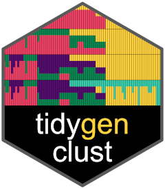

# tidygenclust 

<!-- badges: start -->

[](https://github.com/EvolEcolGroup/tidygenclust/actions/workflows/R-CMD-check.yaml)
[](https://app.codecov.io/gh/EvolEcolGroup/tidygenclust)

<!-- badges: end -->

`tidygenclust` provides functions and methods to run genetic clustering
in R, and to align and compare multiple runs of the same or different K.
`tidygenclust` builds on `tidypopgen`, enhancing the grammar of population
genetics with a focus on genetic clustering.

Its core functionality is native, and needs neither Python nor Julia:

- `gt_radmix()`, to estimate ancestry proportions with the ADMIXTURE
  method, using a modified version of the algorithm of OpenADMIXTURE (Ko et
  al. 2023), ported to C++ from
  [OpenADMIXTURE.jl](https://github.com/OpenMendel/OpenADMIXTURE.jl);
- `gt_clumppling()`, to align multiple clustering runs within and across K
  with the method of clumppling (Liu, Kopelman & Rosenberg 2024), ported to
  R and C++, with modifications, from the python package
  [clumppling](https://github.com/PopGenClustering/Clumppling).

Optionally, `tidygenclust` can also run the python packages
[fastmixture](https://github.com/Rosemeis/fastmixture) (`gt_fastmixture()`)
and [ADAMIXTURE](https://github.com/AI-sandbox/ADAMIXTURE)
(`gt_adamixture()`), and the original ADMIXTURE program
(`tidypopgen::gt_admixture()`), which it installs in a conda environment on
request.

## Installation

You can install the development version of `tidygenclust` from
[GitHub](https://github.com/) with:

``` r
# install.packages("pak")
pak::pak("EvolEcolGroup/tidygenclust")
```

`gt_radmix()` and `gt_clumppling()` work straight away. The
optional tools (`fastmixture`, ADMIXTURE and ADAMIXTURE) are installed with
`reticulate` in a conda environment, `ctidygenclust`, when you ask for them
(this only works on Linux at the moment: on Windows, you can use them
through the WSL; on macOS, they are not available, as their OpenMP library
conflicts with that of R):

``` r
# all the tools
tgc_tools_install()
# or only some of them
tgc_tools_install(tools = "fastmixture")
# add a tool to an existing environment
tgc_admixture_install()
# check what is installed
tgc_tools_version()
```

## Overview of functionality

An overview of the functionality of `tidygenclust` and its integration
with `tidypopgen` is provided in the "Get Started" vignette. This also
includes a detailed description of how to align multiple runs of
clustering and compare them. The article "Installing and running
external tools" shows how to install and run the optional external
programs.

## Clumppling

`gt_clumppling()` aligns the runs stored in a `gt_admix` object (created by
any of the clustering functions, or read from Q files with
`tidypopgen::read_q_files()`), detects modes among runs with the same K, and
aligns the modes across K, with the method of clumppling (Liu, Kopelman &
Rosenberg 2024). Its code is ported, with modifications, from the python
package clumppling (version 2.0.10, by Xiran Liu), and we are grateful to
its authors; if you use it, please cite Liu, Kopelman & Rosenberg (2024).
It reproduces the results of clumppling 2.0.10, against which the test
suite checks it, and it is much faster (about 0.1 seconds, rather than
about 9 seconds with python, for the 200 runs of the capeverde example):

```r
capeverde <- readRDS(
  system.file("extdata", "capeverde_admix.rds", package = "tidygenclust")
)
# the Cape Verde example of clumppling (Verdu et al. 2017)
clump_res <- gt_clumppling(capeverde, seed = 1)
autoplot(clump_res, type = "modes", group = capeverde$group)
```

See `data-raw/clumppling/README.md` for details of the port.

## Ancestry estimation with gt_radmix()

`gt_radmix()` estimates individual ancestry proportions (Q) and ancestral
allele frequencies (P) with the ADMIXTURE method (Alexander et al. 2009),
using a modified version of the fast algorithm of OpenADMIXTURE (Ko et al.
2023). Much of its C++ (OpenMP) code is ported from
[OpenADMIXTURE.jl](https://github.com/OpenMendel/OpenADMIXTURE.jl), and we
are grateful to its authors. It has a different name because it differs
from OpenADMIXTURE: it does not include the selection of ancestry
informative markers that is part of OpenADMIXTURE; we implemented the
cross-validation of ADMIXTURE, to choose K, which is not part of
OpenADMIXTURE; it supports pseudohaploid data; and it changes some details
of the computations (see `?gt_radmix`). If you use it, please cite Ko et al. (2023) for the
algorithm, as well as Alexander et al. (2009) for the method. It needs
neither Python nor Julia: genotypes are read directly from the backing file
of a `gen_tibble`, and results are returned as `gt_admix` objects, which work
with all the methods of `tidypopgen` and with `gt_clumppling()`.
Cross-validation, as in ADMIXTURE, is computed with `crossval = TRUE`.

```r
adm <- gt_radmix(anole_gt, k = 2:4, n_runs = 3, seed = c(1, 2, 3),
                 crossval = TRUE, n_cores = 4)
autoplot(adm, type = "cv")
```

Apart from the documented changes, it reproduces the computations of
OpenADMIXTURE.jl to numerical precision, and it agrees with ADMIXTURE 1.3.0,
which the test suite checks against stored results; on the 379 individuals
and 54,051 SNPs of the `EUR_subset` data used to test OpenADMIXTURE.jl, it
is 2-3 times faster than ADMIXTURE on a single thread, and about 10 times
faster on 4 threads. See `?gt_radmix`, the article "Benchmarking
gt_radmix() against ADMIXTURE, fastmixture and ADAMIXTURE" (in the Articles
section of the website of the package), and `data-raw/radmix/README.md` for
details.

## References

Alexander DH, Novembre J, Lange K (2009) Fast model-based estimation of
ancestry in unrelated individuals. Genome Research, 19(9), 1655-1664.

Ko S, Chu BB, Peterson D, Okenwa C, Papp JC, Alexander DH, Sobel EM, Zhou H,
Lange KL (2023) Unsupervised discovery of ancestry informative markers and
genetic admixture proportions in biobank-scale datasets. The American
Journal of Human Genetics, 110(2), 314-325.

Liu X, Kopelman NM, Rosenberg NA (2024) Clumppling: cluster matching and
permutation program with integer linear programming. Bioinformatics, 40(1),
btad751.

Verdu P, Jewett EM, Pemberton TJ, Rosenberg NA, Baptista M (2017) Parallel
trajectories of genetic and linguistic admixture in a genetically admixed
creole population. Current Biology, 27(16), 2529-2535.
