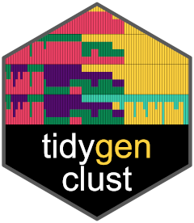

# tidygenclust 

<!-- badges: start -->

[](https://github.com/EvolEcolGroup/tidygenclust/actions/workflows/R-CMD-check.yaml)
[](https://app.codecov.io/gh/EvolEcolGroup/tidygenclust)

<!-- badges: end -->

`tidygenclust` provides functions and methods to run genetic clustering
in R, and to align and compare multiple runs of the same or different K.
`tidygenclust` builds on `tidypopgen`, enhancing the grammar of population
genetics with a focus on genetic clustering.

Its core functionality is provided by native R and C++ code:

- `gt_radmix()` to estimate ancestry proportions with the method of
  ADMIXTURE (Alexander et al. 2009). It is a heavily optimized,
  multithreaded C++ implementation of the algorithm of ADMIXTURE (block
  relaxation with quasi-Newton acceleration), which works directly on a
  `gen_tibble`, supports pseudohaploid data, and includes the
  cross-validation of ADMIXTURE to choose K (Alexander & Lange 2011);
- `gt_clumppling()` to align multiple clustering runs within and across K
  with the method of clumppling (Liu, Kopelman & Rosenberg 2024), ported to
  R and C++, with modifications, from the python package
  [clumppling](https://github.com/PopGenClustering/Clumppling).

Optionally, on Linux, `tidygenclust` can also run the python packages
[fastmixture](https://github.com/Rosemeis/fastmixture) (`gt_fastmixture()`)
and [ADAMIXTURE](https://github.com/AI-sandbox/ADAMIXTURE)
(`gt_adamixture()`), and the original ADMIXTURE program
(`tidypopgen::gt_admixture()`), which it installs in a conda environment on
request.

## Installation

You can install the development version of `tidygenclust` from
[GitHub](https://github.com/) with:

``` r
# install.packages("pak")
pak::pak("EvolEcolGroup/tidygenclust")
```

`gt_radmix()` and `gt_clumppling()` work straight away. The
optional tools (`fastmixture`, ADMIXTURE and ADAMIXTURE) are installed with
`reticulate` in a conda environment, `ctidygenclust`, when you ask for them
(this only works on Linux at the moment: on Windows, you can use them
through the WSL; on macOS, they are not available, as their OpenMP library
conflicts with that of R).

## Overview of functionality

An overview of the functionality of `tidygenclust` and its integration
with `tidypopgen` is provided in the "Get Started" vignette. This also
includes a detailed description of how to align multiple runs of
clustering and compare them. There are also several articles in the "Articles"
section of the website of the package:

1) Benchmarking `gt_radmix()` against ADMIXTURE, fastmixture and ADAMIXTURE.

2) Benchmarking `gt_clumppling()` against the python clumppling.

3) Installing and running external tools.

4) An illustration of how treating pseudohaploids as if they were diploids 
can bias the results of clustering (and how `gt_radmix()` can handle 
pseudohaploids correctly).

## References

Alexander DH, Novembre J, Lange K (2009) Fast model-based estimation of
ancestry in unrelated individuals. Genome Research, 19(9), 1655-1664.

Alexander DH, Lange K (2011) Enhancements to the ADMIXTURE algorithm for
individual ancestry estimation. BMC Bioinformatics, 12, 246.

Liu X, Kopelman NM, Rosenberg NA (2024) Clumppling: cluster matching and
permutation program with integer linear programming. Bioinformatics, 40(1),
btad751.
