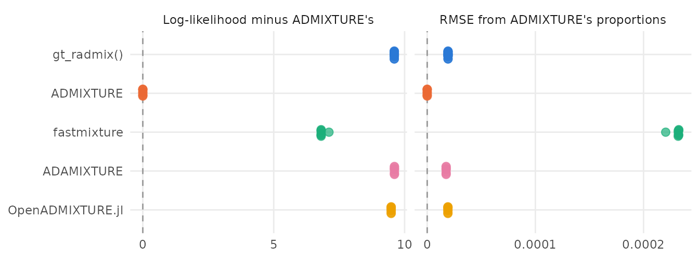
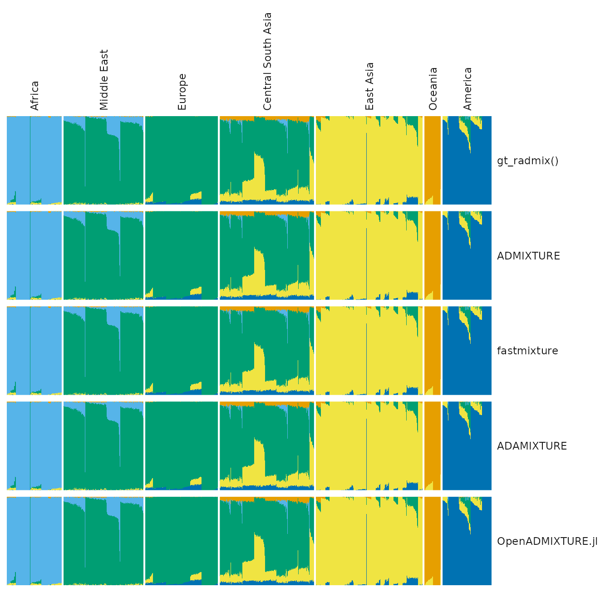
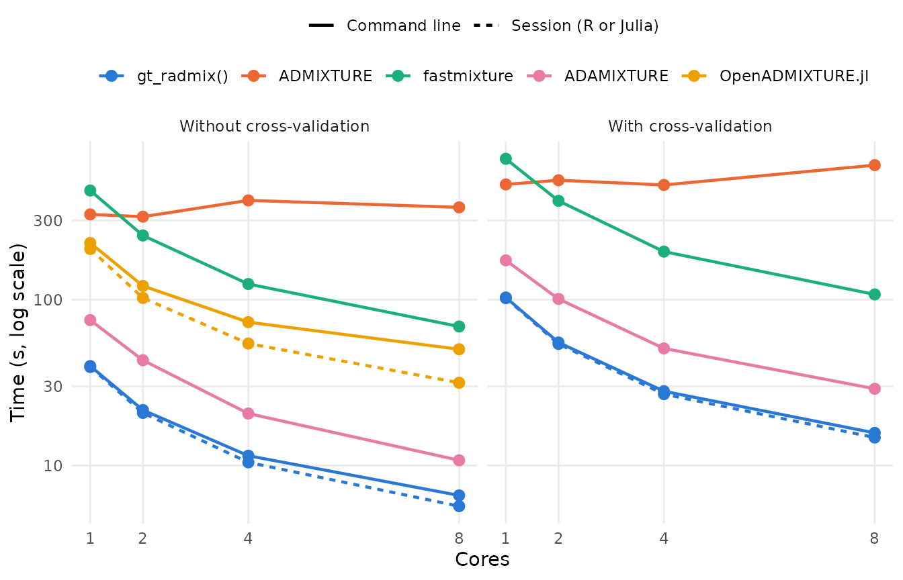
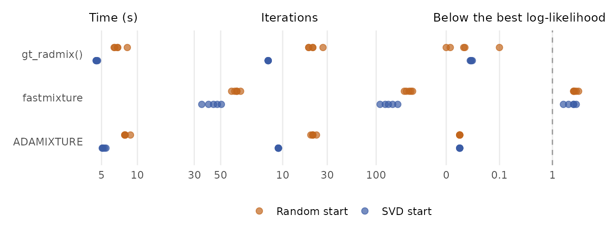

# Benchmarking gt_radmix()

[`gt_radmix()`](https://evolecolgroup.github.io/tidygenclust/reference/gt_radmix.md)
estimates ancestry proportions with the method of ADMIXTURE (Alexander
et al. 2009), directly from the backing file of a `gen_tibble`. It uses
the algorithm of ADMIXTURE (block-wise Newton updates with quasi-Newton
acceleration), in multithreaded C++, and the cross-validation of
ADMIXTURE (Alexander and Lange 2011). This article compares
[`gt_radmix()`](https://evolecolgroup.github.io/tidygenclust/reference/gt_radmix.md)
with four programs that fit the same model: ADMIXTURE itself,
fastmixture (Santander et al. 2024), ADAMIXTURE (Saurina-i-Ricos et
al. 2026), and OpenADMIXTURE.jl (Ko et al. 2023), a Julia implementation
of the algorithm of ADMIXTURE (run without its selection of ancestry
informative markers). Note that OpenADMIXTURE.jl and ADAMIXTURE also
include implementations using the GPU, which can scale to Biobank
datasets, but are not included in this comparison. Here we just compare
the CPU implementations of the programs, which are all multithreaded.
Thus, for very large datasets, some of the programs can perform better
than these benchmarks suggest.

The comparison uses the Human Genome Diversity Project (HGDP), and has
two parts:

- [Random starts](#random-starts): all the programs start from random
  values (ADMIXTURE and OpenADMIXTURE.jl have no other start, and
  fastmixture and ADAMIXTURE are run with their option to do so). It
  checks that the programs find the same ancestry proportions, and
  measures how long each takes on different numbers of cores, with and
  without cross-validation (which OpenADMIXTURE.jl does not have).
- [SVD and random starts](#svd-and-random-starts):
  [`gt_radmix()`](https://evolecolgroup.github.io/tidygenclust/reference/gt_radmix.md),
  fastmixture and ADAMIXTURE can also start from a truncated singular
  value decomposition (SVD) of the genotypes, which fastmixture and
  ADAMIXTURE do by default
  ([`gt_radmix()`](https://evolecolgroup.github.io/tidygenclust/reference/gt_radmix.md)
  does so with `init = "svd"`). Each of them is run from both starts,
  with several seeds, to compare their times and the log-likelihoods
  they reach.

All the programs are timed from the command line, each run being a new
process that starts the program, reads the data and saves the results.
[`gt_radmix()`](https://evolecolgroup.github.io/tidygenclust/reference/gt_radmix.md)
is also timed in an R session, and OpenADMIXTURE.jl in a Julia session,
in which the package is already loaded (see [How long do they
take?](#how-long-do-they-take)).

The [results](#results) come first. The second part, [How the benchmark
was run](#how-the-benchmark-was-run), describes the data and the runs,
with their code, and how to run the benchmark again.

## Results

### Summary

The five programs estimated the ancestry proportions of 1043 individuals
of the HGDP, typed at 130,943 loci, for K = 5 ancestral populations (see
[The data](#the-data)):

- From random starts, from the command line, on 1 core, without
  cross-validation,
  [`gt_radmix()`](https://evolecolgroup.github.io/tidygenclust/reference/gt_radmix.md)
  took 39.8 s, ADMIXTURE 326 s, fastmixture 455 s, ADAMIXTURE 75.3 s and
  OpenADMIXTURE.jl 220 s; on 8 cores, they took 6.6 s, 360 s, 68.8 s,
  10.7 s and 50.2 s.
- Starting R and loading `tidygenclust` took about 0.969 s of the time
  of
  [`gt_radmix()`](https://evolecolgroup.github.io/tidygenclust/reference/gt_radmix.md)
  from the command line. Starting Julia, loading OpenADMIXTURE.jl and
  compiling its code took about 18.6 s: in a Julia session in which
  OpenADMIXTURE.jl has already been used, its fit took 202 s on 1 core.
- Compared with ADMIXTURE (on 1 core, without cross-validation), the
  log-likelihood of
  [`gt_radmix()`](https://evolecolgroup.github.io/tidygenclust/reference/gt_radmix.md)
  differs by 9.6, that of fastmixture by 6.8, that of ADAMIXTURE by 9.6,
  and that of OpenADMIXTURE.jl by 9.5. Their ancestry proportions differ
  from those of ADMIXTURE by up to 0.00016, 0.0023, 0.000052 and 0.00013
  respectively.
- Across numbers of cores, with and without cross-validation,
  [`gt_radmix()`](https://evolecolgroup.github.io/tidygenclust/reference/gt_radmix.md)
  gives identical ancestry proportions, ADMIXTURE ancestry proportions
  that differ by up to 0.000001, fastmixture ancestry proportions that
  differ by up to 0.00021, ADAMIXTURE identical ancestry proportions,
  and OpenADMIXTURE.jl (without cross-validation) identical ancestry
  proportions.
- With 5 seeds on 8 cores (median times from the command line),
  [`gt_radmix()`](https://evolecolgroup.github.io/tidygenclust/reference/gt_radmix.md)
  took 5.73 s from an SVD and 6.88 s from random values (5 and 5 of the
  5 runs reached the highest log-likelihood); fastmixture 43.1 s from an
  SVD and 68.7 s from random values (0 and 0 of the 5 runs reached the
  highest log-likelihood); and ADAMIXTURE 7.65 s from an SVD and 11.7 s
  from random values (5 and 5 of the 5 runs reached the highest
  log-likelihood).

### Random starts

#### Do the programs find the same ancestry proportions?

All the programs maximise the same likelihood, but each starts from its
own random values and stops according to its own convergence criterion.
Each run is compared with ADMIXTURE on 1 core without cross-validation,
after matching its clusters to those of ADMIXTURE (the [detailed
results](#detailed-results) give the numbers of each run):



Each point is a run (on each number of cores, with and without
cross-validation, and, for
[`gt_radmix()`](https://evolecolgroup.github.io/tidygenclust/reference/gt_radmix.md)
and OpenADMIXTURE.jl, from the command line and in a session).

Each program was run once for each number of cores, from a single random
start (with seed 1, but each program draws its own random values), so a
run can end at another local optimum of the likelihood, with a lower
log-likelihood and different ancestry proportions. Here, no run ended
more than 1 below the log-likelihood of ADMIXTURE, and runs of the other
programs ended up to 9.6 above it: ADMIXTURE stopped short of the
maximum that they reached, by its own convergence criterion, with
ancestry proportions that differ little from theirs (see the detailed
results).

The ancestry proportions from each program (on 1 core, without
cross-validation, and in a session for
[`gt_radmix()`](https://evolecolgroup.github.io/tidygenclust/reference/gt_radmix.md)
and OpenADMIXTURE.jl), with the individuals grouped by region and
population:



#### How long do they take?

The times of ADMIXTURE, fastmixture and ADAMIXTURE are those of runs
from the command line: each run is a new process, which starts the
program, reads the bed file and writes the estimates of Q and P to text
files (ADAMIXTURE also always draws a plot of the ancestry proportions,
which is included in its time).
[`gt_radmix()`](https://evolecolgroup.github.io/tidygenclust/reference/gt_radmix.md)
and OpenADMIXTURE.jl are timed in the same way, with `Rscript` and
`julia` (command line), and also in a session, where R or Julia is
already running with the package loaded:

- for
  [`gt_radmix()`](https://evolecolgroup.github.io/tidygenclust/reference/gt_radmix.md),
  the time of reading the bed file into a `gen_tibble` (and its backing
  file), running
  [`gt_radmix()`](https://evolecolgroup.github.io/tidygenclust/reference/gt_radmix.md),
  and saving the resulting `gt_admix` object, with Q and P, to an RDS
  file. In an analysis with several values of K, or several runs, the
  `gen_tibble` would only be read once;
- for OpenADMIXTURE.jl, the time of its fit (including reading the bed
  file and writing Q and P), measured in Julia after a first, untimed
  run on a small subset of the data. Julia compiles the code of a
  function the first time it is called, so this is the time of a fit in
  a Julia session in which OpenADMIXTURE.jl has already been used.



(The times and speed-ups of each run are in the [detailed
results](#detailed-results).) Starting R and loading `tidygenclust` adds
about 0.969 s to each run of
[`gt_radmix()`](https://evolecolgroup.github.io/tidygenclust/reference/gt_radmix.md)
from the command line. Starting Julia, loading OpenADMIXTURE.jl and
compiling its code adds about 18.6 s to each run of OpenADMIXTURE.jl
(these are the median differences between the runs from the command line
and in a session).

#### Cross-validation errors

The cross-validation errors did not depend on the number of cores. On 1
core, they were 0.42239 with
[`gt_radmix()`](https://evolecolgroup.github.io/tidygenclust/reference/gt_radmix.md),
0.42242 with ADMIXTURE, 0.42240 with ADAMIXTURE and 0.42191 with
fastmixture (see the [detailed results](#detailed-results) for all the
runs).

OpenADMIXTURE.jl has no cross-validation. ADMIXTURE and
[`gt_radmix()`](https://evolecolgroup.github.io/tidygenclust/reference/gt_radmix.md)
compute the same cross-validation error (Alexander and Lange 2011): they
hold out a fold of the genotypes, refit the model on the others, and
average the deviance of the held-out genotypes. They draw the folds
differently, so their errors are close but not identical. fastmixture
averages the same deviance, but holds out a fold of the individuals
rather than of the genotypes. The allele frequencies come from the other
individuals, but the ancestry of the held-out individuals is estimated
from their own genotypes, the same genotypes on which the error is then
computed. Its errors can be compared between values of K, but not with
those of the other programs. ADAMIXTURE also averages the deviance of
held-out genotypes, but it refits the model on each fold with only 5
iterations, starting from the estimates on all the genotypes, so its
errors are close to those of ADMIXTURE and
[`gt_radmix()`](https://evolecolgroup.github.io/tidygenclust/reference/gt_radmix.md),
but not identical.

### SVD and random starts

[`gt_radmix()`](https://evolecolgroup.github.io/tidygenclust/reference/gt_radmix.md),
fastmixture and ADAMIXTURE can start from a truncated SVD of the
genotypes, followed by alternating least squares (ALS) on its factors,
as well as from random values. fastmixture and ADAMIXTURE start from the
SVD by default,
[`gt_radmix()`](https://evolecolgroup.github.io/tidygenclust/reference/gt_radmix.md)
from random values (the SVD is an option, `init = "svd"`). Each of the
three programs was run from both starts with seeds 1 to 5, on 8 cores,
without cross-validation, from the command line:



Each point is a run. Time and iterations are on log scales; the
iterations of a program count its own steps, so they can be compared
between its two starts but not between programs. The right panel shows
how far the log-likelihood of each run is below the highest of all the
runs of the benchmark: the runs left of the dashed line (within 1 of it)
reached the same optimum.

The time of
[`gt_radmix()`](https://evolecolgroup.github.io/tidygenclust/reference/gt_radmix.md)
from the command line includes starting R and loading `tidygenclust`
(about 0.969 s), and, from an SVD, imputing the missing genotypes
(needed for the SVD only; the fit ignores the imputed values).

### Detailed results

#### Agreement between the programs (random starts)

| Program | Cores | CV | Log-likelihood | Difference | Largest difference (same program) | RMSE (ADMIXTURE) | Largest difference (ADMIXTURE) |
|:---|:---|:---|---:|---:|---:|---:|---:|
| gt_radmix() (command line) | 1 | no | -101,809,867.11 | 9.6 | 0 | 0.000019 | 0.00016 |
| gt_radmix() (command line) | 1 | yes | -101,809,867.11 | 9.6 | 0 | 0.000019 | 0.00016 |
| gt_radmix() (command line) | 2 | no | -101,809,867.11 | 9.6 | 0 | 0.000019 | 0.00016 |
| gt_radmix() (command line) | 2 | yes | -101,809,867.11 | 9.6 | 0 | 0.000019 | 0.00016 |
| gt_radmix() (command line) | 4 | no | -101,809,867.11 | 9.6 | 0 | 0.000019 | 0.00016 |
| gt_radmix() (command line) | 4 | yes | -101,809,867.11 | 9.6 | 0 | 0.000019 | 0.00016 |
| gt_radmix() (command line) | 8 | no | -101,809,867.11 | 9.6 | 0 | 0.000019 | 0.00016 |
| gt_radmix() (command line) | 8 | yes | -101,809,867.11 | 9.6 | 0 | 0.000019 | 0.00016 |
| gt_radmix() (R session) | 1 | no | -101,809,867.11 | 9.6 | 0 | 0.000019 | 0.00016 |
| gt_radmix() (R session) | 1 | yes | -101,809,867.11 | 9.6 | 0 | 0.000019 | 0.00016 |
| gt_radmix() (R session) | 2 | no | -101,809,867.11 | 9.6 | 0 | 0.000019 | 0.00016 |
| gt_radmix() (R session) | 2 | yes | -101,809,867.11 | 9.6 | 0 | 0.000019 | 0.00016 |
| gt_radmix() (R session) | 4 | no | -101,809,867.11 | 9.6 | 0 | 0.000019 | 0.00016 |
| gt_radmix() (R session) | 4 | yes | -101,809,867.11 | 9.6 | 0 | 0.000019 | 0.00016 |
| gt_radmix() (R session) | 8 | no | -101,809,867.11 | 9.6 | 0 | 0.000019 | 0.00016 |
| gt_radmix() (R session) | 8 | yes | -101,809,867.11 | 9.6 | 0 | 0.000019 | 0.00016 |
| ADMIXTURE | 1 | no | -101,809,876.71 | 0 | 0 | 0 | 0 |
| ADMIXTURE | 1 | yes | -101,809,876.71 | 0 | 0 | 0 | 0 |
| ADMIXTURE | 2 | no | -101,809,876.71 | 0.000077 | 0.000001 | 0.000000014 | 0.000001 |
| ADMIXTURE | 2 | yes | -101,809,876.71 | 0.000077 | 0.000001 | 0.000000014 | 0.000001 |
| ADMIXTURE | 4 | no | -101,809,876.71 | 0.000003 | 0 | 0 | 0 |
| ADMIXTURE | 4 | yes | -101,809,876.71 | 0.000076 | 0.000001 | 0.000000014 | 0.000001 |
| ADMIXTURE | 8 | no | -101,809,876.71 | 0.000004 | 0 | 0 | 0 |
| ADMIXTURE | 8 | yes | -101,809,876.71 | 0.000003 | 0 | 0 | 0 |
| fastmixture | 1 | no | -101,809,869.90 | 6.8 | 0 | 0.00023 | 0.0023 |
| fastmixture | 1 | yes | -101,809,869.90 | 6.8 | 0 | 0.00023 | 0.0023 |
| fastmixture | 2 | no | -101,809,869.60 | 7.1 | 0.00021 | 0.00022 | 0.0023 |
| fastmixture | 2 | yes | -101,809,869.90 | 6.8 | 0.000004 | 0.00023 | 0.0023 |
| fastmixture | 4 | no | -101,809,869.90 | 6.8 | 0.000005 | 0.00023 | 0.0023 |
| fastmixture | 4 | yes | -101,809,869.90 | 6.8 | 0.000005 | 0.00023 | 0.0023 |
| fastmixture | 8 | no | -101,809,869.90 | 6.8 | 0.000005 | 0.00023 | 0.0023 |
| fastmixture | 8 | yes | -101,809,869.90 | 6.8 | 0.000003 | 0.00023 | 0.0023 |
| ADAMIXTURE | 1 | no | -101,809,867.10 | 9.6 | 0 | 0.0000088 | 0.000052 |
| ADAMIXTURE | 1 | yes | -101,809,867.10 | 9.6 | 0 | 0.0000088 | 0.000052 |
| ADAMIXTURE | 2 | no | -101,809,867.10 | 9.6 | 0 | 0.0000088 | 0.000052 |
| ADAMIXTURE | 2 | yes | -101,809,867.10 | 9.6 | 0 | 0.0000088 | 0.000052 |
| ADAMIXTURE | 4 | no | -101,809,867.10 | 9.6 | 0 | 0.0000088 | 0.000052 |
| ADAMIXTURE | 4 | yes | -101,809,867.10 | 9.6 | 0 | 0.0000088 | 0.000052 |
| ADAMIXTURE | 8 | no | -101,809,867.10 | 9.6 | 0 | 0.0000088 | 0.000052 |
| ADAMIXTURE | 8 | yes | -101,809,867.10 | 9.6 | 0 | 0.0000088 | 0.000052 |
| OpenADMIXTURE.jl (command line) | 1 | no | -101,809,867.22 | 9.5 | 0 | 0.000019 | 0.00013 |
| OpenADMIXTURE.jl (command line) | 2 | no | -101,809,867.22 | 9.5 | 0 | 0.000019 | 0.00013 |
| OpenADMIXTURE.jl (command line) | 4 | no | -101,809,867.22 | 9.5 | 0 | 0.000019 | 0.00013 |
| OpenADMIXTURE.jl (command line) | 8 | no | -101,809,867.22 | 9.5 | 0 | 0.000019 | 0.00013 |
| OpenADMIXTURE.jl (Julia session) | 1 | no | -101,809,867.22 | 9.5 | 0 | 0.000019 | 0.00013 |
| OpenADMIXTURE.jl (Julia session) | 2 | no | -101,809,867.22 | 9.5 | 0 | 0.000019 | 0.00013 |
| OpenADMIXTURE.jl (Julia session) | 4 | no | -101,809,867.22 | 9.5 | 0 | 0.000019 | 0.00013 |
| OpenADMIXTURE.jl (Julia session) | 8 | no | -101,809,867.22 | 9.5 | 0 | 0.000019 | 0.00013 |

Log-likelihood of each run (fastmixture and ADAMIXTURE report it with
one decimal), and its difference from that of ADMIXTURE on 1 core
without cross-validation (CV; positive when higher). Largest absolute
difference between the ancestry proportions of each run and those of the
same program on 1 core without CV, and root mean square error (RMSE) and
largest absolute difference from those of ADMIXTURE on 1 core without
CV. The Q matrices are stored with 6 decimals, so differences smaller
than 1e-6 do not show. {.table}

#### Times (random starts)

| Program | Cores | Time (s) | Speed-up | Time with CV (s) | Speed-up with CV |
|:---|---:|---:|---:|---:|---:|
| gt_radmix() (command line) | 1 | 39.8 | 1.0 | 103 | 1.0 |
| gt_radmix() (command line) | 2 | 21.6 | 1.8 | 55.2 | 1.9 |
| gt_radmix() (command line) | 4 | 11.5 | 3.5 | 28 | 3.7 |
| gt_radmix() (command line) | 8 | 6.6 | 6.0 | 15.7 | 6.6 |
| gt_radmix() (R session) | 1 | 39.2 | 1.0 | 102 | 1.0 |
| gt_radmix() (R session) | 2 | 20.8 | 1.9 | 54 | 1.9 |
| gt_radmix() (R session) | 4 | 10.4 | 3.8 | 26.9 | 3.8 |
| gt_radmix() (R session) | 8 | 5.68 | 6.9 | 14.7 | 6.9 |
| ADMIXTURE | 1 | 326 | 1.0 | 495 | 1.0 |
| ADMIXTURE | 2 | 316 | 1.0 | 525 | 0.9 |
| ADMIXTURE | 4 | 397 | 0.8 | 491 | 1.0 |
| ADMIXTURE | 8 | 360 | 0.9 | 647 | 0.8 |
| fastmixture | 1 | 455 | 1.0 | 707 | 1.0 |
| fastmixture | 2 | 244 | 1.9 | 394 | 1.8 |
| fastmixture | 4 | 124 | 3.7 | 195 | 3.6 |
| fastmixture | 8 | 68.8 | 6.6 | 107 | 6.6 |
| ADAMIXTURE | 1 | 75.3 | 1.0 | 173 | 1.0 |
| ADAMIXTURE | 2 | 43.1 | 1.7 | 101 | 1.7 |
| ADAMIXTURE | 4 | 20.6 | 3.7 | 50.8 | 3.4 |
| ADAMIXTURE | 8 | 10.7 | 7.0 | 29 | 5.9 |
| OpenADMIXTURE.jl (command line) | 1 | 220 | 1.0 | \- | \- |
| OpenADMIXTURE.jl (command line) | 2 | 121 | 1.8 | \- | \- |
| OpenADMIXTURE.jl (command line) | 4 | 73.1 | 3.0 | \- | \- |
| OpenADMIXTURE.jl (command line) | 8 | 50.2 | 4.4 | \- | \- |
| OpenADMIXTURE.jl (Julia session) | 1 | 202 | 1.0 | \- | \- |
| OpenADMIXTURE.jl (Julia session) | 2 | 102 | 2.0 | \- | \- |
| OpenADMIXTURE.jl (Julia session) | 4 | 54.4 | 3.7 | \- | \- |
| OpenADMIXTURE.jl (Julia session) | 8 | 31.5 | 6.4 | \- | \- |

Time (s) taken by each run, without and with cross-validation (CV), and
speed-up relative to the run of the same program on 1 core.
OpenADMIXTURE.jl has no cross-validation. {.table}

#### Cross-validation errors (random starts)

| Program                    |  1 core | 2 cores | 4 cores | 8 cores |
|:---------------------------|--------:|--------:|--------:|--------:|
| gt_radmix() (command line) | 0.42239 | 0.42239 | 0.42239 | 0.42239 |
| gt_radmix() (R session)    | 0.42239 | 0.42239 | 0.42239 | 0.42239 |
| ADMIXTURE                  | 0.42242 | 0.42242 | 0.42242 | 0.42242 |
| fastmixture                | 0.42191 | 0.42191 | 0.42191 | 0.42191 |
| ADAMIXTURE                 | 0.42240 | 0.42240 | 0.42240 | 0.42240 |

Cross-validation error of each program, on each number of cores.
{.table}

#### Random and SVD starts

| Program | Start | Time (s) | Iterations | At the best | Largest shortfall | Largest difference between runs | RMSE (ADMIXTURE) |
|:---|:---|---:|---:|---:|---:|---:|---:|
| gt_radmix() | Random | 6.88 (6.62-8.31) | 21 | 5 of 5 | 0.1 | 0.00044 | 0.000019 |
| gt_radmix() | SVD | 5.73 (5.66-5.79) | 7 | 5 of 5 | 0.038 | 0.000043 | 0.000031 |
| fastmixture | Random | 68.7 (65.2-73.5) | 225 | 0 of 5 | 2.8 | 0.0016 | 0.00023 |
| fastmixture | SVD | 43.1 (34.7-53.7) | 135 | 0 of 5 | 2.8 | 0.0014 | 0.00021 |
| ADAMIXTURE | Random | 11.7 (11.6-14.6) | 21 | 5 of 5 | 0.012 | 0.0002 | 0.0000098 |
| ADAMIXTURE | SVD | 7.65 (7.45-9.6) | 9 | 5 of 5 | 0.11 | 0.000037 | 0.0000075 |

Median time (s; range in brackets) and number of iterations of the 5
runs of each program from each start; number of runs that reached the
highest log-likelihood of all the runs of the benchmark (to within 1),
and the largest shortfall from it; largest absolute difference between
the ancestry proportions of two runs of the same program from the same
start; and median root mean square error (RMSE) of the ancestry
proportions from those of ADMIXTURE on 1 core without cross-validation.
The numbers of iterations are not comparable between programs (see
[Running the programs from the command
line](#running-the-programs-from-the-command-line)). {.table}

## How the benchmark was run

The benchmark is run with scripts in `vignettes/articles/code` (in the
source code of the package). The first prepares the data. The second
runs the programs from the command line: ADMIXTURE, fastmixture,
ADAMIXTURE, and
[`gt_radmix()`](https://evolecolgroup.github.io/tidygenclust/reference/gt_radmix.md)
and OpenADMIXTURE.jl with two more scripts, which `Rscript` and `julia`
run. The last runs
[`gt_radmix()`](https://evolecolgroup.github.io/tidygenclust/reference/gt_radmix.md)
in an R session. The results are read here from
`vignettes/articles/data/admixture_benchmark`. Each run is done once, as
the full runs take long enough for the variation between repeated runs
to be small. The code shown below is taken from these scripts. Timings
depend on the machine (see [Machine and
software](#machine-and-software)), but the differences between the
programs should be similar on other machines.

### The data

The data are those of the HGDP used in the benchmark of `tidypopgen`
(1043 individuals typed at about 650,000 loci), downloaded from Zenodo:

``` r

# the HGDP data (1043 individuals typed at about 650k loci) and the
# population of each individual, as used in the benchmark of tidypopgen.
# Each file is downloaded under a temporary name, so that an interrupted
# download is not mistaken for a complete file when the script is run again
zenodo_url <- "https://zenodo.org/records/15582364/files/"
hgdp_files <- c(
  "hgdp650.qc.hg19.bed", "hgdp650.qc.hg19.bim", "hgdp650.qc.hg19.fam",
  "hgdp650_id_pop.txt"
)
options(timeout = max(3600, getOption("timeout")))
for (file in hgdp_files) {
  path <- file.path(hgdp_dir, file)
  if (!file.exists(path)) {
    download.file(paste0(zenodo_url, file), paste0(path, ".part"), mode = "wb")
    file.rename(paste0(path, ".part"), path)
  }
}
```

and prepared as recommended in the manual of ADMIXTURE. The steps are
the same as in the analyses of the HGDP with `tidygenclust`:

``` r

library(tidypopgen)
hgdp <- gen_tibble(
  file.path(hgdp_dir, "hgdp650.qc.hg19.bed"),
  backingfile = file.path(gt_dir, "hgdp_raw"),
  quiet = TRUE
)
# loci with less than 5% of missing genotypes, as recommended in the manual
# of ADMIXTURE, and polymorphic (fastmixture stops on monomorphic loci)
hgdp <- hgdp |>
  select_loci_if(loci_missingness(genotypes) < 0.05) |>
  select_loci_if(loci_maf(genotypes) > 0)
```

``` r

# LD clumping with the thresholds of the manual of ADMIXTURE (plink
# --indep-pairwise 50 10 0.1). Clumping needs complete genotypes, so the
# missing ones are imputed first (on a backing file with only the loci kept
# above). loci_ld_clump() uses the imputed genotypes, but the gen_tibble
# keeps using the raw ones, which are those written to the bed file below:
# missing genotypes remain missing for all the tools
hgdp <- gt_update_backingfile(
  hgdp,
  backingfile = file.path(gt_dir, "hgdp_filtered"),
  quiet = TRUE
)
set.seed(1)
hgdp <- gt_impute_simple(hgdp, method = "random")
hgdp <- hgdp |>
  select_loci_if(
    loci_ld_clump(genotypes, thr_r2 = 0.1, size = 50, use_positions = FALSE)
  )
gt_as_plink(hgdp, file = file.path(hgdp_dir, "hgdp_bench.bed"))
```

All the programs are run on this bed file. A small subset of it is also
saved, to check the scripts quickly (see [Running the benchmark
again](#running-the-benchmark-again)):

``` r

# a small subset to check the benchmark scripts (on which ADMIXTURE takes
# about 30 s on one core): every 5th individual, and 25,000 of the loci that
# are still polymorphic among them
hgdp_quick <- hgdp[seq(1, nrow(hgdp), by = 5), ] |>
  select_loci_if(loci_maf(genotypes) > 0)
n_loci <- count_loci(hgdp_quick)
set.seed(2)
quick_loci <- seq_len(n_loci) %in% sample(n_loci, min(25000, n_loci))
hgdp_quick <- select_loci_if(hgdp_quick, quick_loci)
gt_as_plink(hgdp_quick, file = file.path(hgdp_dir, "hgdp_bench_quick.bed"))
```

### Running the programs from the command line

All the programs are run from the command line with the same settings:

``` bash
# the same settings as in admixture_benchmark_radmix.R
k=5
seed=1
n_folds=5
cores=(1 2 4 8)
# the comparison of the starts: these seeds, on the largest number of cores,
# without cross-validation
start_seeds=(1 2 3 4 5)
```

Each program is run on 1, 2, 4 and 8 cores (with `-j` in ADMIXTURE,
`--threads` in fastmixture, `-t` and `OMP_NUM_THREADS` in ADAMIXTURE,
`n_cores` in
[`gt_radmix()`](https://evolecolgroup.github.io/tidygenclust/reference/gt_radmix.md)
and the number of threads of Julia for OpenADMIXTURE.jl), with and
without cross-validation (with `--cv` in ADMIXTURE, fastmixture and
ADAMIXTURE, and `crossval` in
[`gt_radmix()`](https://evolecolgroup.github.io/tidygenclust/reference/gt_radmix.md);
OpenADMIXTURE.jl has none), from random values or from an SVD of the
genotypes (with `--random-init` in fastmixture, `--init em` or
`--init als` in ADAMIXTURE, and `init` in
[`gt_radmix()`](https://evolecolgroup.github.io/tidygenclust/reference/gt_radmix.md)),
with these functions:

``` bash
# the wall-clock time, in seconds
now() { date +%s.%N; }

# the first match of a regular expression (with one group, which is
# returned) at the start of a line of a log, or NA if there is none
extract() {
  local value
  value=$(sed -n -E "s/$1/\1/p" "$2" | head -n 1)
  echo "${value:-NA}"
}

# Each program is run by a function run_<program> <cores> <cross-validation
# (TRUE or FALSE)> <run directory> <seed> <start (random or svd)>.

# ADMIXTURE writes its output in the current directory, named after the bed
# file (e.g. hgdp_bench.5.Q), so it is run from the directory of the run;
# its log is what it prints. It starts from random values
run_admixture() {
  local n_cores=$1 crossval=$2 run_dir=$3 seed=$4
  local bed_path=$PWD/$bed
  local args=(-s "$seed" -j"$n_cores")
  if [[ $crossval == TRUE ]]; then
    args+=(--cv="$n_folds")
  fi
  (cd "$run_dir" && "$admixture" "${args[@]}" "$bed_path" "$k" > admixture.log 2>&1)
}

# fastmixture writes its output (Q, P and a log with its settings and
# results) with the prefix given by --out, and prints its progress. It
# starts from an SVD of the genotypes, or from random values with
# --random-init
run_fastmixture() {
  local n_cores=$1 crossval=$2 run_dir=$3 seed=$4 init=$5
  local args=(
    --bfile "${bed%.bed}" --K "$k" --threads "$n_cores" --seed "$seed"
    --out "$run_dir/fastmixture"
  )
  if [[ $crossval == TRUE ]]; then
    args+=(--cv "$n_folds")
  fi
  if [[ $init == random ]]; then
    args+=(--random-init)
  fi
  "$fastmixture" "${args[@]}" > "$run_dir/console.log" 2>&1
}

# ADAMIXTURE writes its output (Q, P and a plot, which cannot be turned off)
# in --save_dir, named after --name and K (e.g. adamixture.5.Q), and prints
# its progress. Its command line drops the chromosomes that are not
# autosomes by default (hence --chrom_mode all), and -t alone does not limit
# its number of threads (it sets OMP_NUM_THREADS after loading its OpenMP
# library), so OMP_NUM_THREADS is set before starting it. It starts from an
# SVD of the genotypes followed by alternating least squares (--init als,
# its default), or from random values primed with EM steps (--init em)
run_adamixture() {
  local n_cores=$1 crossval=$2 run_dir=$3 seed=$4 init=$5
  local args=(
    --data_path "$bed" --save_dir "$run_dir" --name adamixture -k "$k"
    -t "$n_cores" -s "$seed" --chrom_mode all
  )
  if [[ $init == random ]]; then
    args+=(--init em)
  else
    args+=(--init als)
  fi
  if [[ $crossval == TRUE ]]; then
    args+=(--cv "$n_folds")
  fi
  OMP_NUM_THREADS=$n_cores "$adamixture" "${args[@]}" \
    > "$run_dir/console.log" 2>&1
}

# gt_radmix() is run by a new R process, which loads tidygenclust, reads the
# bed file into a gen_tibble, runs gt_radmix() (from random values, its
# default, or with init = "svd"), saves the results, and prints the
# log-likelihood and cross-validation error
run_radmix_cli() {
  local n_cores=$1 crossval=$2 run_dir=$3 seed=$4 init=$5
  "$rscript" code/admixture_benchmark_radmix_cli.R "$bed" "$k" "$seed" \
    "$n_cores" "$crossval" "$n_folds" "$run_dir" "$init" \
    > "$run_dir/console.log" 2>&1
}

# julia, with the variables that activating its conda environment would
# set, so that it finds the packages installed in it (without the time
# taken by conda run)
julia_run() {
  env JULIA_DEPOT_PATH="$julia_prefix/share/julia:" \
    JULIA_PROJECT="@$julia_env" JULIA_LOAD_PATH="@:@$julia_env:@stdlib" \
    "$julia_prefix/bin/julia" "$@"
}

# OpenADMIXTURE.jl is run by a new Julia process, which writes Q and P with
# the prefix openadmixture, and prints its progress, the log-likelihood and
# the time of the fit (Julia is started without an interactive thread, see
# admixture_benchmark_openadmixture.jl); it starts from random values, and
# has no cross-validation
run_openadmixture_cli() {
  local n_cores=$1 run_dir=$3 seed=$4
  julia_run --threads="$n_cores,0" code/admixture_benchmark_openadmixture.jl \
    "$bed" "$k" "$seed" "$run_dir/openadmixture" > "$run_dir/console.log" 2>&1
}

# the same, after a warm-up on the small subset of the data, so that the
# fit, timed in Julia, does not include compiling the code
run_openadmixture() {
  local n_cores=$1 run_dir=$3 seed=$4
  julia_run --threads="$n_cores,0" code/admixture_benchmark_openadmixture.jl \
    "$bed" "$k" "$seed" "$run_dir/openadmixture" "$warmup_bed" \
    > "$run_dir/console.log" 2>&1
}
```

and the time, Q matrix, log-likelihood, cross-validation error and
number of iterations of each run are saved:

``` bash
# each run is done in its own directory, and its time includes starting the
# program, reading the data and saving the results. Its Q matrix and log are
# then copied to the results, and its time, log-likelihood, cross-validation
# error and number of iterations (extracted from its log) are added to a
# table (csv file)
run_and_record() {
  local tool=$1 n_cores=$2 crossval=$3 seed=$4 init=$5 run=$6 table=$7
  local run_dir=$runs_dir/$run start seconds q_file log_file loglik cv_error
  local iterations iterations_pattern='^Converged in ([0-9]+) iterations.*'
  rm -rf "$run_dir"
  mkdir -p "$run_dir"
  echo "Running $run"
  start=$(now)
  "run_$tool" "$n_cores" "$crossval" "$run_dir" "$seed" "$init"
  seconds=$(awk -v start="$start" -v end="$(now)" \
    'BEGIN { printf "%.3f", end - start }')
  case $tool in
    admixture)
      q_file=$run_dir/$(basename "$bed" .bed).$k.Q
      log_file=$run_dir/admixture.log
      loglik=$(extract '^Loglikelihood: ([^[:space:]]+).*' "$log_file")
      cv_error=$(extract \
        '^CV error \(K=[0-9]+\): ([^[:space:]]+).*' "$log_file")
      ;;
    fastmixture)
      q_file=$run_dir/fastmixture.K$k.s$seed.Q
      log_file=$run_dir/fastmixture.K$k.s$seed.log
      loglik=$(extract \
        '^Final log-likelihood: ([^[:space:]]+).*' "$log_file")
      cv_error=$(extract \
        '^Cross-validation error \(SD\): ([^[:space:]]+).*' "$log_file")
      ;;
    adamixture)
      q_file=$run_dir/adamixture.$k.Q
      log_file=$run_dir/console.log
      loglik=$(extract \
        '^ *Final log-likelihood: ([^[:space:]]+).*' "$log_file")
      cv_error=$(extract \
        '^ *K=[0-9]+: CV index = ([^[:space:]]+).*' "$log_file")
      # (the lines indented further are those of the initialisation)
      iterations_pattern='^ {4}Converged at iteration ([0-9]+).*'
      ;;
    radmix_cli)
      q_file=$run_dir/radmix.Q
      log_file=$run_dir/radmix.log
      loglik=$(extract '^Loglikelihood: ([^[:space:]]+).*' \
        "$run_dir/console.log")
      cv_error=$(extract '^CV error \(K=[0-9]+\): ([^[:space:]]+).*' \
        "$run_dir/console.log")
      ;;
    openadmixture*)
      q_file=$run_dir/openadmixture.Q
      log_file=$run_dir/console.log
      loglik=$(extract '^Loglikelihood: ([^[:space:]]+).*' "$log_file")
      cv_error=NA
      iterations_pattern='^Main algorithm converged in ([0-9]+) iterations.*'
      if [[ $tool == openadmixture ]]; then
        # after the warm-up, the time of the fit alone
        seconds=$(extract '^Fit time \(s\): ([^[:space:]]+).*' "$log_file")
      fi
      ;;
  esac
  iterations=$(extract "$iterations_pattern" "$log_file")
  cp "$q_file" "$out_dir/Q/$run.Q"
  cp "$log_file" "$out_dir/logs/$run.log"
  echo "$tool,$init,$seed,$n_cores,$crossval,$seconds,$loglik,$cv_error,$iterations" \
    >> "$table"
}
mkdir -p "$out_dir/Q" "$out_dir/logs"
header=tool,init,seed,n_cores,crossval,seconds,loglik,cv_error,iterations
```

The programs are first run from random values, on each number of cores,
with and without cross-validation:

``` bash
# all the programs from random starting values: each combination of
# program, number of cores and cross-validation (or not) is run once (e.g.
# admixture_t4_cv for ADMIXTURE on 4 cores with cross-validation).
# OpenADMIXTURE.jl, which has no cross-validation, is run without it, both
# from the command line (openadmixture_cli) and after a warm-up
# (openadmixture, timed in Julia)
timings=$out_dir/timings_cli.csv
echo "$header" > "$timings"
for tool in admixture fastmixture adamixture radmix_cli openadmixture_cli \
  openadmixture; do
  for n_cores in "${cores[@]}"; do
    for crossval in FALSE TRUE; do
      if [[ $crossval == TRUE && $tool == openadmixture* ]]; then
        continue
      fi
      if [[ $crossval == TRUE ]]; then
        run=${tool}_t${n_cores}_cv
      else
        run=${tool}_t${n_cores}_nocv
      fi
      run_and_record "$tool" "$n_cores" "$crossval" "$seed" random "$run" \
        "$timings"
    done
  done
done
```

and then
[`gt_radmix()`](https://evolecolgroup.github.io/tidygenclust/reference/gt_radmix.md),
fastmixture and ADAMIXTURE from both starts, with several seeds:

``` bash
# the programs that can start from an SVD of the genotypes as well as from
# random values, from each start with each seed, on the largest number of
# cores, without cross-validation (e.g. fastmixture_svd_s2 for fastmixture
# from an SVD with seed 2)
starts=$out_dir/starts_cli.csv
echo "$header" > "$starts"
for tool in fastmixture adamixture radmix_cli; do
  for init in random svd; do
    for start_seed in "${start_seeds[@]}"; do
      run_and_record "$tool" "${cores[-1]}" FALSE "$start_seed" "$init" \
        "${tool}_${init}_s$start_seed" "$starts"
    done
  done
done
```

From the command line,
[`gt_radmix()`](https://evolecolgroup.github.io/tidygenclust/reference/gt_radmix.md)
is run by this R script (with `Rscript`), which reads the same bed file
into a `gen_tibble` (imputing the missing genotypes for the SVD), runs
[`gt_radmix()`](https://evolecolgroup.github.io/tidygenclust/reference/gt_radmix.md),
and saves the result to an RDS file:

``` r

args <- commandArgs(trailingOnly = TRUE)
bed_file <- args[1]
k <- as.integer(args[2])
seed <- as.integer(args[3])
n_cores <- as.integer(args[4])
crossval <- as.logical(args[5])
n_folds <- as.integer(args[6])
run_dir <- args[7]
init <- args[8]
library(tidygenclust)
# BLAS is limited to the cores of the run: gt_radmix() uses it for the SVD
# of init = "svd" (and otherwise only for small k x k systems)
bigparallelr::set_blas_ncores(n_cores)
hgdp <- tidypopgen::gen_tibble(
  bed_file,
  backingfile = file.path(run_dir, "hgdp_bench"),
  quiet = TRUE
)
# the SVD of init = "svd" needs complete genotypes: the missing ones are
# imputed with the mean, and the fit itself ignores them
if (init == "svd") {
  hgdp <- tidypopgen::gt_impute_simple(hgdp, method = "mean0")
}
fit <- gt_radmix(
  hgdp,
  k = k,
  seed = seed,
  init = init,
  crossval = crossval,
  n_folds = n_folds,
  n_cores = n_cores
)
saveRDS(fit, file.path(run_dir, "radmix.rds"))
# the Q matrix (one row per individual, with 6 decimals, as ADMIXTURE writes
# it) and the log
q <- fit$Q[[1]]
write.table(
  matrix(sprintf("%.6f", q), nrow = nrow(q)),
  file.path(run_dir, "radmix.Q"),
  quote = FALSE,
  row.names = FALSE,
  col.names = FALSE
)
writeLines(fit$log[[1]], file.path(run_dir, "radmix.log"))
cat(sprintf("Loglikelihood: %.6f\n", fit$loglik))
if (crossval) {
  cat(sprintf("CV error (K=%d): %.6f\n", k, fit$cv))
}
```

and OpenADMIXTURE.jl by this Julia script (with `julia`), which runs it
on all the loci, without its selection of ancestry informative markers,
with its default settings (which
[`gt_radmix()`](https://evolecolgroup.github.io/tidygenclust/reference/gt_radmix.md)
follows, except for its convergence threshold, see below):

``` julia
using OpenADMIXTURE, Printf, Random

bed, k, seed, prefix = ARGS[1], parse(Int, ARGS[2]), parse(Int, ARGS[3]), ARGS[4]
warmup = length(ARGS) >= 5 ? ARGS[5] : nothing

# a matrix written with one row per line, as ADMIXTURE writes its Q and P
# matrices (6 decimals)
function write_matrix(file, m)
    open(file, "w") do io
        for i in axes(m, 1)
            println(io, join([@sprintf("%.6f", x) for x in m[i, :]], " "))
        end
    end
end

if warmup !== nothing
    OpenADMIXTURE.run_admixture(warmup, k; rng=Xoshiro(seed), admix_n_iter=1,
        progress_bar=false)
end

seconds = @elapsed begin
    # sparsity = nothing (the default): all the loci are used
    d, _, _ = OpenADMIXTURE.run_admixture(bed, k; rng=Xoshiro(seed), progress_bar=false)
    # d.q and d.p have one column per individual and per locus
    write_matrix(prefix * ".Q", permutedims(d.q))
    write_matrix(prefix * ".P", permutedims(d.p))
end
println("Loglikelihood: ", @sprintf("%.6f", d.ll_new))
println("Fit time (s): ", @sprintf("%.3f", seconds))
```

### Running gt_radmix() in an R session

[`gt_radmix()`](https://evolecolgroup.github.io/tidygenclust/reference/gt_radmix.md)
runs on a `gen_tibble`. Its parallel loops use OpenMP, with `n_cores`
threads. From random values, it only calls BLAS for small systems of K
equations; BLAS is limited to the cores of each run:

``` r

library(tidygenclust)
# gt_radmix() runs in parallel with OpenMP (with n_cores threads); from a
# random start it only uses BLAS for small (k x k) systems. BLAS is limited
# to the cores of each run (below), so that a multithreaded BLAS does not
# use more cores than requested
```

It is run from random values, with the same settings as the other
programs:

``` r

# the same settings as in admixture_benchmark_cli.sh
k <- 5
seed <- 1
n_folds <- 5
cores <- c(1, 2, 4, 8)
```

Each run reads the same bed file into a `gen_tibble`, runs
[`gt_radmix()`](https://evolecolgroup.github.io/tidygenclust/reference/gt_radmix.md),
and saves the result to an RDS file:

``` r

# the Q matrices are written as ADMIXTURE and fastmixture write theirs (one
# row per individual, with 6 decimals)
write_q <- function(q, file) {
  q_text <- matrix(sprintf("%.6f", q), nrow = nrow(q))
  write.table(q_text, file, quote = FALSE, row.names = FALSE, col.names = FALSE)
}
# each combination of number of cores and cross-validation (or not) is run
# once, in its own directory. As ADMIXTURE and fastmixture read the bed file
# and write their estimates, the time of each run includes reading the bed
# file into a gen_tibble (with its backing file in the directory of the
# run), and saving the gt_admix object (with Q and P) to an RDS file. Its Q
# matrix and log are then saved with the results, and its log-likelihood,
# cross-validation error and number of iterations are recorded
timings <- list()
for (n_cores in cores) {
  for (crossval in c(FALSE, TRUE)) {
    run <- paste0("radmix_t", n_cores, if (crossval) "_cv" else "_nocv")
    run_dir <- file.path(runs_dir, run)
    unlink(run_dir, recursive = TRUE)
    dir.create(run_dir, recursive = TRUE)
    message("Running ", run)
    bigparallelr::set_blas_ncores(n_cores)
    start <- proc.time()[["elapsed"]]
    hgdp <- tidypopgen::gen_tibble(
      bed_file,
      backingfile = file.path(run_dir, "hgdp_bench"),
      quiet = TRUE
    )
    fit <- gt_radmix(
      hgdp,
      k = k,
      seed = seed,
      crossval = crossval,
      n_folds = n_folds,
      n_cores = n_cores
    )
    saveRDS(fit, file.path(run_dir, "radmix.rds"))
    seconds <- proc.time()[["elapsed"]] - start
    write_q(fit$Q[[1]], file.path(out_dir, "Q", paste0(run, ".Q")))
    writeLines(fit$log[[1]], file.path(out_dir, "logs", paste0(run, ".log")))
    converged_line <- grep("^Converged in", fit$log[[1]], value = TRUE)[1]
    timings[[run]] <- data.frame(
      tool = "radmix",
      init = "random",
      seed = seed,
      n_cores = n_cores,
      crossval = crossval,
      seconds = seconds,
      loglik = fit$loglik,
      cv_error = if (crossval) fit$cv else NA,
      iterations = as.integer(
        sub("^Converged in ([0-9]+) iterations.*", "\\1", converged_line)
      )
    )
  }
}
timings <- do.call(rbind, timings)
```

Each program stops when its own default convergence criterion is met.
ADMIXTURE stops when the log-likelihood increases by less than 1e-4
between iterations. fastmixture checks every 5 iterations, and stops
when the log-likelihood, divided by the number of observed genotypes,
has increased by less than 1e-9. ADAMIXTURE, with its default solver
(BR-QN; it also offers the Adam-EM algorithm of its paper), stops when
the log-likelihood changes by less than 0.1 between iterations.
[`gt_radmix()`](https://evolecolgroup.github.io/tidygenclust/reference/gt_radmix.md)
stops when the relative change in the log-likelihood is less than 1e-8,
and OpenADMIXTURE.jl when it is less than 1e-7. The numbers of
iterations are not comparable either. An iteration of fastmixture is a
pass of accelerated EM updates, first over mini-batches of the loci. An
iteration of ADMIXTURE, ADAMIXTURE,
[`gt_radmix()`](https://evolecolgroup.github.io/tidygenclust/reference/gt_radmix.md)
and OpenADMIXTURE.jl updates all the parameters with block-wise Newton
steps. From random values, ADMIXTURE, ADAMIXTURE,
[`gt_radmix()`](https://evolecolgroup.github.io/tidygenclust/reference/gt_radmix.md)
and OpenADMIXTURE.jl first refine them with a few EM steps. From an SVD,
fastmixture, ADAMIXTURE and
[`gt_radmix()`](https://evolecolgroup.github.io/tidygenclust/reference/gt_radmix.md)
start from the solution of alternating least squares on its factors
([`gt_radmix()`](https://evolecolgroup.github.io/tidygenclust/reference/gt_radmix.md)
keeps the best of three such solutions).

### From the results to the tables and plots

The results are read, and the Q matrices aligned and compared, with this
code:

``` r

# to summarise and plot the results
library(dplyr)
library(tidyr)
library(ggplot2)
# each program, and how it is run (from the command line, or in an R or
# Julia session), in the order of the tables and plots
tool_labels <- c(
  radmix_cli = "gt_radmix() (command line)",
  radmix = "gt_radmix() (R session)",
  admixture = "ADMIXTURE",
  fastmixture = "fastmixture",
  adamixture = "ADAMIXTURE",
  openadmixture_cli = "OpenADMIXTURE.jl (command line)",
  openadmixture = "OpenADMIXTURE.jl (Julia session)"
)
# the program of each of them
tool_program <- c(
  radmix_cli = "radmix", radmix = "radmix", admixture = "admixture",
  fastmixture = "fastmixture", adamixture = "adamixture",
  openadmixture_cli = "openadmixture", openadmixture = "openadmixture"
)
program_labels <- c(
  radmix = "gt_radmix()",
  admixture = "ADMIXTURE",
  fastmixture = "fastmixture",
  adamixture = "ADAMIXTURE",
  openadmixture = "OpenADMIXTURE.jl"
)
# one colour per program, in all the plots
program_colours <- c(
  radmix = "#2a78d6",
  admixture = "#eb6834",
  fastmixture = "#1baf7a",
  adamixture = "#e87ba4",
  openadmixture = "#eda100"
)
# one row per run, with its time, log-likelihood, cross-validation error
# and number of iterations, and the name of the files of its Q matrix and
# log (e.g. admixture_t4_cv for ADMIXTURE on 4 cores with cross-validation)
timings <- bind_rows(
  read.csv(file.path(results_dir, "timings_cli.csv")),
  read.csv(file.path(results_dir, "timings_radmix.csv"))
) %>%
  mutate(
    run = paste0(tool, "_t", n_cores, if_else(crossval, "_cv", "_nocv")),
    tool = factor(tool, names(tool_labels))
  )
# the machine and software, and the size of the data
session_cli <- read.csv(file.path(results_dir, "session_cli.csv"))
session_r <- read.csv(file.path(results_dir, "session_r.csv"))
session_value <- function(session, item) session$value[session$item == item]
n_indiv <- as.integer(session_value(session_cli, "individuals"))
# the numbers of cores, e.g. "1, 2 and 4"
cores_text <- knitr::combine_words(
  sort(unique(timings$n_cores)),
  oxford_comma = FALSE
)
n_loci <- as.integer(session_value(session_cli, "loci"))
# the population and region of the individual of each row of the Q matrices
individuals <- read.csv(file.path(results_dir, "individuals.csv"))
# the Q matrix of a run, with 6 decimals (as written by ADMIXTURE and most
# of the other programs; ADAMIXTURE writes 18 significant digits)
read_q <- function(run) {
  round(
    as.matrix(read.table(file.path(results_dir, "Q", paste0(run, ".Q")))),
    6
  )
}
# all the permutations of 1:n, one per row
permutations <- function(n) {
  if (n == 1) {
    return(matrix(1L))
  }
  smaller <- permutations(n - 1)
  do.call(rbind, lapply(seq_len(n), function(first) {
    others <- setdiff(seq_len(n), first)
    cbind(first, matrix(others[smaller], ncol = n - 1))
  }))
}
# the clusters of different runs are numbered arbitrarily, so the columns of
# a Q matrix are reordered to best match those of a reference (with the
# smallest sum of squared differences, trying all the permutations)
align_q <- function(q, reference) {
  perms <- permutations(ncol(q))
  ssd <- apply(perms, 1, function(perm) sum((q[, perm] - reference)^2))
  unname(q[, perms[which.min(ssd), ]])
}
# the reference: ADMIXTURE on the fewest cores, without cross-validation
min_cores <- min(timings$n_cores)
max_cores <- max(timings$n_cores)
reference_run <- paste0("admixture_t", min_cores, "_nocv")
q_ref <- read_q(reference_run)
k <- ncol(q_ref)
# the Q matrix of each run, with its clusters in the order of the reference
q_aligned <- lapply(
  setNames(timings$run, timings$run),
  function(run) align_q(read_q(run), q_ref)
)
max_diff <- function(a, b) max(abs(a - b))
rmse <- function(a, b) sqrt(mean((a - b)^2))
# for each run, the difference in log-likelihood from the reference, the
# largest difference in the ancestry proportions from the run of the same
# program on the fewest cores without cross-validation, and the RMSE and
# largest difference from the reference
agreement <- timings %>%
  mutate(
    own_run = paste0(tool, "_t", min_cores, "_nocv"),
    loglik_diff = loglik - loglik[run == reference_run],
    diff_own = mapply(
      function(run, own_run) max_diff(q_aligned[[run]], q_aligned[[own_run]]),
      run, own_run
    ),
    rmse_ref = vapply(run, function(r) rmse(q_aligned[[r]], q_ref), 0),
    diff_ref = vapply(run, function(r) max_diff(q_aligned[[r]], q_ref), 0)
  )
```

### Running the benchmark again

To run the benchmark again (e.g. after changing `tidygenclust`, or on
another machine), install `tidygenclust` with `R CMD INSTALL`, rather
than loading it with
[`devtools::load_all()`](https://devtools.r-lib.org/reference/load_all.html),
which compiles its C++ code without optimisation. Also install
ADMIXTURE, fastmixture and ADAMIXTURE, e.g. in the conda environment
created by
[`tgc_tools_install()`](https://evolecolgroup.github.io/tidygenclust/reference/tgc_tools_install.md),
and OpenADMIXTURE.jl, in the conda environment created (from the root of
the package) by:

``` sh
bash data-raw/radmix/setup_julia_env.sh
```

Then run, from `vignettes/articles`, on an otherwise idle machine with
at least 8 cores (the largest number of cores tested, set by `cores` in
the scripts). On a processor with performance and efficiency cores,
confine the runs to the performance cores (e.g. with `taskset -c 0-7`
before `bash` and `Rscript` on Linux):

``` sh
cd vignettes/articles
Rscript code/admixture_benchmark_data.R
conda activate ctidygenclust
bash code/admixture_benchmark_cli.sh
Rscript code/admixture_benchmark_radmix.R
```

The first script downloads and prepares the data in `data/hgdp`, which
is not part of the repository, and only needs to be run once. The other
two overwrite the results in `data/admixture_benchmark`; then render
this article again. With the argument `quick`, the last two scripts run
everything on the small subset of the data, to check them in less time.
They then save their results in `data/admixture_benchmark_quick`, which
this article can be rendered on with:

``` r

rmarkdown::render(
  "admixture_benchmark.Rmd",
  params = list(results_dir = "data/admixture_benchmark_quick")
)
```

### Machine and software

|                  |                                                         |
|:-----------------|:--------------------------------------------------------|
| date             | 2026-11-16                                              |
| CPU              | 13th Gen Intel(R) Core(TM) i9-13900                     |
| cores            | 24                                                      |
| cores used       | 8                                                       |
| RAM              | 126 GB                                                  |
| ADMIXTURE        | 1.3.0                                                   |
| fastmixture      | 1.3.0                                                   |
| ADAMIXTURE       | 1.8.9                                                   |
| Julia            | 1.12.7                                                  |
| OpenADMIXTURE.jl | 0.1.0 (401ac5c4056f0f6f2a7ea6ffc3af69c2b1e56fdc)        |
| R                | R version 4.5.2 (2025-10-31)                            |
| BLAS             | /usr/lib/x86_64-linux-gnu/openblas-pthread/libblas.so.3 |
| tidygenclust     | 0.1.5.9005                                              |
| tidypopgen       | 1.0.0.9001                                              |

## References

Alexander, D. H., Novembre, J. & Lange, K. (2009). Fast model-based
estimation of ancestry in unrelated individuals. *Genome Research*, 19,
1655-1664.

Alexander, D. H. & Lange, K. (2011). Enhancements to the ADMIXTURE
algorithm for individual ancestry estimation. *BMC Bioinformatics*, 12,
246.

Ko, S., Chu, B. B., Peterson, D., Okenwa, C., Papp, J. C., Alexander, D.
H., Sobel, E. M., Zhou, H. & Lange, K. L. (2023). Unsupervised discovery
of ancestry-informative markers and genetic admixture proportions in
biobank-scale datasets. *The American Journal of Human Genetics*, 110,
314-325.

Saurina-i-Ricos, J., Mas Montserrat, D. & Ioannidis, A. G. (2026).
ADAMIXTURE: adaptive first-order optimization for biobank-scale genetic
clustering. *Bioinformatics*, 42(Supplement_1), btag236.

Santander, C. G., Refoyo Martinez, A. & Meisner, J. (2024). Faster
model-based estimation of ancestry proportions. *Peer Community
Journal*, 4, e115.
