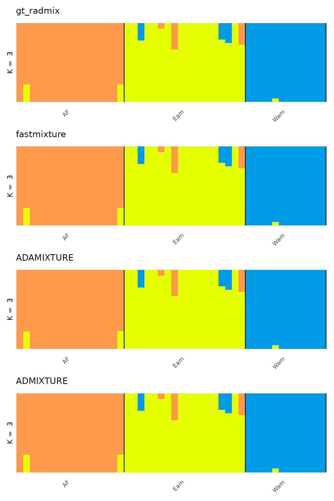

# Installing and running external tools

`tidygenclust` estimates ancestry with the ADMIXTURE model natively,
with
[`gt_radmix()`](https://evolecolgroup.github.io/tidygenclust/reference/gt_radmix.md).
It also provides interfaces to three external programs that fit the same
model: the original ADMIXTURE program (Alexander et al. 2009), run with
[`tidypopgen::gt_admixture()`](https://evolecolgroup.github.io/tidypopgen/reference/gt_admixture.html),
and two Python packages - fastmixture (Santander et al. 2024), run with
[`gt_fastmixture()`](https://evolecolgroup.github.io/tidygenclust/reference/gt_fastmixture.md),
and ADAMIXTURE (Saurina-i-Ricos et al. 2026), run with
[`gt_adamixture()`](https://evolecolgroup.github.io/tidygenclust/reference/gt_adamixture.md).
These programs are optional: they are not needed by the rest of
`tidygenclust`.

In this article, we show how to install the three programs and how to
run them, alongside
[`gt_radmix()`](https://evolecolgroup.github.io/tidygenclust/reference/gt_radmix.md),
on the lizard *Anolis punctatus* dataset (Prates et al. 2018) used in
the main vignette, and we check that the four programs give consistent
ancestry proportions. For a comparison of their performance, see the
article “Benchmarking gt_radmix() against ADMIXTURE, fastmixture and
ADAMIXTURE”.

[`gt_radmix()`](https://evolecolgroup.github.io/tidygenclust/reference/gt_radmix.md)
estimates individual ancestry proportions (Q) and ancestral allele
frequencies (P) with the method and the algorithm of ADMIXTURE,
implemented in C++ within `tidygenclust`, so no external program is
needed. It includes the cross-validation of ADMIXTURE, to choose K, it
supports pseudohaploid data, and it can start from an SVD of the
genotypes (see
[`?gt_radmix`](https://evolecolgroup.github.io/tidygenclust/reference/gt_radmix.md)).
If you use it, please cite Alexander et al. (2009) for the method, and,
if you use cross-validation, Alexander and Lange (2011). If you use
fastmixture, cite Santander et al. (2024), if you use ADAMIXTURE,
Saurina-i-Ricos et al. (2026), and if you use ADMIXTURE, Alexander et
al. (2009).

## Installing the external tools

We use `reticulate` to install the three programs in a conda
environment, `ctidygenclust`, so the details of the Python packages and
their dependencies are handled automatically. This only works on Linux
at the moment: on Windows, the programs can be used through the WSL; on
macOS, they are not available, as the OpenMP library that they use
conflicts with the one used by R (by packages such as `bigstatsr`),
which crashes the R session. ADAMIXTURE is installed from PyPI in its
CPU version, which does not need PyTorch. You can install all three
programs with:

``` r

library(tidygenclust)
tgc_tools_install()
```

or choose which programs to install, e.g. only `fastmixture`:

``` r

tgc_tools_install(tools = "fastmixture")
```

Programs can be added later to an existing environment with
[`tgc_fastmixture_install()`](https://evolecolgroup.github.io/tidygenclust/reference/tgc_fastmixture_install.md),
[`tgc_admixture_install()`](https://evolecolgroup.github.io/tidygenclust/reference/tgc_admixture_install.md)
and
[`tgc_adamixture_install()`](https://evolecolgroup.github.io/tidygenclust/reference/tgc_adamixture_install.md):

``` r

tgc_admixture_install()
```

### Checking which programs are installed

[`tgc_tools_version()`](https://evolecolgroup.github.io/tidygenclust/reference/tgc_tools_version.md)
reports which programs are installed (`NA` for those that are not):

``` r

library(tidypopgen)
#> Loading required package: dplyr
#> 
#> Attaching package: 'dplyr'
#> The following objects are masked from 'package:stats':
#> 
#>     filter, lag
#> The following objects are masked from 'package:base':
#> 
#>     intersect, setdiff, setequal, union
#> Loading required package: tibble
library(tidygenclust)

tools_version <- tgc_tools_version()
tools_version
#> $fastmixture
#> [1] "v1.3.0"
#> 
#> $admixture
#> [1] "1.3.0"
#> 
#> $adamixture
#> [1] "1.9.6"
```

The code that runs each program in this article is only run if that
program is available, and the comparison only if all three are:

``` r

fastmixture_available <- !is.na(tools_version$fastmixture)
admixture_available <- !is.na(tools_version$admixture)
adamixture_available <- !is.na(tools_version$adamixture)
all_available <- fastmixture_available && admixture_available &&
  adamixture_available
```

## The data

We read the vcf file of the 46 lizards into a `gen_tibble`, add the
population information, and group the individuals by the three genetic
groups found by Prates et al. (2018): Eastern Amazonia (Eam), Western
Amazonia (Wam) and the Atlantic Forest (AF):

``` r

vcf_path <- system.file(
  "/extdata/anolis/punctatus_t70_s10_n46_filtered.recode.vcf.gz",
  package = "tidypopgen"
)
anole_gt <- gen_tibble(vcf_path,
  quiet = TRUE, backingfile = tempfile("anolis_"),
  parser = "cpp"
)
pops_path <- system.file("/extdata/anolis/punctatus_n46_meta.csv",
  package = "tidypopgen"
)
pops <- utils::read.csv(pops_path)
anole_gt <- anole_gt %>%
  left_join(pops, by = "id") %>%
  group_by(pop)
anole_gt
#> # A gen_tibble: 3249 loci
#> # A tibble:     46 × 6
#> # Groups:       pop [3]
#>    id                 genotypes population       longitude latitude pop  
#>    <chr>             <vctr_SNP> <chr>                <dbl>    <dbl> <chr>
#>  1 punc_BM288         [0,0,...] Amazonian_Forest     -51.8    -3.32 Eam  
#>  2 punc_GN71          [2,0,...] Amazonian_Forest     -54.6    -9.73 Eam  
#>  3 punc_H1907         [0,2,...] Amazonian_Forest     -64.8    -9.45 Wam  
#>  4 punc_H1911         [0,2,...] Amazonian_Forest     -64.8    -9.44 Wam  
#>  5 punc_H2546         [0,1,...] Amazonian_Forest     -65.4    -9.60 Wam  
#>  6 punc_IBSPCRIB0361  [0,0,...] Atlantic_Forest      -46.0   -23.8  AF   
#>  7 punc_ICST764       [0,0,...] Atlantic_Forest      -36.3    -9.81 AF   
#>  8 punc_JFT459        [0,0,...] Atlantic_Forest      -40.5   -20.3  AF   
#>  9 punc_JFT773        [0,0,...] Atlantic_Forest      -40.5   -20.0  AF   
#> 10 punc_LG1299        [0,0,...] Atlantic_Forest      -39.1   -15.3  AF   
#> # ℹ 36 more rows
```

For each program, we make a single run for K = 3.

## Running gt_radmix()

``` r

anole_radmix <- gt_radmix(anole_gt, k = 3, seed = 1)
summary(anole_radmix)
#> Admixture results for k =  3 
#> with slots:
#> $Q for Q matrices
#> $P for  matrices
#> $log for logs from the algorithm
```

The results are stored in a `gt_admix` object, so we can use all the
methods from `tidypopgen` (see the main vignette).

## Running fastmixture

[`gt_fastmixture()`](https://evolecolgroup.github.io/tidygenclust/reference/gt_fastmixture.md)
runs fastmixture on a `gen_tibble` (reading its backing file directly)
or on a set of PLINK files. Its arguments follow those of fastmixture,
so some differ from those of
[`gt_radmix()`](https://evolecolgroup.github.io/tidygenclust/reference/gt_radmix.md):
the number of cores is set with `threads`, and cross-validation with
`cv`, which gives the number of folds. By default, it only returns the Q
matrices (set `no_freqs = FALSE` to also keep the P matrices). As the
fastmixture program does, it starts from a randomised SVD of the
genotypes, which needs all the loci to be polymorphic
(`random_init = TRUE` starts from random values instead, but can take
much longer to converge). fastmixture prints its progress, which we hide
here:

``` r

anole_fm <- gt_fastmixture(anole_gt, k = 3, seed = 1)
```

``` r

summary(anole_fm)
#> Admixture results for k =  3 
#> with slots:
#> $Q for Q matrices
```

## Running ADMIXTURE

[`tidypopgen::gt_admixture()`](https://evolecolgroup.github.io/tidypopgen/reference/gt_admixture.html)
runs the original ADMIXTURE program: it writes the `gen_tibble` to PLINK
files, runs ADMIXTURE on them, and reads its results back into a
`gt_admix` object, with the log-likelihood and the log of each run. With
`conda_env = "auto"` (the default), it uses the ADMIXTURE installed by
[`tgc_tools_install()`](https://evolecolgroup.github.io/tidygenclust/reference/tgc_tools_install.md):

``` r

anole_adm <- gt_admixture(anole_gt, k = 3, seed = 1)
summary(anole_adm)
#> Admixture results for k =  3 
#> with slots:
#> $Q for Q matrices
#> $P for  matrices
#> $log for logs from the algorithm
```

## Running ADAMIXTURE

[`gt_adamixture()`](https://evolecolgroup.github.io/tidygenclust/reference/gt_adamixture.md)
runs ADAMIXTURE, which combines a spectral initialisation (SVD and ALS)
with accelerated block relaxation (BR-QN), on a `gen_tibble` or on a set
of PLINK files. Like
[`gt_fastmixture()`](https://evolecolgroup.github.io/tidygenclust/reference/gt_fastmixture.md),
it sets the number of cores with `threads` and cross-validation with
`cv`, and by default it only returns the Q matrices (set
`no_freqs = FALSE` to also keep the P matrices). ADAMIXTURE prints its
progress, which we turn off with `verbose = FALSE`:

``` r

anole_ada <- gt_adamixture(anole_gt, k = 3, seed = 1, verbose = FALSE)
summary(anole_ada)
#> Admixture results for k =  3 
#> with slots:
#> $Q for Q matrices
```

## Comparing the results

All four programs return `gt_admix` objects, which can be plotted with
[`autoplot()`](https://ggplot2.tidyverse.org/reference/autoplot.html).
The labels of the clusters are arbitrary, so we first match the clusters
of
[`gt_radmix()`](https://evolecolgroup.github.io/tidygenclust/reference/gt_radmix.md),
fastmixture and ADAMIXTURE to those of ADMIXTURE, so that each cluster
has the same colour in all the plots:

``` r

# all permutations of 1:n
permutations <- function(n) {
  if (n == 1) {
    return(matrix(1))
  }
  sub <- permutations(n - 1)
  do.call(rbind, lapply(seq_len(n), function(i) {
    cbind(i, matrix(setdiff(seq_len(n), i)[sub], nrow = nrow(sub)))
  }))
}
# reorder the clusters of a gt_admix object with a single run, to best
# match those of the Q matrix q_ref
match_clusters <- function(adm, q_ref) {
  q <- unclass(adm$Q[[1]])
  perms <- permutations(ncol(q))
  diffs <- apply(perms, 1, function(x) sum(abs(q[, x] - q_ref)))
  best <- perms[which.min(diffs), ]
  adm$Q[[1]] <- q_matrix(q[, best])
  if (!is.null(adm$P)) {
    adm$P[[1]] <- adm$P[[1]][, best]
  }
  adm
}
q_adm <- unclass(anole_adm$Q[[1]])
anole_radmix <- match_clusters(anole_radmix, q_adm)
anole_fm <- match_clusters(anole_fm, q_adm)
anole_ada <- match_clusters(anole_ada, q_adm)
```

``` r

library(ggplot2)
plots <- list(
  autoplot(anole_radmix, type = "barplot", k = 3, run = 1,
    annotate_group = TRUE
  ) +
    ggtitle("gt_radmix"),
  autoplot(anole_fm, type = "barplot", k = 3, run = 1,
    annotate_group = TRUE
  ) +
    ggtitle("fastmixture"),
  autoplot(anole_ada, type = "barplot", k = 3, run = 1,
    annotate_group = TRUE
  ) +
    ggtitle("ADAMIXTURE"),
  autoplot(anole_adm, type = "barplot", k = 3, run = 1,
    annotate_group = TRUE
  ) +
    ggtitle("ADMIXTURE")
)
patchwork::wrap_plots(plots, ncol = 1)
```



The four plots look the same. To confirm it, we compare the ancestry
proportions of each individual with those estimated by ADMIXTURE:

``` r

q_differences <- function(adm) {
  q <- unclass(adm$Q[[1]])
  c(
    max_abs_difference = max(abs(q - q_adm)),
    correlation = stats::cor(as.vector(q), as.vector(q_adm))
  )
}
rbind(
  gt_radmix = q_differences(anole_radmix),
  fastmixture = q_differences(anole_fm),
  ADAMIXTURE = q_differences(anole_ada)
)
#>             max_abs_difference correlation
#> gt_radmix          0.005020889   0.9999980
#> fastmixture        0.005003754   0.9999981
#> ADAMIXTURE         0.005074944   0.9999979
```

## Cross-validation

To choose K, all four programs can compute a cross-validation error for
each run, with `crossval = TRUE` in
[`gt_radmix()`](https://evolecolgroup.github.io/tidygenclust/reference/gt_radmix.md)
and
[`gt_admixture()`](https://evolecolgroup.github.io/tidypopgen/reference/gt_admixture.html),
and with `cv` (the number of folds) in
[`gt_fastmixture()`](https://evolecolgroup.github.io/tidygenclust/reference/gt_fastmixture.md)
and
[`gt_adamixture()`](https://evolecolgroup.github.io/tidygenclust/reference/gt_adamixture.md):

``` r

gt_radmix(anole_gt, k = 2:4, n_runs = 3, crossval = TRUE)
gt_admixture(anole_gt, k = 2:4, n_runs = 3, crossval = TRUE)
gt_fastmixture(anole_gt, k = 2:4, n_runs = 3, cv = 5)
gt_adamixture(anole_gt, k = 2:4, n_runs = 3, cv = 5)
```

[`gt_radmix()`](https://evolecolgroup.github.io/tidygenclust/reference/gt_radmix.md)
implements the procedure of ADMIXTURE, which holds out randomly chosen
genotypes, fits the model to the remaining genotypes, and scores its
predictions of the held-out ones. ADAMIXTURE also holds out random
genotypes, but it refits each fold with only 5 iterations, starting from
the estimates of the full data. fastmixture instead holds out whole
individuals. Because of these differences, the errors are not comparable
between programs, and only the K favoured by each program can be
compared.

## References

Alexander DH, Novembre J, Lange K (2009) Fast model-based estimation of
ancestry in unrelated individuals. Genome Research, 19(9), 1655-1664.

Alexander DH, Lange K (2011) Enhancements to the ADMIXTURE algorithm for
individual ancestry estimation. BMC Bioinformatics, 12, 246.

Prates I, Penna A, Rodrigues MT, Carnaval AC (2018) Local adaptation in
mainland anole lizards: Integrating population history and
genome-environment associations. Ecology and Evolution, 8(23),
11932-11944.

Saurina-i-Ricos J, Mas Montserrat D, Ioannidis AG (2026) ADAMIXTURE:
adaptive first-order optimization for biobank-scale genetic clustering.
Bioinformatics, 42(Supplement_1), btag236.
<https://doi.org/10.1093/bioinformatics/btag236>

Santander CG, Refoyo Martinez A, Meisner J (2024) Faster model-based
estimation of ancestry proportions. Peer Community Journal, 4: e115.
<https://doi.org/10.24072/pcjournal.503>
