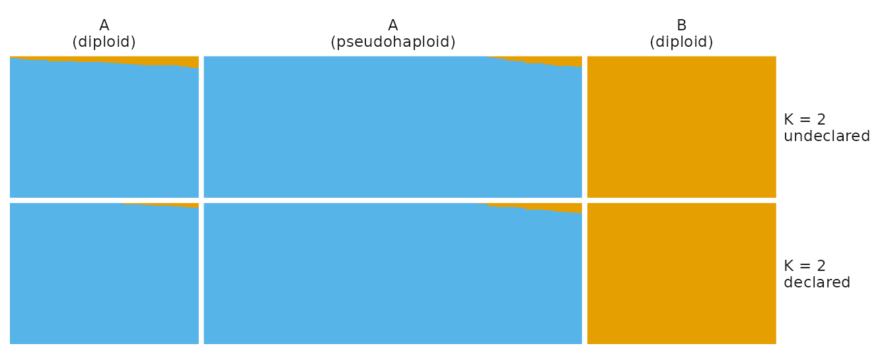
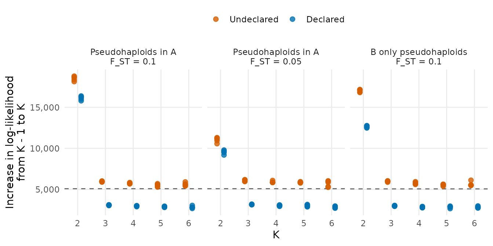
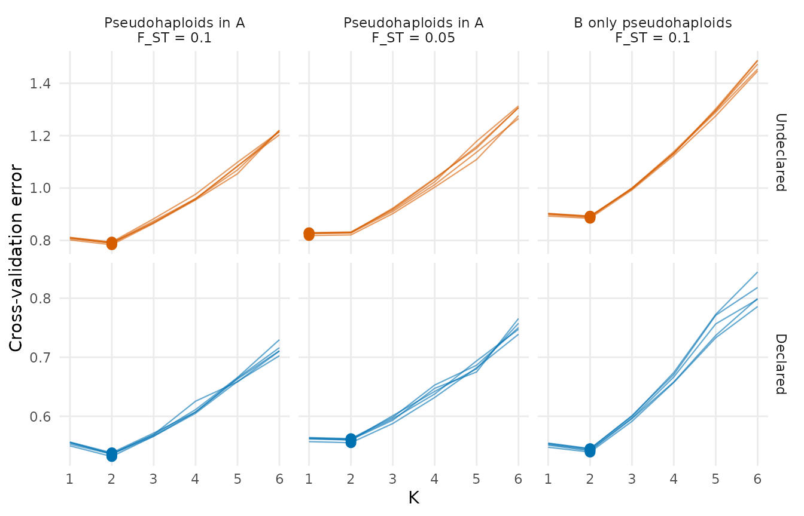
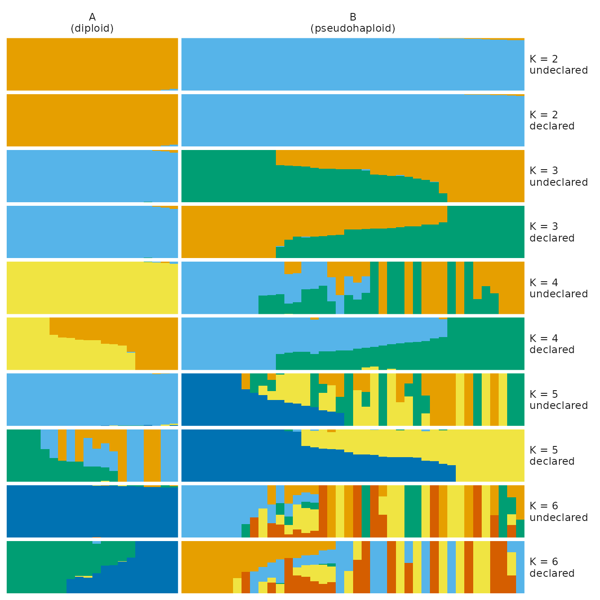
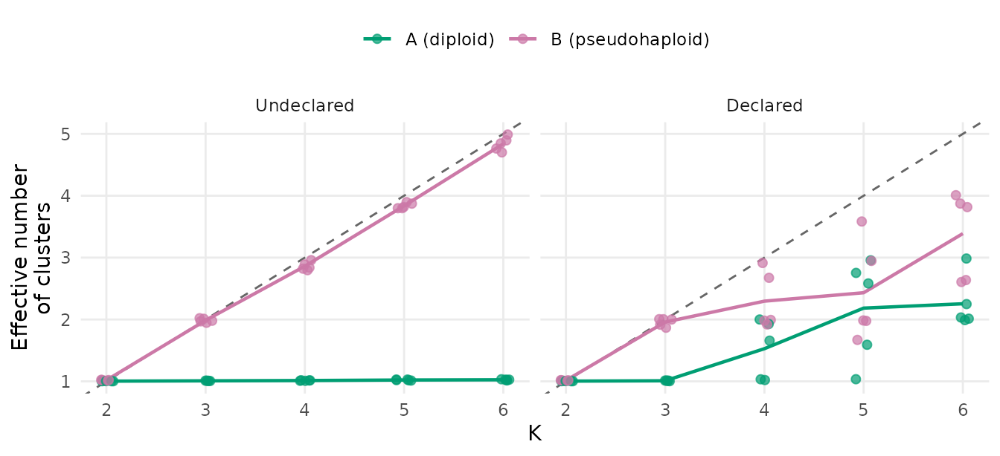

# Why pseudohaploids must be declared

Diploid genotypes cannot be called reliably from low-coverage data,
which includes most ancient genomes. A common workaround is to sample a
single allele at random at each site, so that the individual is treated
as “pseudohaploid”. `tidypopgen` encodes each pseudohaploid call as a
homozygous genotype (0 or 2), and
[`tidypopgen::gt_pseudohaploid()`](https://evolecolgroup.github.io/tidypopgen/reference/gt_pseudohaploid.html)
marks the individuals with no heterozygous genotypes as pseudohaploids
(with a ploidy of 1).
[`gt_radmix()`](https://evolecolgroup.github.io/tidygenclust/reference/gt_radmix.md)
estimates ancestry proportions with the method and the algorithm of
ADMIXTURE (Alexander et al. 2009), including its cross-validation
procedure (Alexander & Lange 2011). For pseudohaploid individuals, it
counts a single copy of the allele at each genotype.

If the pseudohaploid individuals are not declared as such, each genotype
is treated as a true diploid call. This happens in programs such as
ADMIXTURE, which assume diploid genotypes for autosomes. Using simulated
data, we show below the consequences of this approach. In summary, we
show that:

- the log-likelihood of every pseudohaploid is doubled. Likelihood-based
  criteria for choosing K (such as the Akaike information criterion,
  AIC) tend to favour an increasing number of clusters, whereas
  cross-validation generally identifies the correct K;
- when the population structure is weak, cross-validation can support
  too few clusters;
- even at the correct K, diploid individuals from the population
  containing pseudohaploid individuals appear artificially admixed;
- when K is too large, the additional clusters artificially divide the
  pseudohaploid individuals into groups that do not reflect genuine
  population structure.

All of these artefacts disappear once the pseudohaploids are declared
with
[`gt_pseudohaploid()`](https://evolecolgroup.github.io/tidypopgen/reference/gt_pseudohaploid.html).

The first sections analyse a single simulated dataset, with code that
runs in a few seconds. The later sections summarise replicated
simulations, run with a script described in [How the replicated
simulations were run](#how-the-replicated-simulations-were-run).

## Simulating the data

First, we load the packages required for the simulations and subsequent
analyses.

``` r

library(tidygenclust)
library(tidypopgen)
library(dplyr)
library(ggplot2)
```

The simulations follow the ADMIXTURE model, with unadmixed individuals
from a few populations:

1.  For each of `n_loci` independent loci, the frequency of the
    alternate allele is drawn from a uniform distribution between 0.05
    and 0.95 in a common ancestral population.
2.  Each population drifts from the ancestral population: the
    alternative allele frequency of each locus is drawn independently
    for each population from the Balding-Nichols model (Balding &
    Nichols 1995), a beta distribution with the ancestral frequency `p`
    as its mean and a variance of `fst * p * (1 - p)`. The larger `fst`
    is, the more the populations differ.
3.  Each diploid individual carries two independently sampled alleles at
    each locus, with the probability of sampling the alternate allele
    given by its population-specific frequency. The resulting genotype
    therefore follows a binomial distribution with two trials, and takes
    the values 0, 1 or 2.
4.  Each pseudohaploid individual carries a single sampled allele at
    each locus, drawn according to the population-specific allele
    frequency. This mimics the random selection of a single allele at
    each site: At a heterozygous site, either allele is equally likely
    to be selected. Consequently, across individuals, the probability of
    observing the alternate allele is equal to its population frequency.
    The genotype is stored as 0 or 2.

The simulated data contain no missing genotypes, no linkage between loci
and no admixture, so the true number of clusters equals the number of
populations. The function `simulate_pseudohaploids()` implements these
steps. The populations and their numbers of diploid and pseudohaploid
individuals are given as named vectors. It returns a `gen_tibble` in
which the pseudohaploids are coded 0/2 but not declared, as when they
are read from a file (with the true allele frequencies of the
populations in its attribute “frequencies”):

``` r

# Simulate diploid and pseudohaploid individuals from a few populations.
# n_diploid and n_pseudohaploid are named vectors with the number of
# individuals of each population (a population missing from one of them has
# none of that type), e.g. n_diploid = c(A = 20, B = 20) and
# n_pseudohaploid = c(A = 40). The allele frequencies of each population
# drift from those of a common ancestral population (with the given F_ST).
# Returns a gen_tibble with the columns id, population and type ("diploid" or
# "pseudohaploid"), in which the pseudohaploids are coded 0/2 but not
# declared as pseudohaploids, as when they are read from a file. The true
# allele frequencies of the populations (a matrix with one row per locus and
# one column per population) are in its attribute "frequencies"
simulate_pseudohaploids <- function(n_diploid, n_pseudohaploid = c(),
                                    n_loci = 5000, fst = 0.1, seed = NULL) {
  if (!is.null(seed)) {
    set.seed(seed)
  }
  populations <- union(names(n_diploid), names(n_pseudohaploid))
  # the number of individuals of a population in n (0 if it is not in n)
  count <- function(n, pop) if (pop %in% names(n)) n[[pop]] else 0
  # the frequency of the alternate allele of each locus in the ancestral
  # population
  p_ancestral <- stats::runif(n_loci, 0.05, 0.95)
  frequencies <- list()
  genotypes <- list()
  indiv_meta <- list()
  for (pop in populations) {
    # the frequencies in this population, drifted from the ancestral ones
    # (Balding-Nichols model: a beta distribution with mean p_ancestral and
    # variance fst * p_ancestral * (1 - p_ancestral))
    p_pop <- frequencies[[pop]] <- stats::rbeta(
      n_loci,
      p_ancestral * (1 - fst) / fst,
      (1 - p_ancestral) * (1 - fst) / fst
    )
    # n individuals with `copies` copies of each locus, each copy carrying
    # the alternate allele with probability p_pop (one row per individual)
    draw <- function(n, copies) {
      matrix(
        stats::rbinom(n * n_loci, copies, p_pop),
        ncol = n_loci, byrow = TRUE
      )
    }
    # a diploid carries two copies; a pseudohaploid carries one, stored as a
    # homozygous genotype (0 or 2), as in tidypopgen
    n_dip <- count(n_diploid, pop)
    n_pseudo <- count(n_pseudohaploid, pop)
    genotypes[[pop]] <- rbind(draw(n_dip, 2), 2 * draw(n_pseudo, 1))
    indiv_meta[[pop]] <- data.frame(
      population = rep(pop, n_dip + n_pseudo),
      type = rep(c("diploid", "pseudohaploid"), c(n_dip, n_pseudo))
    )
  }
  indiv_meta <- do.call(rbind, indiv_meta)
  indiv_meta <- data.frame(
    id = paste0("ind", seq_len(nrow(indiv_meta))),
    indiv_meta
  )
  loci <- data.frame(
    name = paste0("rs", seq_len(n_loci)),
    chromosome = 1L,
    position = seq_len(n_loci),
    genetic_dist = 0,
    allele_ref = "A",
    allele_alt = "T"
  )
  gt <- tidypopgen::gen_tibble(
    do.call(rbind, genotypes),
    indiv_meta = indiv_meta,
    loci = loci,
    backingfile = tempfile("pseudohaploids_"),
    quiet = TRUE
  )
  attr(gt, "frequencies") <- do.call(cbind, frequencies)
  gt
}
```

The function is defined in
`vignettes/articles/code/pseudohaploid_simulation.R` (in the source code
of the package), and can be loaded with
[`source()`](https://rdrr.io/r/base/source.html) to simulate other
designs.

As a first example, we simulate two populations, A and B, that have each
diverged from their common ancestor with an F_ST of 0.1. The dataset
comprises 5,000 loci, 20 diploid individuals from each of populations A
and B, and an additional 40 pseudohaploid individuals from population A.

``` r

gt <- simulate_pseudohaploids(
  n_diploid = c(A = 20, B = 20),
  n_pseudohaploid = c(A = 40),
  fst = 0.1,
  seed = 1
)
gt
#> # A gen_tibble: 5000 loci
#> # A tibble:     80 × 4
#>    id    population type     genotypes
#>    <chr> <chr>      <chr>   <vctr_SNP>
#>  1 ind1  A          diploid  [0,1,...]
#>  2 ind2  A          diploid  [0,0,...]
#>  3 ind3  A          diploid  [0,0,...]
#>  4 ind4  A          diploid  [1,0,...]
#>  5 ind5  A          diploid  [0,2,...]
#>  6 ind6  A          diploid  [0,0,...]
#>  7 ind7  A          diploid  [0,1,...]
#>  8 ind8  A          diploid  [0,1,...]
#>  9 ind9  A          diploid  [0,1,...]
#> 10 ind10 A          diploid  [0,1,...]
#> # ℹ 70 more rows
table(gt$population, gt$type)
#>    
#>     diploid pseudohaploid
#>   A      20            40
#>   B      20             0
```

The pseudohaploids have no heterozygous genotypes:

``` r

heterozygosity <- rowMeans(show_genotypes(gt) == 1)
tapply(heterozygosity, gt$type, mean)
#>       diploid pseudohaploid 
#>      0.323615      0.000000
```

The function
[`gt_pseudohaploid()`](https://evolecolgroup.github.io/tidypopgen/reference/gt_pseudohaploid.html)
identifies them:

``` r

gt_declared <- gt_pseudohaploid(gt)
table(type = gt$type, ploidy = indiv_ploidy(gt_declared))
#>                ploidy
#> type             1  2
#>   diploid        0 40
#>   pseudohaploid 40  0
```

## The log-likelihood counts the pseudohaploids twice

We fit the true model (K = 2) twice: once with the pseudohaploids
treated as diploids (undeclared), and once with them declared:

``` r

fit_undeclared <- gt_radmix(gt, k = 2, seed = 1)
fit_declared <- gt_radmix(gt_declared, k = 2, seed = 1)
c(undeclared = fit_undeclared$loglik, declared = fit_declared$loglik)
#> undeclared   declared 
#>  -382540.8  -286929.4
```

The two log-likelihoods are very different. In the ADMIXTURE model, the
genotype g at a given locus is the number of alternate-allele copies
carried by an individual, out of n total allele copies. The number of
alternate-allele copies follows a binomial distribution with n trials
and a probability of observing the alternate allele given by
`qp = sum_k q_k p_k` (where `q_k` is the proportion of the ancestry of
the individual from cluster `k`, and `p_k` the frequency of the allele
in that cluster). The log-likelihood contribution of this genotype is
therefore

    g log(qp) + (n - g) log(1 - qp)

A declared pseudohaploid individual carrying the alternate allele at a
locus has `g = 1` out of `n = 1`, and contributes `log(qp)`. Undeclared,
it has `g = 2` out of `n = 2`, and contributes `2 log(qp)`. The same
holds for the reference allele: `g = 0` contributes `log(1 - qp)` when
declared and `2 log(1 - qp)` when undeclared. The log-likelihood of
every pseudohaploid is therefore exactly doubled. We can check this by
computing the log-likelihood of each individual from the estimates of
the declared fit:

``` r

# the log-likelihood of each individual, given the genotypes `gt`, the
# ancestry proportions q (individuals x K), the allele frequencies p
# (loci x K) and the number of allele copies of each individual
loglik_individuals <- function(gt, q, p, n_copies) {
  # copies of the alternate allele out of n_copies (the pseudohaploids are
  # coded 0/2)
  copies <- show_genotypes(gt) * n_copies / 2
  qp <- q %*% t(p)
  rowSums(copies * log(qp) + (n_copies - copies) * log(1 - qp))
}
q <- unclass(fit_declared$Q[[1]])
p <- fit_declared$P[[1]]
loglik_declared <- loglik_individuals(gt, q, p, indiv_ploidy(gt_declared))
loglik_undeclared <- loglik_individuals(gt, q, p, n_copies = 2)
# the total for the declared pseudohaploids is that of the fit
c(by_hand = sum(loglik_declared), fit = fit_declared$loglik)
#>   by_hand       fit 
#> -286929.4 -286929.4
# the log-likelihood of each type of individual, with the same estimates
rbind(
  declared = tapply(loglik_declared, gt$type, sum),
  undeclared = tapply(loglik_undeclared, gt$type, sum)
)
#>              diploid pseudohaploid
#> declared   -190883.8     -96045.62
#> undeclared -190883.8    -192091.24
```

The diploids contribute the same log-likelihood in both cases, but the
pseudohaploids contribute twice as much when undeclared. The model
behaves as if it had twice as much information about the pseudohaploids
as it really has. The rest of this article shows the consequences.

### Ancestry proportions at the true K

Given the allele frequencies, the ancestry proportions of the
pseudohaploids maximise their own log-likelihood, and doubling that
log-likelihood does not change where the maximum is. However, the
pseudohaploids also affect the allele frequencies of the clusters, and
through them the ancestry of the other individuals:

``` r

# the ancestry proportions of a gt_admix object with a single run, as a
# data frame with one row per individual and cluster, labelled with the
# treatment ("declared" or "undeclared")

q_long <- function(fit, gt, treatment) {
  q <- unclass(fit$Q[[1]])
  data.frame(
    treatment = treatment,
    k = fit$k,
    id = gt$id,
    population = gt$population,
    type = gt$type,
    cluster = rep(seq_len(ncol(q)), each = nrow(q)),
    q = as.vector(q)
  )
}
# one colour per cluster (from the Okabe-Ito palette); the numbering of the
# clusters, and hence their colours, is arbitrary in each fit
cluster_colours <- c(
  "#E69F00", "#56B4E9", "#009E73", "#F0E442", "#0072B2", "#D55E00"
)
# bar plot of the ancestry proportions of each individual (from q_long()),
# with one row of panels per K and per treatment, and the individuals
# grouped by population and type, and sorted within each group by their
# ancestry from the main cluster of the group
plot_q <- function(q) {
  # one row of panels per K and treatment, undeclared first
  rows <- paste0(
    "K = ", rep(sort(unique(q$k)), each = 2), "\n",
    c("undeclared", "declared")
  )
  q <- q %>%
    mutate(
      group = paste0(.data$population, "\n(", .data$type, ")"),
      row = factor(paste0("K = ", .data$k, "\n", .data$treatment), rows)
    ) %>%
    group_by(.data$treatment, .data$k, .data$group, .data$cluster) %>%
    mutate(cluster_mean = mean(.data$q)) %>%
    group_by(.data$treatment, .data$k, .data$group) %>%
    mutate(
      main_cluster = .data$cluster[which.max(.data$cluster_mean)]
    ) %>%
    group_by(.data$treatment, .data$k, .data$id) %>%
    mutate(main_q = .data$q[.data$cluster == .data$main_cluster[1]]) %>%
    group_by(.data$treatment, .data$k) %>%
    arrange(.data$group, desc(.data$main_q), .data$id, .by_group = TRUE) %>%
    mutate(individual = match(.data$id, unique(.data$id))) %>%
    ungroup()
  ggplot(q, aes(
    x = .data$individual, y = .data$q, fill = factor(.data$cluster)
  )) +
    geom_col(width = 1) +
    facet_grid(
      row ~ group,
      scales = "free_x",
      space = "free_x"
    ) +
    scale_fill_manual(values = cluster_colours, guide = "none") +
    scale_x_continuous(breaks = NULL, expand = c(0, 0)) +
    scale_y_continuous(breaks = NULL, expand = c(0, 0)) +
    labs(x = NULL, y = NULL) +
    theme_minimal() +
    theme(
      panel.spacing = unit(0.2, "lines"),
      strip.text.y = element_text(angle = 0, hjust = 0)
    )
}
```

``` r

plot_q(rbind(
  q_long(fit_undeclared, gt, "undeclared"),
  q_long(fit_declared, gt, "declared")
))
```



Declared, every individual is assigned almost entirely to the cluster of
its population. A few individuals of A get a little ancestry from the
cluster of B, and none of B from that of A, but this is due to the
larger sample of A (60 individuals against 20), not to its
pseudohaploids (see [Why population A looks slightly
admixed](#why-population-a-looks-slightly-admixed)). Undeclared, the
pseudohaploids are still assigned to their own cluster, but the diploids
of population A appear slightly admixed with population B. Treated as
diploids, the pseudohaploids are homozygous at every locus, which the
model can only partly explain, with allele frequencies closer to 0
and 1. As they make up most of the information on population A (counted
twice, they carry 80 of its 120 allele copies per locus), the cluster of
population A takes more extreme frequencies than the true frequencies of
the population. The diploids of population A, which do carry
heterozygotes, then fit better as a mixture of this cluster with that of
population B.

The replicated simulations (see [Choosing K](#choosing-k) for their
design) show the same bias, which is stronger when the structure is
weak. The table gives the mean ancestry of each group of individuals
from the cluster of the other population, at K = 2:

| Scenario | Population | Type | Undeclared (%) | Declared (%) |
|:---|:---|:---|---:|---:|
| Pseudohaploids in A, F_ST = 0.1 | A | diploid | 5.3 | 1.0 |
| Pseudohaploids in A, F_ST = 0.1 | A | pseudohaploid | 1.2 | 1.3 |
| Pseudohaploids in A, F_ST = 0.1 | B | diploid | 0.2 | 0.3 |
| Pseudohaploids in A, F_ST = 0.05 | A | diploid | 12.4 | 3.1 |
| Pseudohaploids in A, F_ST = 0.05 | A | pseudohaploid | 3.3 | 3.0 |
| Pseudohaploids in A, F_ST = 0.05 | B | diploid | 1.0 | 1.1 |
| B only pseudohaploids, F_ST = 0.1 | A | diploid | 0.2 | 0.2 |
| B only pseudohaploids, F_ST = 0.1 | B | pseudohaploid | 0.9 | 0.7 |

Mean ancestry (%) of each group of individuals from the cluster of the
other population at K = 2, over 5 replicates. {.table}

When undeclared, the pseudohaploids make the diploids of their
population appear four to five times more admixed than when they are
declared. The pseudohaploids themselves, and the other population, are
almost unaffected. There is no bias when one population is made up only
of pseudohaploids (the third scenario), as there are no diploids in it
to appear admixed.

Even when the pseudohaploids are declared, the individuals of population
A get a little more ancestry from the other cluster than those of B do.
As explained below, this is not due to the pseudohaploids.

#### Why population A looks slightly admixed

The ancestry of an individual is estimated from a finite number of loci,
and cannot be negative, so the noise of the estimate shows up as a
little ancestry from the other cluster, even in an unadmixed individual.
In the scenarios above, this is larger in population A than in B. Two
differences between the populations could explain this: A has more
individuals (60 against 20), and two thirds of them are pseudohaploids,
whose ancestry is estimated with more noise. To separate the two, we
simulated two populations of different or equal sizes, with and without
pseudohaploids (F_ST = 0.1, 10 replicates). We fitted K = 2 in two ways:
with the allele frequencies estimated, as usual, and with them fixed at
their true values (stored in the “frequencies” of the simulated data,
and passed to
[`gt_radmix()`](https://evolecolgroup.github.io/tidygenclust/reference/gt_radmix.md)
with `init_p` and `fix_p = TRUE`):

| Simulated individuals | Population | Type | Undeclared (%) | Declared (%) | Declared, true frequencies (%) |
|:---|:---|:---|---:|---:|---:|
| A: 20 diploids; B: 20 diploids | A | diploid | \- | 0.2 | 0.6 |
|  | B | diploid | \- | 0.3 | 0.6 |
| A: 60 diploids; B: 20 diploids | A | diploid | \- | 1.1 | 0.6 |
|  | B | diploid | \- | 0.3 | 0.7 |
| A: 20 diploids and 40 pseudohaploids; B: 20 diploids (the first scenario) | A | diploid | 5.1 | 1.1 | 0.6 |
|  | A | pseudohaploid | 1.2 | 1.5 | 0.9 |
|  | B | diploid | 0.2 | 0.2 | 0.7 |
| A: 20 diploids and 40 pseudohaploids; B: 60 diploids | A | diploid | 4.7 | 1.0 | 0.6 |
|  | A | pseudohaploid | 1.0 | 1.3 | 0.9 |
|  | B | diploid | 0.9 | 0.9 | 0.6 |

Mean ancestry (%) of each group of individuals from the cluster of the
other population at K = 2, over 10 replicates, with the allele
frequencies estimated (with the pseudohaploids undeclared or declared),
or fixed at their true values. {.table}

- With the true frequencies, all diploids get about the same small
  ancestry from the other cluster (0.6% on average), whatever the size
  of their population: this is the noise of the estimates. The
  pseudohaploids, with half as many allele copies, get a little more
  (0.9%).
- With the estimated frequencies, the difference between the populations
  follows their sizes, not the pseudohaploids. Without any
  pseudohaploids, A (60 diploids) still looks more admixed than B (20
  diploids), by about the same amount as in the original scenario (A: 20
  diploids and 40 pseudohaploids; B: 20 diploids). Conversely, when the
  pseudohaploids are kept in A but B is enlarged to 60 diploids, the two
  populations look alike. The allele frequencies of a cluster are
  estimated from the individuals assigned to it. With few individuals,
  the estimated frequencies are pulled towards each of them and fit them
  closely, so they appear less admixed than with the true frequencies
  (as in B, with 20 individuals). With many, each individual has less
  influence on the frequencies, which fit them less closely, so they
  appear more admixed (as in A, with 60).
- The pseudohaploids themselves appear a little more admixed than the
  diploids of their population, because of the larger noise of their
  estimates.
- Undeclared pseudohaploids add a much larger bias to the diploids of A,
  which remains when B is as large as A: it comes from the extreme
  frequencies of the cluster of A, explained above, not from the sizes
  of the populations.

So, when the pseudohaploids are declared, the slight admixture of
population A comes mostly from its larger sample, and only a little from
its pseudohaploids. It is a property of the maximum-likelihood estimates
of the ADMIXTURE model, with or without pseudohaploids, and the
differences are small (about 1%).

## Choosing K

The replicated simulations have 5 replicates of each of three scenarios,
each with two populations (so the true K is 2), and 5,000 loci:

- **Pseudohaploids in A, F_ST = 0.1**: as above, 20 diploids from each
  population, and 40 pseudohaploids from population A;
- **Pseudohaploids in A, F_ST = 0.05**: the same, with weaker structure;
- **Pseudohaploids in B only, F_ST = 0.1**: 20 diploids from population
  A, and 40 pseudohaploids from population B, e.g. a population known
  only from ancient samples.

Each dataset is analysed with
[`gt_radmix()`](https://evolecolgroup.github.io/tidygenclust/reference/gt_radmix.md)
for K = 1 to 6, with cross-validation, with its pseudohaploids
undeclared and declared.

### The log-likelihood keeps adding clusters

Adding a cluster always increases the log-likelihood, as the extra
parameters can fit some of the noise of the sample. Criteria based on
the log-likelihood, such as AIC, only add a cluster if the increase is
large enough. AIC is `-2 log-likelihood + 2 x (number of parameters)`.
Each additional cluster adds one allele frequency per locus and an
ancestry proportion for every individual, so a cluster lowers AIC if it
increases the log-likelihood by more than the number of loci plus the
number of individuals:



Each point is a replicate, and the dashed line is the increase that a
cluster needs to lower AIC. The second cluster (K=2), which separates
the two populations, increases the log-likelihood far above the line
with both treatments. Further clusters only fit noise. Declared, they
gain little more than half of what AIC requires; undeclared, the noise
of the pseudohaploids counts twice, and every further cluster passes the
line.

### Cross-validation is unaffected by the inflated log-likelihood

Cross-validation (Alexander & Lange 2011) holds out a fold of the
genotypes, fits the model to the remaining ones, and scores how well it
predicts the held-out genotypes. A cluster that fits only noise does not
improve these predictions, so the cross-validation error stops
decreasing at the true K, whatever the size of the log-likelihood:



Each line is a replicate, and the large points mark the K with the
lowest error. The number of replicates in which each criterion picks
each K:

| Scenario | Pseudohaploids | Best K by AIC | Best K by cross-validation |
|:---|:---|:---|:---|
| Pseudohaploids in A, F_ST = 0.1 | Undeclared | 6 (5) | 2 (5) |
| Pseudohaploids in A, F_ST = 0.1 | Declared | 2 (5) | 2 (5) |
| Pseudohaploids in A, F_ST = 0.05 | Undeclared | 6 (5) | 1 (5) |
| Pseudohaploids in A, F_ST = 0.05 | Declared | 2 (5) | 2 (5) |
| B only pseudohaploids, F_ST = 0.1 | Undeclared | 6 (5) | 2 (5) |
| B only pseudohaploids, F_ST = 0.1 | Declared | 2 (5) | 2 (5) |

K with the lowest AIC and cross-validation error, shown as “K (number of
replicates)”, out of 5 replicates. The true K is 2. {.table}

With moderate structure (F_ST = 0.1), cross-validation picks the true K
with both treatments, whereas AIC picks the largest K tested when the
pseudohaploids are undeclared.

The cross-validation errors themselves are much larger when the
pseudohaploids are undeclared (note the different scales of the plot):
each held-out pseudohaploid genotype is scored as two copies of the same
allele, which a diploid prediction rarely expects. The errors can only
be compared between values of K of the same analysis, not between
analyses that treat the pseudohaploids differently (e.g. ADMIXTURE and
[`gt_radmix()`](https://evolecolgroup.github.io/tidygenclust/reference/gt_radmix.md)
on declared pseudohaploids).

### Cross-validation picks too few clusters when the structure is weak

With weaker structure (F_ST = 0.05), cross-validation picks K = 1 when
the pseudohaploids are undeclared, missing the two populations, and K =
2 when they are declared. At K = 2, the allele frequencies of the
cluster of population A are a compromise between its diploids, which
carry heterozygotes, and its undeclared pseudohaploids, which do not
(see [Ancestry proportions at the true
K](#ancestry-proportions-at-the-true-k)). The model then predicts the
held-out genotypes of the pseudohaploids worse than at K = 1, where a
single cluster cannot explain the lack of heterozygotes anyway, and its
allele frequencies are simply those of the whole sample. These errors
count twice, and when the structure is weak they outweigh the gain from
separating the two populations. (We checked this by splitting the
cross-validation error by group of individuals, in the first replicate
of each design.)

To see when this happens, we simulated 20 diploids from each population,
with 0 to 80 pseudohaploids from population A, for three values of F_ST,
and compared the cross-validation errors of K = 1 and K = 2 (5
replicates of each combination):

| Pseudohaploids | Number of pseudohaploids | F_ST = 0.03 | F_ST = 0.05 | F_ST = 0.1 |
|:---------------|-------------------------:|------------:|------------:|-----------:|
| Undeclared     |                        0 |         0/5 |         0/5 |        5/5 |
| Undeclared     |                       20 |         0/5 |         0/5 |        5/5 |
| Undeclared     |                       40 |         0/5 |         0/5 |        5/5 |
| Undeclared     |                       80 |         0/5 |         5/5 |        5/5 |
| Declared       |                        0 |         0/5 |         0/5 |        5/5 |
| Declared       |                       20 |         0/5 |         1/5 |        5/5 |
| Declared       |                       40 |         0/5 |         5/5 |        5/5 |
| Declared       |                       80 |         0/5 |         5/5 |        5/5 |

Number of replicates in which cross-validation prefers K = 2 (the true
K) to K = 1, with 20 diploids from each population and 0 to 80
pseudohaploids from population A. {.table}

At F_ST = 0.03, cross-validation misses the structure even without
pseudohaploids, and at F_ST = 0.1 it always finds it. At the
intermediate value, declared pseudohaploids add information, and 40 of
them are enough for cross-validation to detect the two populations in
every replicate. When undeclared, 20 or 40 pseudohaploids hide the
structure. With 80, cross-validation finds it again: the cluster of
population A then fits its pseudohaploids, which make up most of it (its
diploids appear admixed instead), and at K = 1 the allele frequencies of
the whole sample, dominated by population A, predict population B
poorly. Whether undeclared pseudohaploids hide weak structure thus
depends on the composition of the sample.

## Too many clusters: ghost clusters among the pseudohaploids

Ancestry is often shown for a range of K, including values larger than
the one picked by cross-validation, and AIC picks the largest K tested
when the pseudohaploids are undeclared. Beyond the true K, the extra
clusters split the populations into arbitrary groups, which fit the
noise of the sample. When a population is known only from
pseudohaploids, where these “ghost” clusters fall depends on whether the
pseudohaploids are declared. In the first replicate of that scenario (20
diploids from population A and 40 pseudohaploids from population B):



Declared, the 20 diploids of population A and the 40 pseudohaploids of
population B carry the same number of allele copies per locus (40). The
first ghost cluster splits population B, which has more individuals, but
the following ones are shared between the two populations. Undeclared,
all the ghost clusters fall within population B, splitting the
pseudohaploids into groups that do not exist, whereas population A
remains a single cluster. Each ghost cluster lets some of the
pseudohaploids have more extreme allele frequencies, which explains part
of their lack of heterozygotes, and its gain counts twice.

Over all the replicates, we measure how many clusters each population is
spread over by the effective number of clusters, `1 / sum_k m_k^2`,
where `m_k` is the mean ancestry of the population from cluster `k`. It
is 1 for a population assigned to a single cluster, and K for a
population spread evenly over K clusters:



Each point is a replicate, and the lines join the means. The dashed line
marks K - 1 clusters, i.e. all clusters but one. Undeclared, in every
replicate, the pseudohaploid population is spread over almost all the
clusters but one, and the diploid population stays in that one;
declared, the two populations share the ghost clusters from K = 4. An
analysis with undeclared pseudohaploids would suggest structure among
the ancient samples, and none in the modern ones, when neither has any.

## Recommendations

Based on these results, we recommend the following:

- Declare pseudohaploids with
  [`gt_pseudohaploid()`](https://evolecolgroup.github.io/tidypopgen/reference/gt_pseudohaploid.html)
  before running
  [`gt_radmix()`](https://evolecolgroup.github.io/tidygenclust/reference/gt_radmix.md),
  and check the result with
  [`indiv_ploidy()`](https://evolecolgroup.github.io/tidypopgen/reference/indiv_ploidy.html).
  A diploid is only mistaken for a pseudohaploid if it has no
  heterozygous genotype among the loci tested (`test_n_loci`, 10,000 by
  default).
- Do not choose K from the log-likelihood (e.g. with AIC, or by looking
  for the point where it stops increasing) when pseudohaploids might not
  be declared, or in programs that cannot declare them. Cross-validation
  is more robust, but can still miss weak structure.
- Compare log-likelihoods and cross-validation errors only between
  analyses that treat the pseudohaploids in the same way.
- With programs that treat every individual as diploid, expect the
  diploids of populations with many pseudohaploids to appear slightly
  admixed, and be wary of clusters beyond the best K that only split
  pseudohaploids.

## How the replicated simulations were run

The replicated simulations are run with the script
`vignettes/articles/code/pseudohaploid_runs.R` (in the source code of
the package), which saves its results in
`vignettes/articles/data/pseudohaploids`; this article reads them from
there. The code below is taken from that script. It uses the simulator
described in [Simulating the data](#simulating-the-data):

``` r

library(tidygenclust)
library(tidypopgen)
source("code/pseudohaploid_simulation.R")
start_time <- Sys.time()
out_dir <- "data/pseudohaploids"
dir.create(out_dir, recursive = TRUE, showWarnings = FALSE)
# each replicate simulates a dataset with its own seed (also used for the
# fits), so every dataset can be simulated again on its own
replicates <- 1:5
n_cores <- min(4L, parallel::detectCores())
```

Each dataset is analysed for each K, with cross-validation (5 folds),
with its pseudohaploids undeclared and declared:

``` r

# Analyse a dataset for each value of k, with cross-validation, twice: with
# the pseudohaploids undeclared (treated as diploids) and declared with
# gt_pseudohaploid(). Returns the log-likelihood and cross-validation error
# of each fit (fits), and, if with_q is TRUE, the ancestry proportions of
# each individual for each k > 1 (q, in long format)
analyse <- function(gt, k, seed, with_q = FALSE) {
  fits <- list()
  q <- list()
  for (treatment in c("undeclared", "declared")) {
    x <- if (treatment == "declared") gt_pseudohaploid(gt) else gt
    adm <- gt_radmix(
      x,
      k = k,
      seed = seed,
      crossval = TRUE,
      n_cores = n_cores
    )
    fits[[treatment]] <- data.frame(
      treatment = treatment,
      k = adm$k,
      loglik = adm$loglik,
      cv = adm$cv
    )
    if (with_q) {
      for (i in which(adm$k > 1)) {
        q_i <- unclass(adm$Q[[i]])
        q[[paste(treatment, i)]] <- data.frame(
          treatment = treatment,
          k = adm$k[i],
          id = gt$id,
          population = gt$population,
          type = gt$type,
          cluster = rep(seq_len(ncol(q_i)), each = nrow(q_i)),
          q = round(as.vector(q_i), 4)
        )
      }
    }
  }
  list(fits = do.call(rbind, fits), q = do.call(rbind, q))
}
```

The three scenarios are analysed for K = 1 to 6:

``` r

# three scenarios, all with 5,000 loci and two populations (so the true K is
# 2): pseudohaploids in one of the two populations, with moderate (F_ST =
# 0.1) or weak (F_ST = 0.05) structure; and a population known only from
# pseudohaploids (e.g. ancient samples), next to a diploid population
scenarios <- list(
  pseudohaploids_in_a = list(
    n_diploid = c(A = 20, B = 20), n_pseudohaploid = c(A = 40), fst = 0.1
  ),
  weak_structure = list(
    n_diploid = c(A = 20, B = 20), n_pseudohaploid = c(A = 40), fst = 0.05
  ),
  b_pseudohaploid = list(
    n_diploid = c(A = 20), n_pseudohaploid = c(B = 40), fst = 0.1
  )
)
# each scenario is analysed for K = 1 to 6
fits <- list()
q <- list()
for (scenario in names(scenarios)) {
  for (replicate in replicates) {
    message("Scenario ", scenario, ", replicate ", replicate)
    s <- scenarios[[scenario]]
    gt <- simulate_pseudohaploids(
      n_diploid = s$n_diploid,
      n_pseudohaploid = s$n_pseudohaploid,
      fst = s$fst,
      seed = replicate
    )
    res <- analyse(gt, k = 1:6, seed = replicate, with_q = TRUE)
    run <- paste(scenario, replicate)
    fits[[run]] <- data.frame(scenario, replicate, res$fits)
    q[[run]] <- data.frame(scenario, replicate, res$q)
  }
}
fits <- do.call(rbind, fits)
q <- do.call(rbind, q)
```

the grid of conditions for K = 1 and 2 only:

``` r

# when does cross-validation prefer K = 2 over K = 1? 20 diploids from each
# population, and 0 to 80 pseudohaploids from population A, with weak to
# moderate structure (K = 1 and 2 only)
grid <- expand.grid(
  fst = c(0.03, 0.05, 0.1),
  n_pseudohaploid = c(0, 20, 40, 80),
  replicate = replicates
)
grid_fits <- list()
for (i in seq_len(nrow(grid))) {
  message("Grid ", i, " of ", nrow(grid))
  gt <- simulate_pseudohaploids(
    n_diploid = c(A = 20, B = 20),
    n_pseudohaploid = c(A = grid$n_pseudohaploid[i]),
    fst = grid$fst[i],
    seed = grid$replicate[i]
  )
  res <- analyse(gt, k = 1:2, seed = grid$replicate[i])
  grid_fits[[i]] <- data.frame(grid[i, ], res$fits, row.names = NULL)
}
grid_fits <- do.call(rbind, grid_fits)
```

and the designs with populations of different sizes, at K = 2, with the
allele frequencies estimated or fixed at their true values:

``` r

# why do the individuals of the larger population appear slightly admixed
# at K = 2? Two populations of different or equal sizes, with or without
# pseudohaploids, fitted at K = 2 with the allele frequencies estimated (with
# the pseudohaploids undeclared and declared), and with the allele
# frequencies fixed at their true values (pseudohaploids declared)
sample_size_designs <- list(
  equal = list(n_diploid = c(A = 20, B = 20), n_pseudohaploid = c()),
  a_larger = list(n_diploid = c(A = 60, B = 20), n_pseudohaploid = c()),
  pseudohaploids_in_a = list(
    n_diploid = c(A = 20, B = 20), n_pseudohaploid = c(A = 40)
  ),
  b_larger = list(n_diploid = c(A = 20, B = 60), n_pseudohaploid = c(A = 40))
)
# more replicates than above, as the differences are small
sample_size_replicates <- 1:10
sample_size <- list()
for (design in names(sample_size_designs)) {
  for (replicate in sample_size_replicates) {
    message("Design ", design, ", replicate ", replicate)
    d <- sample_size_designs[[design]]
    gt <- simulate_pseudohaploids(
      n_diploid = d$n_diploid,
      n_pseudohaploid = d$n_pseudohaploid,
      fst = 0.1,
      seed = replicate
    )
    fit <- function(x, frequencies) {
      adm <- gt_radmix(
        x,
        k = 2,
        seed = replicate,
        n_cores = n_cores,
        init_p = if (frequencies == "true") attr(gt, "frequencies"),
        fix_p = frequencies == "true"
      )
      q_i <- unclass(adm$Q[[1]])
      # the cluster of each population: with the true frequencies, the
      # column of the population; otherwise, the cluster with the largest
      # mean ancestry among its individuals
      own <- if (frequencies == "true") {
        c(A = 1, B = 2)
      } else {
        sapply(c(A = "A", B = "B"), function(pop) {
          unname(which.max(colMeans(q_i[gt$population == pop, ])))
        })
      }
      own <- own[gt$population]
      # the mean ancestry of each group from the other cluster
      other <- 1 - q_i[cbind(seq_len(nrow(q_i)), own)]
      data.frame(
        design = design,
        replicate = replicate,
        frequencies = frequencies,
        stats::aggregate(
          list(other = other),
          list(population = gt$population, type = gt$type),
          mean
        )
      )
    }
    runs <- list(
      fit(gt_pseudohaploid(gt), "estimated"),
      fit(gt_pseudohaploid(gt), "true")
    )
    runs[[1]]$treatment <- runs[[2]]$treatment <- "declared"
    if (length(d$n_pseudohaploid) > 0) {
      runs[[3]] <- fit(gt, "estimated")
      runs[[3]]$treatment <- "undeclared"
    }
    sample_size[[paste(design, replicate)]] <- do.call(rbind, runs)
  }
}
sample_size <- do.call(rbind, sample_size)
```

To run the simulations again (e.g. after changing `tidygenclust`),
install `tidygenclust` with `R CMD INSTALL`, rather than loading it with
`devtools::load_all()`, which compiles its C++ code without
optimisation, and run, from `vignettes/articles`:

``` sh
cd vignettes/articles
Rscript code/pseudohaploid_runs.R
```

This takes about half an hour on 4 cores. Then render this article
again.

The results shown here were obtained with:

|              |                              |
|:-------------|:-----------------------------|
| date         | 2026-10-30                   |
| R            | R version 4.6.1 (2026-06-24) |
| tidygenclust | 0.1.5.9003                   |
| tidypopgen   | 0.4.4.9008                   |

## References

Alexander, D. H., Novembre, J. & Lange, K. (2009). Fast model-based
estimation of ancestry in unrelated individuals. *Genome Research*, 19,
1655-1664.

Alexander, D. H. & Lange, K. (2011). Enhancements to the ADMIXTURE
algorithm for individual ancestry estimation. *BMC Bioinformatics*, 12,
246.

Balding, D. J. & Nichols, R. A. (1995). A method for quantifying
differentiation between populations at multi-allelic loci and its
implications for investigating identity and paternity. *Genetica*, 96,
3-12.
