# Overview of tidygenclust

## Using `tidygenclust` for clustering in R

`tidygenclust` provides functions and methods to run genetic clustering
in R, and to align and compare multiple runs of the same or different K.
This package builds on `tidypopgen`, enhancing the grammar of population
genetics with a focus on genetic clustering.

At its core, `tidygenclust` includes native R and C++ implementations of
two algorithms:

- [`gt_radmix()`](https://evolecolgroup.github.io/tidygenclust/reference/gt_radmix.md)
  estimates individual ancestry proportions and ancestral allele
  frequencies with the method of the popular clustering tool ADMIXTURE
  (Alexander et al. 2009), using the fast algorithm of ADMIXTURE
  (block-wise Newton updates with quasi-Newton acceleration),
  implemented in C++. It works directly on the backing files of a
  `gen_tibble`, it can use multiple cores, and it supports pseudohaploid
  data. It also includes the cross-validation of ADMIXTURE (Alexander
  and Lange 2011), to choose K (see
  [`?gt_radmix`](https://evolecolgroup.github.io/tidygenclust/reference/gt_radmix.md)).
  It is faster than the original ADMIXTURE program, and can handle large
  datasets.

- [`gt_clumppling()`](https://evolecolgroup.github.io/tidygenclust/reference/gt_clumppling.md)
  implements the method of clumppling (Liu, Kopelman, & Rosenberg,
  2024), with code ported, with modifications, from the python package
  `Clumppling` (<https://github.com/PopGenClustering/Clumppling>). It
  aligns multiple runs of clustering analyses, allowing for easy
  comparison and summary of clustering results both across different
  values of K and for repeated runs within K. It works on the results of
  any clustering algorithm once they have been imported as `gt_admix`
  objects.

Both functions reproduce the results of the original implementations
(which the test suite checks against stored results). They are
integrated with `tidypopgen`: clustering results are stored as
`gt_admix` objects, which can be explored and plotted with the methods
provided by `tidypopgen`, and aligned with
[`gt_clumppling()`](https://evolecolgroup.github.io/tidygenclust/reference/gt_clumppling.md).

Optionally, `tidygenclust` also provides an interface to three external
clustering programs: the python packages `fastmixture`
(<https://github.com/Rosemeis/fastmixture>) (Santander et al. 2024),
with
[`gt_fastmixture()`](https://evolecolgroup.github.io/tidygenclust/reference/gt_fastmixture.md),
and ADAMIXTURE (<https://github.com/AI-sandbox/ADAMIXTURE>)
(Saurina-i-Ricos et al. 2026), with
[`gt_adamixture()`](https://evolecolgroup.github.io/tidygenclust/reference/gt_adamixture.md),
and the original ADMIXTURE program (Alexander et al. 2009), with
[`tidypopgen::gt_admixture()`](https://evolecolgroup.github.io/tidypopgen/reference/gt_admixture.html).
These external programs are not required to use `tidygenclust`, but they
can be used to compare results with the native implementations. They are
all installed in a conda environment using `reticulate`, so you do not
need to worry about the details of the python packages or dependencies
(this only works on Linux at the moment). We show how to install and run
them in the article “Installing and running external tools” (in the
Articles section of the website of the package).

Genetic data analyses through the integration of `tidypopgen` and
`tidygenclust` seamlessly joins upstream genetic data manipulation
(`tidypopgen`) with downstream clustering analyses and extensive
visualisation options of the clustering results (`tidygenclust`) in an
integrated pipeline all natively within R.

## Installation

[`gt_radmix()`](https://evolecolgroup.github.io/tidygenclust/reference/gt_radmix.md)
and
[`gt_clumppling()`](https://evolecolgroup.github.io/tidygenclust/reference/gt_clumppling.md)
work as soon as `tidygenclust` is installed:

``` r

library(tidygenclust)
```

The external programs `fastmixture`, ADAMIXTURE and ADMIXTURE are
optional: we show how to install and run them in the article “Installing
and running external tools”.

## An example workflow

To explore the use of `tidygenclust` with `tidypopgen`, we will
investigate the genetic ancestry of the anolis lizard *Anolis punctatus*
across its range in South America, using data from Prates et al 2018.

We downloaded the vcf file of the genotype data from the Prates et al
2018 GitHub repository which can be accessed
[here](https://github.com/ivanprates/2018_Anolis_EcolEvol/blob/master/data/VCFtools_SNMF_punctatus_t70_s10_n46/punctatus_t70_s10_n46_filtered.recode.vcf?raw=true)
and compressed it to a vcf.gz file.

### Read data into `gen_tibble` format

First, using `tidypopgen` we can read our compressed vcf file directly
into R to create our `gen_tibble`:

``` r

library(tidypopgen)
```

    ## Loading required package: dplyr

    ## 
    ## Attaching package: 'dplyr'

    ## The following objects are masked from 'package:stats':
    ## 
    ##     filter, lag

    ## The following objects are masked from 'package:base':
    ## 
    ##     intersect, setdiff, setequal, union

    ## Loading required package: tibble

``` r

vcf_path <- system.file(
  "/extdata/anolis/punctatus_t70_s10_n46_filtered.recode.vcf.gz",
  package = "tidypopgen"
)
anole_gt <- gen_tibble(vcf_path,
  quiet = TRUE, backingfile = tempfile("anolis_"),
  parser = "cpp"
)
```

By inspecting our `gen_tibble` we can see that we have a total of 46
individuals and 3249 loci, but no population information attached yet:

``` r

anole_gt
```

    ## # A gen_tibble: 3249 loci
    ## # A tibble:     46 × 2
    ##    id                 genotypes
    ##    <chr>             <vctr_SNP>
    ##  1 punc_BM288         [0,0,...]
    ##  2 punc_GN71          [2,0,...]
    ##  3 punc_H1907         [0,2,...]
    ##  4 punc_H1911         [0,2,...]
    ##  5 punc_H2546         [0,1,...]
    ##  6 punc_IBSPCRIB0361  [0,0,...]
    ##  7 punc_ICST764       [0,0,...]
    ##  8 punc_JFT459        [0,0,...]
    ##  9 punc_JFT773        [0,0,...]
    ## 10 punc_LG1299        [0,0,...]
    ## # ℹ 36 more rows

We can easily attach the population metadata to our `gen_tibble` which
is stored in another file that can be found on the Prates et al 2018
GitHub repository
[here](https://github.com/ivanprates/2018_Anolis_EcolEvol/raw/master/data/plot_order_punctatus_n46.csv).

We can read this file into R and attach the population information to
our `gen_tibble`:

``` r

pops_path <- system.file("/extdata/anolis/punctatus_n46_meta.csv",
  package = "tidypopgen"
)
pops <- readr::read_csv(pops_path)
```

    ## Rows: 46 Columns: 5
    ## ── Column specification ────────────────────────────────────────────────────────
    ## Delimiter: ","
    ## chr (3): id, population, pop
    ## dbl (2): longitude, latitude
    ## 
    ## ℹ Use `spec()` to retrieve the full column specification for this data.
    ## ℹ Specify the column types or set `show_col_types = FALSE` to quiet this message.

``` r

anole_gt <- anole_gt %>% left_join(pops, by = "id")
```

Now we can inspect the `gen_tibble` object again to see that the
population information has been added to our genotypes:

``` r

anole_gt
```

    ## # A gen_tibble: 3249 loci
    ## # A tibble:     46 × 6
    ##    id                 genotypes population       longitude latitude pop  
    ##    <chr>             <vctr_SNP> <chr>                <dbl>    <dbl> <chr>
    ##  1 punc_BM288         [0,0,...] Amazonian_Forest     -51.8    -3.32 Eam  
    ##  2 punc_GN71          [2,0,...] Amazonian_Forest     -54.6    -9.73 Eam  
    ##  3 punc_H1907         [0,2,...] Amazonian_Forest     -64.8    -9.45 Wam  
    ##  4 punc_H1911         [0,2,...] Amazonian_Forest     -64.8    -9.44 Wam  
    ##  5 punc_H2546         [0,1,...] Amazonian_Forest     -65.4    -9.60 Wam  
    ##  6 punc_IBSPCRIB0361  [0,0,...] Atlantic_Forest      -46.0   -23.8  AF   
    ##  7 punc_ICST764       [0,0,...] Atlantic_Forest      -36.3    -9.81 AF   
    ##  8 punc_JFT459        [0,0,...] Atlantic_Forest      -40.5   -20.3  AF   
    ##  9 punc_JFT773        [0,0,...] Atlantic_Forest      -40.5   -20.0  AF   
    ## 10 punc_LG1299        [0,0,...] Atlantic_Forest      -39.1   -15.3  AF   
    ## # ℹ 36 more rows

Finally, we group our `gen_tibble` by population to make it easier to
plot later, as the grouping information will be passed to objects
created by clustering algorithms:

``` r

anole_gt <- anole_gt %>% group_by(population)
```

### Data preparation and PCA

To get an initial idea of our data and potentially help choose a
reasonable starting value for K we may want to run a principal component
analyses (PCA) to explore the data prior to running a clustering
algorithm.

Before running the PCA we also need to impute any missing values that
may be present in our data.

We can quickly and easily impute and perform a PCA on our `gen_tibble`
with `tidypopgen`:

``` r

anole_gt <- anole_gt %>% gt_impute_simple(method = "mode")

anole_pca <- anole_gt %>% gt_pca_partialSVD(k = 2)

library(ggplot2)
anole_pca %>% autoplot(type = "scores") +
  aes(color = anole_gt$population) +
  labs(color = "Population")
```

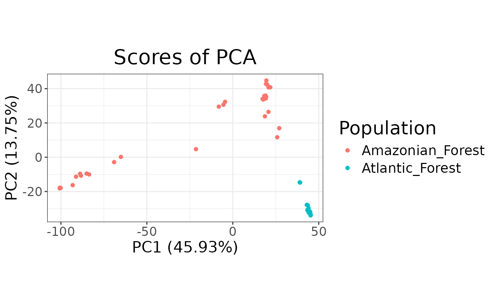

From the PCA plot we can see that the Amazonian forest and Atlantic
forest populations separate quite clearly. Additionally, whilst the
Atlantic forest individuals cluster tightly together the Amazonian
forest individuals are quite spread indicating three major clusters in
the anolis.

### Running gt_radmix()

Now we can run
[`gt_radmix()`](https://evolecolgroup.github.io/tidygenclust/reference/gt_radmix.md)
on our `gen_tibble` object. Note that, unlike the PCA,
[`gt_radmix()`](https://evolecolgroup.github.io/tidygenclust/reference/gt_radmix.md)
does not need imputed data: missing genotypes are simply ignored when
computing the likelihood (imputed genotypes are treated as missing,
unless we set `use_imputed = TRUE`).

As a minimum
[`gt_radmix()`](https://evolecolgroup.github.io/tidygenclust/reference/gt_radmix.md)
requires you to supply your input data, in this case a `gen_tibble`, and
specify a value for the number of clusters K. Based on our PCA results K
= 3 may be a good place to start:

``` r

anole_res <- anole_gt %>% gt_radmix(k = 3)
```

This will very quickly return a single Q matrix, for one specified K
value. But, most likely we want to explore multiple values for K and
should run multiple repeats of each K to assess the stability of the
clustering.
[`gt_radmix()`](https://evolecolgroup.github.io/tidygenclust/reference/gt_radmix.md)
allows you to specify a vector of K values you wish to run and the
number of repeats per K value.

Since we are trying multiple values for K, we can also choose to compute
the cross-validation error, as in ADMIXTURE, to help identify the most
appropriate value of K for our dataset.

For our multiple repeat runs it is also important that for each repeat
we specify a different seed number to ensure consistent and robust
results.

Let’s now set values of K from 2 to 4 and run 3 repeats of each K value,
setting a different random seed for each repeat. We turn on 5-fold
cross-validation with `crossval = TRUE`:

``` r

anole_res <- anole_gt %>% gt_radmix(
  k = c(2:4), n_runs = 3,
  seed = c(42, 2, 16),
  crossval = TRUE
)
```

Our results are returned as a `gt_admix` object which neatly packages
the Q matrices, the P matrices (containing ancestral allele
frequencies), the corresponding K value for each run, the
log-likelihoods and the cross-validation errors in a structured list.

We can get a summary of our `gt_admix` results object to see exactly
what it contains:

``` r

anole_res %>% summary()
```

    ## Admixture results for multiple runs:       
    ## k 2 3 4
    ## n 3 3 3
    ## with slots:
    ## $Q for Q matrices
    ## $P for  matrices
    ## $log for logs from the algorithm
    ## $cv for cross validation error

From the summary we can see our `gt_admix` object contains Q and P
matrices for 3 repeat runs of K values 2, 3 and 4 as expected.

We may want to inspect a specific Q or P matrix in our `gt_admix` object
and this can be done using the `get_q_matrix` or `get_p_matrix`
functions, we simply need to specify the K value and the repeat run
number we are interested in.

For example we can view the Q matrix corresponding to the second run of
K = 4 like so:

``` r

anole_res %>%
  get_q_matrix(k = 4, run = 2) %>%
  head()
```

    ##            .Q1     .Q2       .Q3     .Q4
    ## [1,] 0.0000100 0.99997 0.0000100 0.00001
    ## [2,] 0.0000100 0.99997 0.0000100 0.00001
    ## [3,] 0.6706262 0.00001 0.3293538 0.00001
    ## [4,] 0.0000100 0.00001 0.9999700 0.00001
    ## [5,] 0.7260964 0.00001 0.2738836 0.00001
    ## [6,] 0.0000100 0.00001 0.0000100 0.99997

Or the P matrix of the first run of K = 3:

``` r

anole_res %>%
  get_p_matrix(k = 3, run = 1) %>%
  head()
```

    ##                    .P1   .P2       .P3
    ## locus_137_2  0.0000100 1e-05 0.3920996
    ## locus_137_13 0.8360442 1e-05 0.1676845
    ## locus_137_16 0.8407303 1e-05 0.0000100
    ## locus_203_57 0.4998483 1e-05 0.1834460
    ## locus_346_34 0.0000100 1e-05 0.3321086
    ## locus_346_37 0.9999900 1e-05 0.2612285

We can now compare the cross-validation errors for our range of K values
2-4, stored in the `cv` element of our `gt_admix` object, to help
identify the most appropriate value of K for our dataset:

``` r

anole_res %>% autoplot(type = "cv")
```

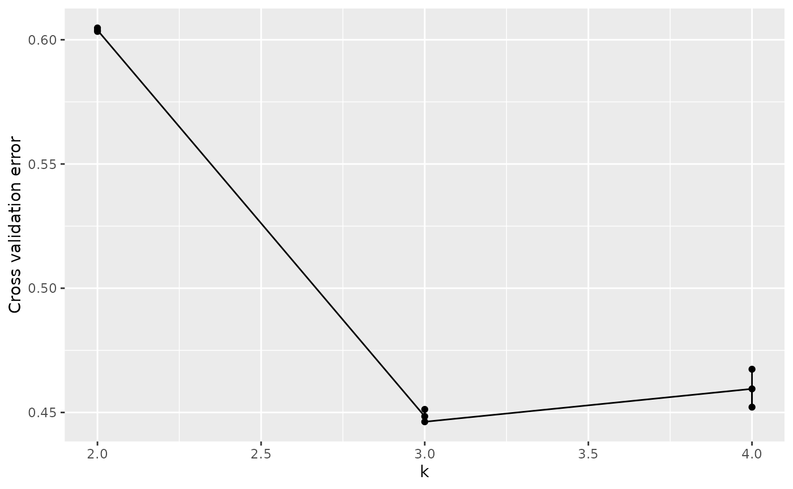

We are looking for the ‘elbow’ point in the plot where the
cross-validation error is at its lowest, here it looks like `k = 3`
would be a sensible choice.

For a comparison of
[`gt_radmix()`](https://evolecolgroup.github.io/tidygenclust/reference/gt_radmix.md)
with the original ADMIXTURE program, with fastmixture and with
ADAMIXTURE, see the article “Benchmarking gt_radmix() against ADMIXTURE,
fastmixture and ADAMIXTURE” (in the Articles section of the website of
the package).

[`gt_radmix()`](https://evolecolgroup.github.io/tidygenclust/reference/gt_radmix.md)
implements the method and the algorithm of ADMIXTURE: when using it,
make sure that you cite the original ADMIXTURE paper (Alexander et
al. 2009) and, if you use cross-validation, Alexander and Lange (2011).

### Visualising the results

For a quick visualisation of a single Q matrix we can use the autoplot
function in `tidypopgen`:

``` r

anole_res %>% autoplot(type = "barplot", k = 3, run = 1)
```

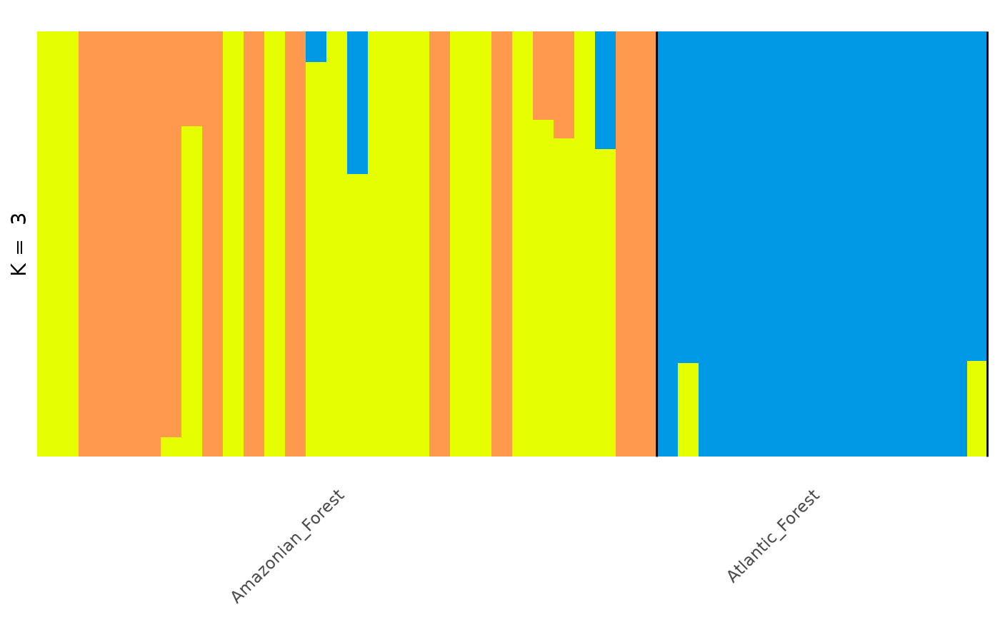

It is possible to rearrange individual within groups according to their
ancestral components. This makes for a visually appealing plots that
focuses on the main ancestral component within each plot, but makes
multiple plots not comparable (as individuals will not be in the same
order across plots):

``` r

anole_res %>% autoplot(
  type = "barplot", k = 3, run = 1,
  reorder_within_groups = TRUE
)
```

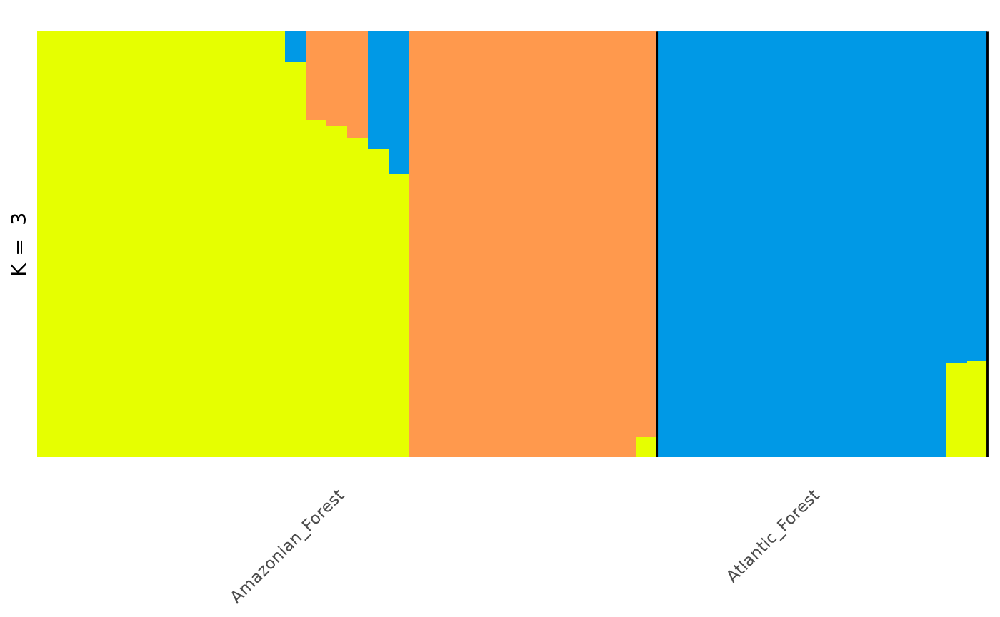

Note that the colours assigned to each component are arbitrary and may
change if we reorder individuals. If you want complete control of your
plot, you can create your own customised plot with `ggplot2`; we can use
[`tidy()`](https://generics.r-lib.org/reference/tidy.html) to easily
extract the required information from a `gt_admix` object to use for the
plot:

``` r

anole_q_tbl <- anole_res %>%
  get_q_matrix(k = 3, run = 1) %>%
  tidy(data = anole_gt)
anole_q_tbl
```

    ## # A tibble: 138 × 4
    ##    id         group            q     percentage
    ##    <chr>      <chr>            <chr>      <dbl>
    ##  1 punc_BM288 Amazonian_Forest .Q1      0.00001
    ##  2 punc_BM288 Amazonian_Forest .Q2      0.00001
    ##  3 punc_BM288 Amazonian_Forest .Q3      1.000  
    ##  4 punc_GN71  Amazonian_Forest .Q1      0.00001
    ##  5 punc_GN71  Amazonian_Forest .Q2      0.00001
    ##  6 punc_GN71  Amazonian_Forest .Q3      1.000  
    ##  7 punc_H1907 Amazonian_Forest .Q1      1.000  
    ##  8 punc_H1907 Amazonian_Forest .Q2      0.00001
    ##  9 punc_H1907 Amazonian_Forest .Q3      0.00001
    ## 10 punc_H1911 Amazonian_Forest .Q1      1.000  
    ## # ℹ 128 more rows

In the Prates et al 2018 study, the anolis lizards were found to split
into three genetic groups, two in the Amazonian forest; the Eastern
Amazonia (Eam) and Western Amazonia (Wam) and one in the Atlantic Forest
(AF).

If we wanted to change the grouping variable of our plot to match these
groups we can use the `gt_admix_reorder_q` function which will reorder
the Q matrix by a chosen grouping variable. Our metadata contains this
new grouping information in the column `pop`:

``` r

anole_gt_admix <- anole_res %>% gt_admix_reorder_q(group = anole_gt$pop)
```

We can then visualise our results again with this new grouping:

``` r

anole_gt_admix %>% autoplot(
  type = "barplot", k = 3, run = 1,
  reorder_within_groups = TRUE
)
```

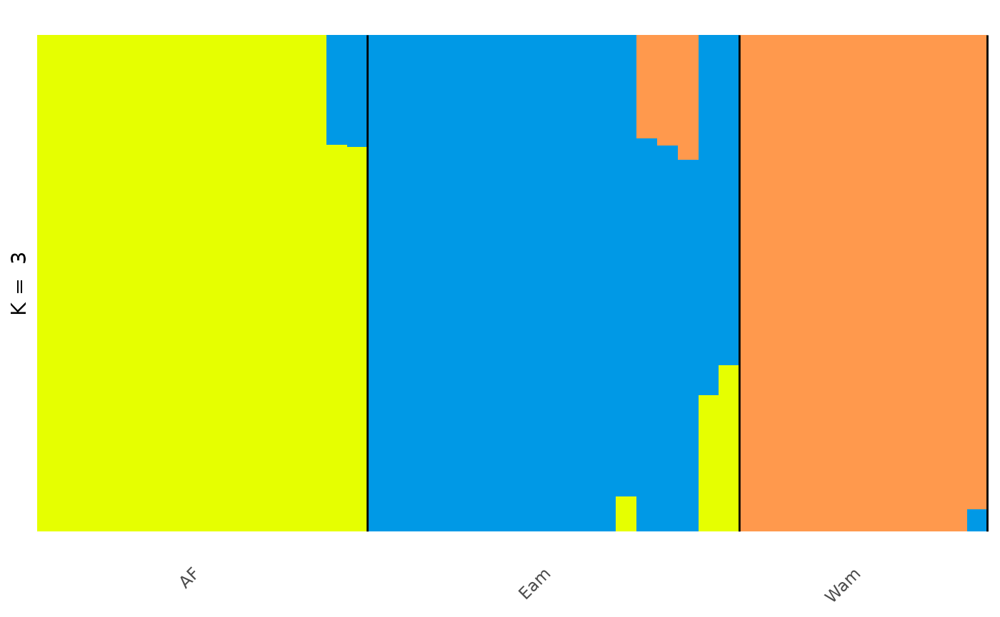

### Visualisations with `gt_clumppling`

Whilst this gives us a useful, quick visual to check one particular Q
matrix, ideally we want to be able to compare the different K values we
tried in our clustering analyses and to assess the stability of the
multiple repeat runs. For proper comparative visualisation and
assessment of the different K values and repeats we can use the
`gt_clumppling` function which aligns multiple clustering results within
and between different values of K and allows for easy visualisation in
multipartite plots.

[`gt_clumppling()`](https://evolecolgroup.github.io/tidygenclust/reference/gt_clumppling.md)
works on `gt_admix` objects, irrespective of the algorithm used to
create them. Results of clustering programs run outside of R can be read
into a `gt_admix` object with
[`tidypopgen::read_q_files()`](https://evolecolgroup.github.io/tidypopgen/reference/read_q_files.html).

Once we use `gt_clumppling`, the resulting plots will only show
individuals in the order in which they were found in the `gt_admix`
object. This means that, if they were not ordered into groups, we will
not be able to annotate groups. One solution would be to arrange our
original gen_tibble by group before starting the analysis, but we can
also use `gt_admix_reorder_q` to reorder the individuals in the groups
which we have done in the previous step.

Now let’s run the `Clumppling` analysis on our `gt_admix` object (as
community detection is stochastic, we set a seed to make the results
reproducible):

``` r

anole_clump <- anole_gt_admix %>% gt_clumppling(seed = 1)
```

Now we can visualise the aligned Q matrices for each value of K we
tried:

``` r

anole_clump %>% autoplot(type = "all_modes", group = anole_gt_admix$group)
```

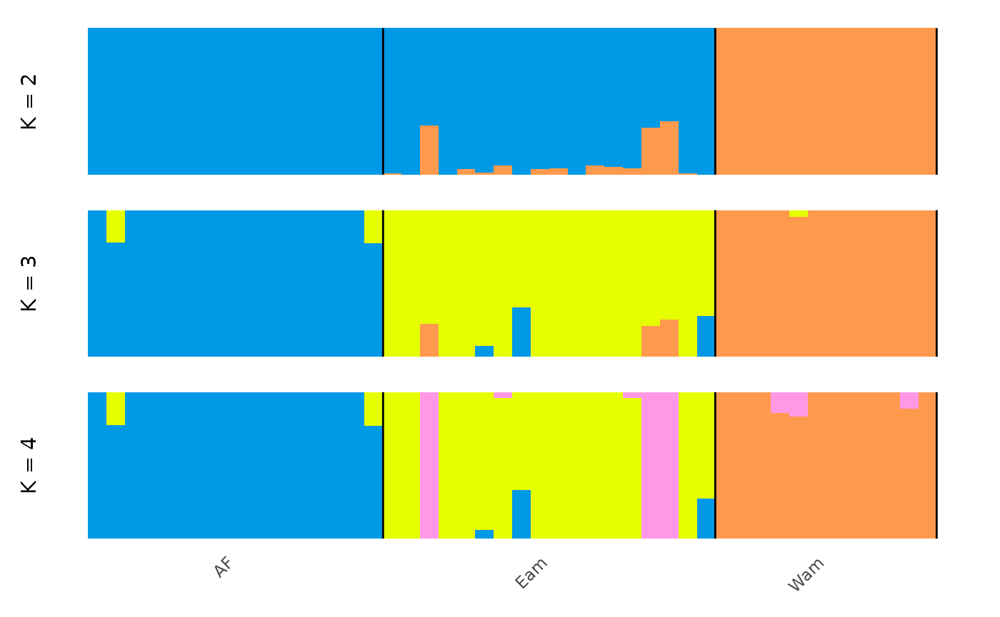

We can see that for the anolis dataset there is only one mode for each
value of K. For a more complex example, where multiple modes are found
in runs of the same K, we can explore a dataset investigating the the
ancestry of Cape Verde individuals, the same example used in the
`Clumppling` manual.

The results of 200 ADMIXTURE runs (50 runs for each K from 2 to 5) are
stored in the package as a `gt_admix` object:

``` r

capeverde_admix <- readRDS(
  system.file("extdata", "capeverde_admix.rds", package = "tidygenclust")
)
capeverde_admix %>% summary()
```

    ## Admixture results for multiple runs:             
    ## k  2  3  4  5
    ## n 50 50 50 50
    ## with slots:
    ## $Q for Q matrices

and we can align them with:

``` r

clump_res <- capeverde_admix %>% gt_clumppling(seed = 1)
```

The statistics of each mode (the number of runs that it includes, and
the average cost and similarity of the alignment between pairs of runs)
are stored in `mode_stats`:

``` r

clump_res$mode_stats
```

    ##   Mode Representative Size         Cost Performance
    ## 1 K2M1       39_K2R39   50 8.043783e-14   0.9999998
    ## 2 K3M1       65_K3R15   50 3.067899e-09   0.9999592
    ## 3 K4M1      112_K4R12   39 7.341008e-04   0.9788892
    ## 4 K4M2      138_K4R38   11 4.944349e-02   0.7918295
    ## 5 K5M1      192_K5R42   18 5.074185e-02   0.7939366
    ## 6 K5M2      167_K5R17   18 3.704965e-02   0.8188414
    ## 7 K5M3      160_K5R10   14 2.550706e-02   0.8478811

Once we have a `gt_clumppling` results object, we can use `autoplot` to
make a number of default plots.

We can plot the modes for all values of k with:

``` r

clump_res %>% autoplot(type = "all_modes")
```

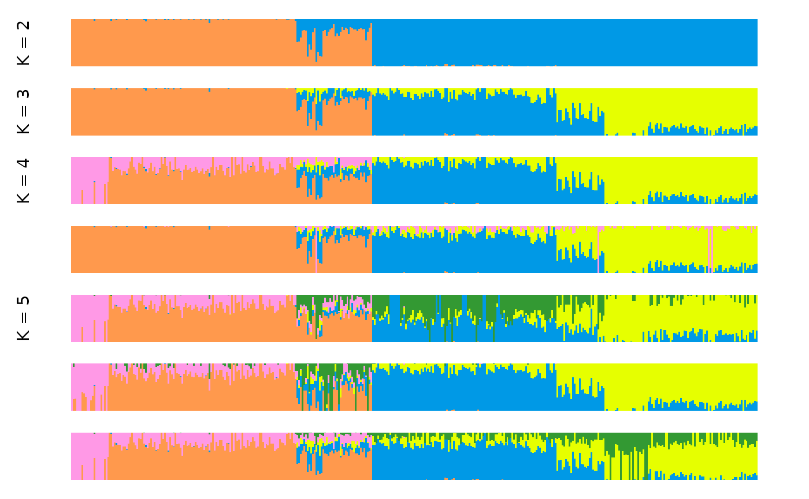

It is often informative to overlay information on the population from
which each individual was sampled. This can be done by providing a
vector of population labels for each individual. In the case of the Cape
Verde dataset, the populations are stored in the `group` element of the
`gt_admix` object (and in the `capeverde_pops` dataset):

``` r

capeverde_admix$group %>% table()
```

    ## .
    ##      British Cape Verdean       French      Gambian      Iberian     Mandenka 
    ##           89           44           28          109          107           22

We can now add it to our plots with the `group` argument:

``` r

clump_res %>% autoplot(type = "all_modes", group = capeverde_admix$group)
```

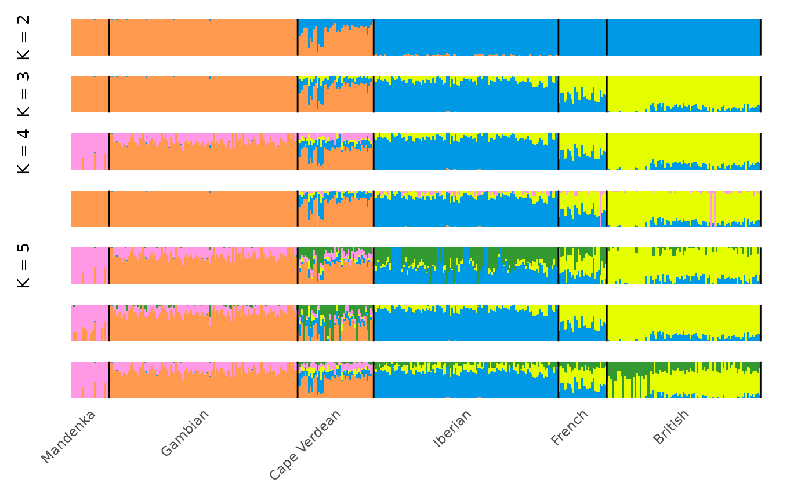

And subset our visualisation to only the major modes with:

``` r

clump_res %>% autoplot(type = "major_modes", group = capeverde_admix$group)
```

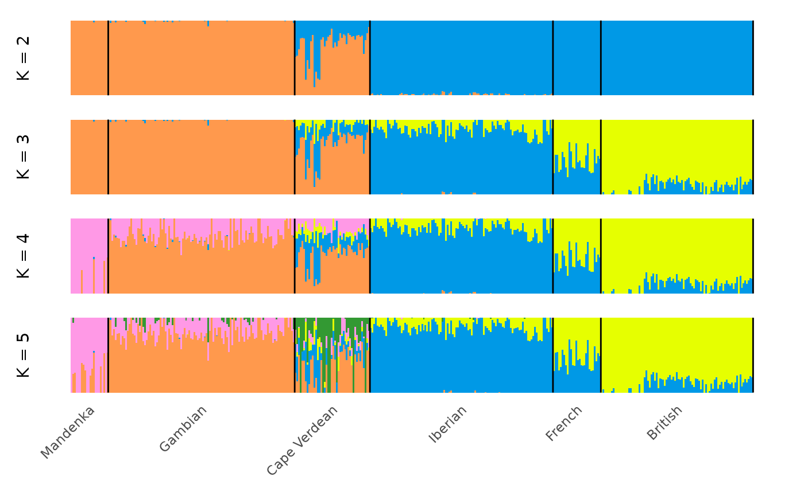

The modes of a specific k value can be plotted with:

``` r

clump_res %>% autoplot(
  type = "modes_within_k", k = 4,
  group = capeverde_admix$group
)
```

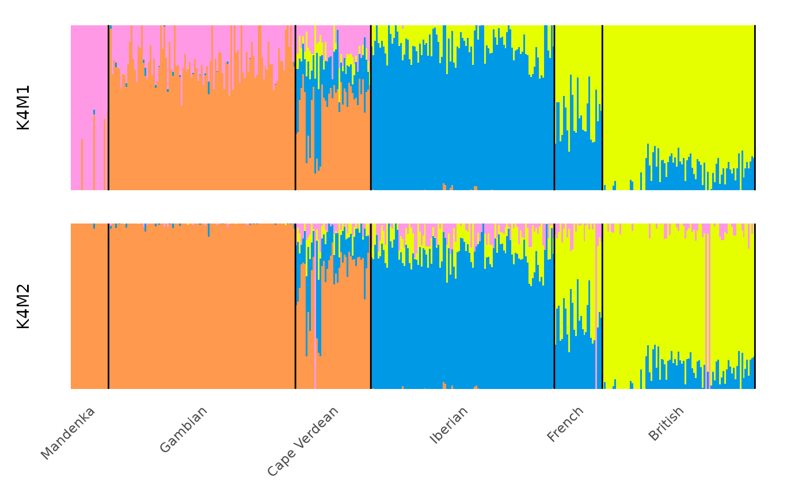

We can also visualise the relationship among modes by plotting over a
multipartite graph, where better alignment between the modes is
indicated by the darker color of the edges connecting their structure
plots (edges are coloured by the cost of the optimal alignment, as shown
by the legend):

``` r

clump_res %>% autoplot(type = "modes", group = capeverde_admix$group)
```

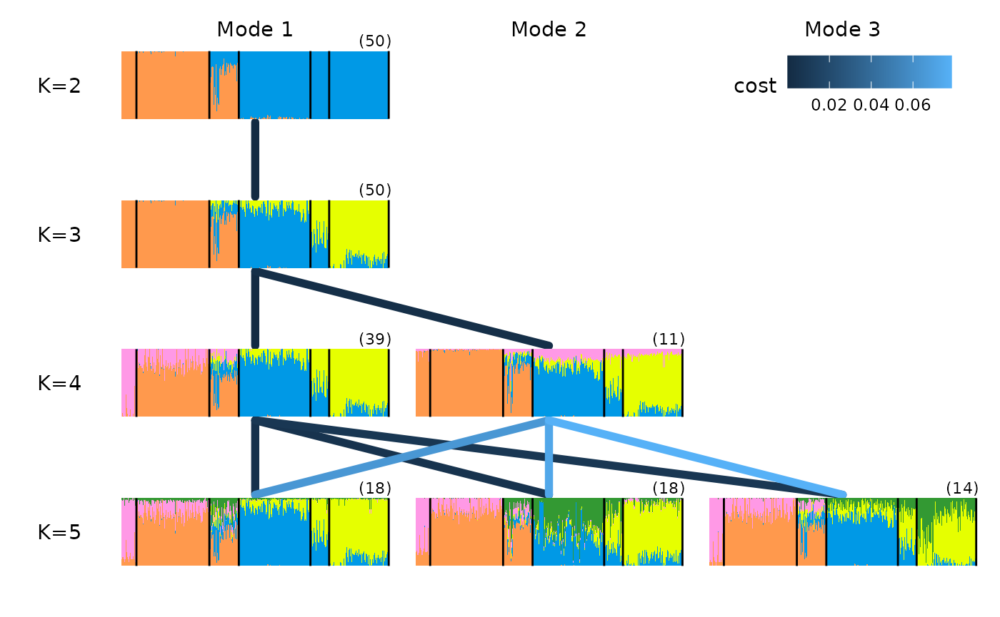

`gt_clumppling` can also deal with very large K values and gaps in the K
values explored.

For example, we can use the ‘chicken_gapK’ data example also from
`Clumppling`, with the results of 60 STRUCTURE runs for K = 17, 19 and
21 (STRUCTURE rounds memberships to three decimals, so they have been
rescaled to sum to one, as
[`gt_clumppling()`](https://evolecolgroup.github.io/tidygenclust/reference/gt_clumppling.md)
requires):

``` r

chicken_admix <- readRDS(
  system.file("extdata", "chicken_admix.rds", package = "tidygenclust")
)
chicken_res <- chicken_admix %>% gt_clumppling(seed = 1)
```

We can plot the membership plots on top of the multipartite plot with:

``` r

chicken_res %>% autoplot()
```

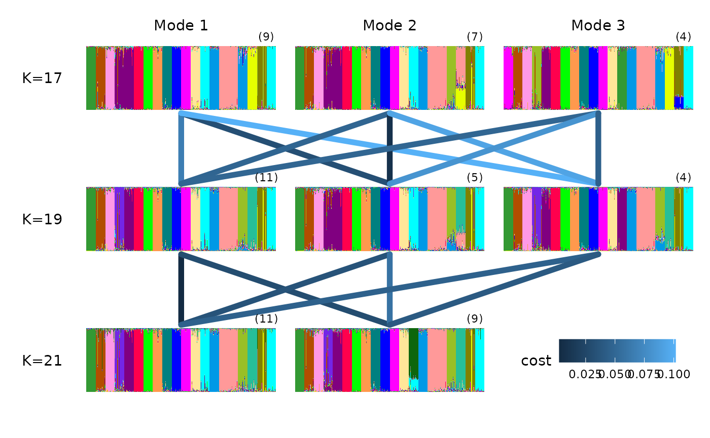

[`gt_clumppling()`](https://evolecolgroup.github.io/tidygenclust/reference/gt_clumppling.md)
is ported, with modifications, from the python package clumppling: when
using it, make sure that you cite the original paper on the algorithm
(Liu, Kopelman, & Rosenberg, 2024).

### Making custom plots with `ggplot2`

If we want to customise the default plots, we can use
[`tidy()`](https://generics.r-lib.org/reference/tidy.html) to easily
extract the required information from a `gt_clumppling` object.

To get all the modes for each k, we use:

``` r

clump_res %>% tidy(matrix = "modes")
```

    ## # A tibble: 7 × 3
    ##       k     m label
    ##   <dbl> <dbl> <chr>
    ## 1     2     1 K2M1 
    ## 2     3     1 K3M1 
    ## 3     4     1 K4M1 
    ## 4     4     2 K4M2 
    ## 5     5     1 K5M1 
    ## 6     5     2 K5M2 
    ## 7     5     3 K5M3

The major modes can be obtained simply with:

``` r

clump_res %>% tidy(matrix = "major_modes")
```

    ## # A tibble: 4 × 3
    ##       k     m label
    ##   <dbl> <dbl> <chr>
    ## 1     2     1 K2M1 
    ## 2     3     1 K3M1 
    ## 3     4     1 K4M1 
    ## 4     5     1 K5M1

To create custom plots, we can also extract the Q matrices for modes,
with their clusters aligned, by typing:

``` r

q_modes <- clump_res %>% tidy(matrix = "Q_modes")
```

`q_modes` is a list of tibbles, one per mode:

``` r

q_modes %>% names()
```

    ## [1] "K2M1" "K3M1" "K4M1" "K4M2" "K5M1" "K5M2" "K5M3"

If we only want the major modes, we can simply use:

``` r

q_major_modes <- clump_res %>% tidy(matrix = "Q_major_modes")
q_major_modes %>% names()
```

    ## [1] "K2M1" "K3M1" "K4M1" "K5M1"

Let us inspect one of the tidied modes:

``` r

q4_tidied <- q_major_modes[["K4M1"]]
q4_tidied %>% head()
```

    ## # A tibble: 6 × 3
    ##      id q     percentage
    ##   <int> <chr>      <dbl>
    ## 1     1 1      0.0000100
    ## 2     1 2      0.0000100
    ## 3     1 3      0.0000100
    ## 4     1 4      1.000    
    ## 5     2 1      0.0000100
    ## 6     2 2      0.0000100

We can now create a simple plot of this mode with:

``` r

library(ggplot2)
# set up the ggplot object
plt <- q4_tidied %>% ggplot(
  aes(
    x = id,
    y = percentage,
    fill = q
  )
) +
  # add the columns based on percentage membership to each cluster
  geom_col(
    width = 1,
    position = position_stack(reverse = TRUE)
  ) +
  # set the y label
  labs(y = "K = 4") +
  # use a theme to match the distruct look, removing most decorations
  theme_distruct() +
  # set the colour scale to be the same as in distruct and clumppling
  scale_fill_distruct()

plt
```

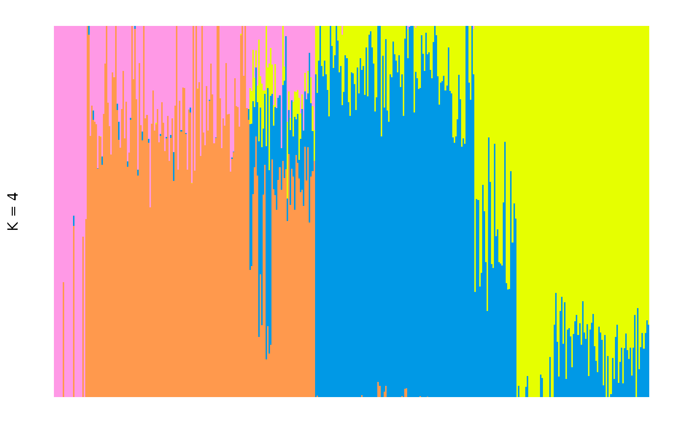

We used a preset theme and colour scale, but you could use any custom
option you prefer by using standard `ggplot2` theme and scale_fill
options. For example:

``` r

plt + scale_fill_viridis_d(guide = "none")
```

    ## Scale for fill is already present.
    ## Adding another scale for fill, which will replace the existing scale.

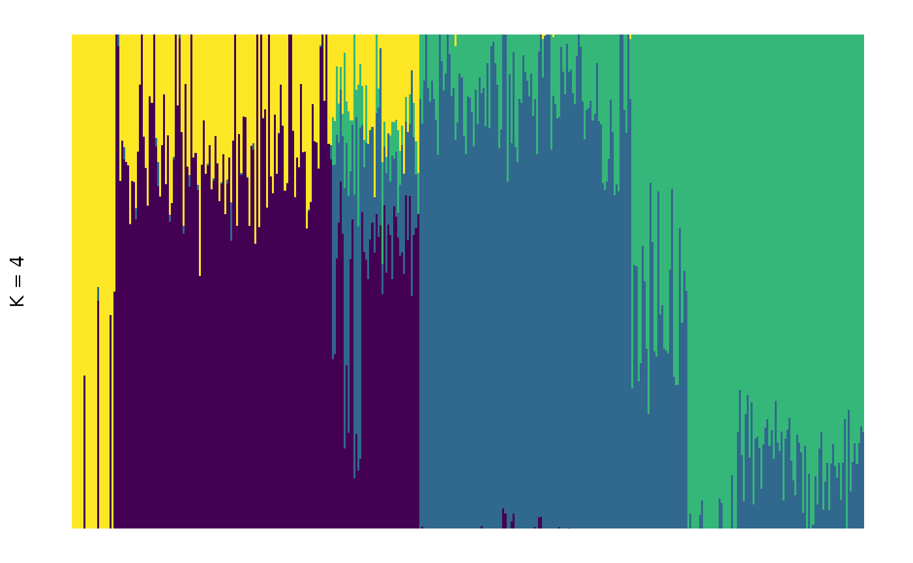

## References

Alexander DH, Novembre J, Lange K (2009) Fast model-based estimation of
ancestry in unrelated individuals. Genome Research, 19(9), 1655-1664.

Alexander DH, Lange K (2011) Enhancements to the ADMIXTURE algorithm for
individual ancestry estimation. BMC Bioinformatics, 12, 246.

Liu X, Kopelman NM, Rosenberg NA (2024) Clumppling: cluster matching and
permutation program with integer linear programming. Bioinformatics,
40(1), btad751.

Prates I, Penna A, Rodrigues MT, Carnaval AC (2018) Local adaptation in
mainland anole lizards: Integrating population history and
genome-environment associations. Ecology and Evolution, 8(23),
11932-11944.

Saurina-i-Ricos J, Mas Montserrat D, Ioannidis AG (2026) ADAMIXTURE:
adaptive first-order optimization for biobank-scale genetic clustering.
Bioinformatics, 42(Supplement_1), btag236.

Santander CG, Refoyo Martinez A, Meisner J (2024) Faster model-based
estimation of ancestry proportions. Peer Community Journal, 4: e115.
<https://doi.org/10.24072/pcjournal.503>
