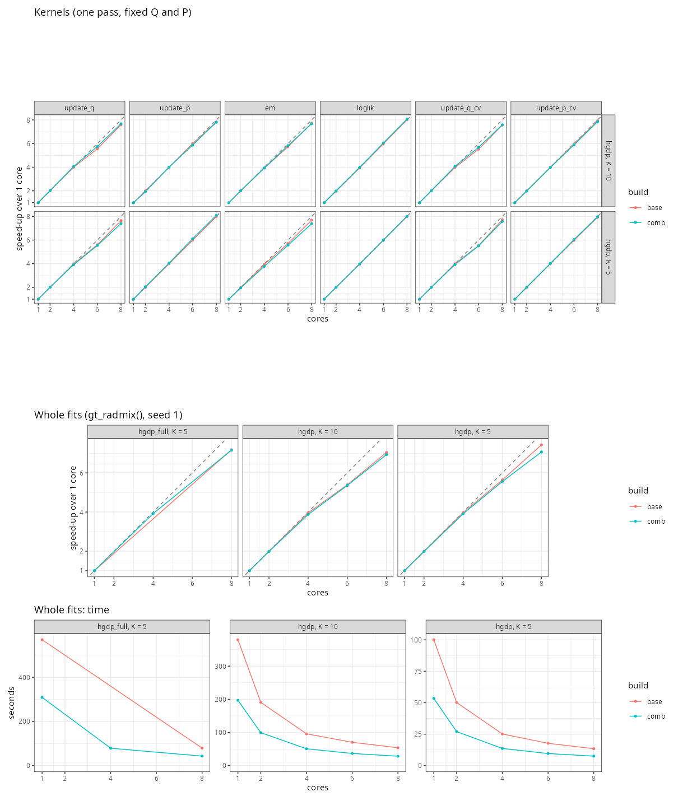

# gt_radmix() speed-ups: verification on the desktop

Run on 2026-11-02 on the branch `radmix-perf-verify`, following sections 4-7
of `../HANDOVER.md`. Builds: `base` = `svd-start` (7baa46c), `comb` =
`kernel-speedups` (017e176), the patches of `../patches/` on `base`, and the
flag variants, all made with `build_variants.sh`. In `laptop_results/`,
"hgdp" is the quick subset (`hgdp_quick` here); "hgdp" here is the full
1043 x 130,943 set, "hgdp_full" the unpruned 1043 x 642,794 set.

## Summary

- **Correctness (V1).** Test suite: 3652 expectations passed, 0 failed, on
  `base`, `comb` and `comb_nomv`. R CMD check of `kernel-speedups`: Status OK.
  No bugs found, so no fix branch.
- **Experiments alone (V2).** dec, mv and pairs hold. div gains more here
  (0.86-0.87 of base's fit time, laptop 0.94-0.98). hexp, rejected on the
  laptop (1.01-1.06), is faster here (0.87-0.97). On update_p, though, it
  runs the same instructions as base in 10% fewer cycles: a code-layout
  effect, not the change itself.
- **Flags (V3).** Same picture as on the laptop. `-march=native` on top of
  the combination (`comb_native`) is a further 11-16% faster than `comb`,
  most of it in loglik.
- **Combination (V4).**
  - Fits take 0.57-0.60 of base's time on 1 core (laptop 0.61-0.63) and
    0.56-0.63 on 4 and 8 cores. Without multiversioning: 0.73-0.81.
  - CV: 0.62.
  - rtol 1e-8 with `comb`: 0.59-0.70 of base at 1e-7 (laptop 0.65-0.74).
  - The rtol table of handover 2.2 reproduces: same iterations, same
    log-likelihood gaps, same Q differences.
- **Laptop vs desktop.** Fits match: same iterations, and log-likelihoods
  equal in all 15 digits the CSVs keep, for base, comb and comb_nomv, at
  1e-7 and 1e-8.
- **Scaling (V5), 1 to 8 P-cores.**
  - Kernels: 7.4-8.1x on 8 cores.
  - Whole fits: 6.9-7.4x. comb takes 0.52-0.56 of base's time at every core
    count.
  - Results are bit-identical across core counts and bindings.
  - No loss of clock or IPC at 8 threads. The losses come from the Q-side
    task granularity (34 tasks) and 1-2% of serial work per fit.
- **SVD start at scale (V6)**, full HGDP, 8 P-cores, `comb`:
  - Speed-up of a first run over a random start: 1.0x (K = 3), 1.5x (K = 5),
    2.3x (K = 7), 2.4x (K = 10). Further runs, which share the SVD: 1.7-2.8x.
  - All SVD runs end at the best mode.
  - Random starts at K = 10 put 2 of 5 runs in modes 68,000 and 118,000
    log-likelihood units below the best.
  - The HGDP-quick K = 7 problem does not appear at full size.
  - On 1 core the laptop's result reproduces exactly (3.0x here, 2.7x
    there).
  - BLAS threads do not help the start's ALS, and the default OpenBLAS
    (24 threads) doubles its time at K = 10.
- **ADAMIXTURE (V7)**: not run (see V7).

## Machine

| | laptop | desktop |
|---|---|---|
| CPU | i7-10510U, 4 cores, 15 W | i9-13900, 8 P-cores (CPUs 0-7, up to 5.3/5.6 GHz) + 16 E-cores (CPUs 8-23, 4.2 GHz) |
| SMT | on | off (24 logical = 24 physical) |
| SIMD | AVX2, FMA | AVX2, FMA, AVX-VNNI; no AVX-512 |
| caches, NUMA | | L2 32 MB, L3 36 MB; 1 NUMA node |
| memory | | 125 GiB |
| R, GCC | 4.6.1, 13.3 | 4.5.2, 13.3 |
| BLAS | OpenBLAS 0.3.26 | OpenBLAS 0.3.26 (pthread; 24 threads by default) |
| tidypopgen | 0.4.4.9008 | 0.4.4.9009 (dev, 27b8b8b) |
| settings | throttles with 4 busy cores | governor powersave (intel_pstate HWP), turbo on, perf_event_paranoid 1; not changed |

Per core the desktop is about 2x the laptop (base, EUR K = 3: 10.0 s against
19.8 s). Details in `machine.txt`.

## Deviations from the protocol

- **Core counts.** At most 8 cores, as the user asked: the 8 P-cores.
  `final_compare.sh` ran with NCORES "4 8". The scaling runs used 1, 2, 4, 6
  and 8 cores. The E-cores, the 24 logical CPUs, SMT (off) and NUMA (one
  node) were not tested.
- **Pinning.**
  - 1-core runs: pinned to CPU 2 (`PIN=2`).
  - Multi-core runs: confined to the P-cores with `taskset -c 0-7`
    (`PIN_MULTI`, a small addition to `final_compare.sh`).
  - Scaling: bound (`OMP_PROC_BIND=close OMP_PLACES=cores`, threads on CPUs
    0..n-1) and unbound.
  - Without confinement, OpenMP threads drift onto the E-cores.
- **Background load.** Zoom (0.5-1.1 cores) ran during part of the day.
  Noise was checked with repeats: below 1% on 1 core, up to 2.4% on several
  cores (two short runs 5-14%). All the effects reported are larger.
- **Phase F threads.** Under `taskset -c 0-7` OpenBLAS used 8 threads.
  `F_svd_1core` used `OPENBLAS_NUM_THREADS=4`, as on the laptop.
- **Scaling rerun.** The bound HGDP kernels were run a second time
  (`E_scaling_rerun`); see "Unexpected".
- **New scripts** (`../scripts/`): `plot_scaling.R`, `rtol_summary.R`,
  `kernel_loop.R` (for perf stat) and `svd_blas_threads.R` (V6, BLAS
  threads).

## V1. Correctness

| | laptop | desktop |
|---|---|---|
| tests, base / comb / comb_nomv | 3586 expectations, 0 failures | 3652 passed, 0 failed on each |
| skipped | (tests needing conda tools) | `test_gt_adamixture.R` only (ADAMIXTURE not installed) |
| R CMD check of `kernel-speedups` | 1 NOTE (hidden `.git`, from the worktree) | Status OK |

The 66 extra expectations were not investigated. They may be tests that
need conda tools, which run here; only the ADAMIXTURE file was skipped.
Files: `A_tests/`.

## V2. Each experiment alone (1 core, CPU 2)

Fit time as a fraction of base's (EUR K = 3 / EUR K = 4 / HGDP quick K = 5 /
K = 7), seed 1, medians of 3:

| experiment | laptop | desktop | outputs (desktop) |
|---|---|---|---|
| div | 0.94-0.98 | 0.86 / 0.86 / 0.87 / 0.87 | rounding (Q <= 1.1e-12) |
| dec | 0.86 / 0.89 / 0.92 / 0.95 | 0.89 / 0.91 / 0.90 / 0.89 | bit-identical |
| pairs | 0.92 / 0.94 / 0.86 / 0.86 | 0.95 / 0.91 / 0.89 / 0.83 | rounding (Q <= 5.6e-12) |
| mv | 0.83 / 0.86 / 0.75 / 0.71 | 0.83 / 0.79 / 0.75 / 0.70 | rounding (Q <= 4.9e-12) |
| hexp (rejected) | 1.01-1.06 | 0.97 / 0.94 / 0.92 / 0.87 | rounding (Q <= 1.0e-11) |

Kernels, desktop, range over EUR 4, HGDP quick 5 and 10 (update_q /
update_p / em / loglik):
- div: 0.87-0.96 / 0.76-0.84 / 0.98-1.00 / 0.95-1.00
- dec: 0.92-0.97 / 0.83-0.88 / 0.91-1.02 / 0.91-0.96
- pairs: 0.76-0.90 / 0.81-0.86 / 1.04-1.09 / 1.07-1.09
- mv: 0.66-0.79 / 0.67-0.73 / 0.85-0.94 / 1.00-1.01
- hexp: 0.84-0.97 / 0.85-0.89 / 0.94-1.00 / 0.96-1.00

Conclusion:
- The four adopted experiments help on both CPUs, by similar amounts. div
  helps more here.
- hexp reverses sign, but at least part of its gain is code layout (see
  "Unexpected"), so the laptop's rejection still stands on the evidence.
- pairs makes em and loglik 4-9% slower when applied alone. In the
  combination those kernels are still faster than base (V3).

Files: `B_experiments/`.

## V3. Compiler flags and multiversioning (1 core)

Kernels: range over EUR 4, HGDP quick 5, 10, as a fraction of base's time.
Fits: EUR 3 / EUR 4 / HGDP quick 5 / 7.

| build | update_q (laptop / desktop) | update_p | em | loglik | fits, desktop | outputs |
|---|---|---|---|---|---|---|
| f_o3 | 0.90-0.96 / 0.95-0.97 | 0.93-0.94 / 0.90-0.97 | 1.01-1.11 / 0.96-0.97 | 0.90-0.94 / 1.00-1.04 | 0.95 / 0.95 / 0.96 / 0.95 | bit-identical |
| f_avx2fma | 0.66-0.72 / 0.61-0.76 | 0.67-0.73 / 0.64-0.72 | 0.76-0.84 / 0.73-0.86 | 0.76-0.79 / 0.70-0.82 | 0.82 / 0.76 / 0.73 / 0.67 | rounding |
| f_native | 0.61-0.64 / 0.58-0.71 | 0.63-0.69 / 0.60-0.66 | 0.63-0.67 / 0.66-0.77 | 0.76-0.79 / 0.63-0.73 | 0.73 / 0.69 / 0.66 / 0.59 | rounding |
| comb | 0.56-0.58 / 0.45-0.53 | 0.58-0.65 / 0.53-0.59 | 0.74-0.84 / 0.70-0.73 | 0.92-1.02 / 0.86-0.89 | 0.61 / 0.59 / 0.57 / 0.56 | rounding (Q <= 5.2e-12) |
| comb_o3 | - / 0.46-0.51 | - / 0.52-0.56 | - / 0.68-0.72 | - / 0.82-0.85 | 0.60 / 0.57 / 0.56 / 0.54 | identical to comb |
| comb_native | - / 0.43-0.48 | - / 0.50-0.53 | - / 0.61-0.66 | - / 0.59-0.64 | 0.52 / 0.51 / 0.51 / 0.47 | rounding |

(The laptop's comb column is from `laptop_results/final`. comb_o3 and
comb_native were not built on the laptop.)

Conclusion:
- Multiversioning captures most of what AVX2 gives, but not all.
  `comb_native` takes 0.84-0.89 of `comb`'s fit time.
- The biggest gap is loglik: 0.59-0.64 with `-march=native`, 0.70-0.82 with
  whole-file `-mavx2 -mfma`, 0.86-0.89 in `comb`.
- On both machines loglik is faster when the whole file is compiled for
  AVX2. On the laptop it was the multiversioned clone of loglik that was
  slower. So the lead is how loglik is cloned, not AVX2 itself.
- The rest of the gap is in code outside the cloned kernels (QP solves and
  others).
- `-O3` on top of comb: 0.96-0.98 of comb, identical results.
- No AVX-512 on this CPU, so `comb_v4` was not built.

Files: `C_flags/`.

## V4. The combination (`final_compare.sh`)

Fits, seed 1, medians of 3. Seconds for base; fractions of base's time for
comb and comb_nomv:

| case | cores | base (s) | comb, laptop / desktop | comb_nomv, laptop / desktop |
|---|---|---|---|---|
| EUR 3 | 1 | 10.21 | 0.62 / 0.60 | 0.70 / 0.73 |
| EUR 4 | 1 | 14.13 | 0.61 / 0.59 | 0.73 / 0.75 |
| HGDP quick 5 | 1 | 3.34 | 0.63 / 0.57 | 0.76 / 0.75 |
| HGDP quick 7 | 1 | 6.44 | 0.61 / 0.57 | 0.76 / 0.75 |
| EUR 3 | 4 | 2.70 | 0.47 / 0.63 | 0.60 / 0.75 |
| EUR 4 | 4 | 3.74 | 0.65 / 0.61 | 0.72 / 0.75 |
| HGDP quick 5 | 4 | 0.90 | 0.52 / 0.58 | 0.63 / 0.81 |
| HGDP quick 7 | 4 | 1.74 | 0.59 / 0.58 | 0.78 / 0.76 |
| EUR 3 | 8 | 1.60 | - / 0.63 | - / 0.75 |
| EUR 4 | 8 | 2.19 | - / 0.62 | - / 0.77 |
| HGDP quick 5 | 8 | 0.54 | - / 0.56 | - / 0.74 |
| HGDP quick 7 | 8 | 1.04 | - / 0.57 | - / 0.74 |
| HGDP quick 5, CV (5 folds) | 1 | 16.84 | 0.66 / 0.62 | 0.81 / 0.75 |

- Same iterations everywhere. CV errors identical (0.444386058963).
- comb against comb_nomv on this machine: Q up to 2.2e-12, P up to 6.6e-12,
  log-likelihood up to 3.7e-9.
- The laptop's 4-core numbers were affected by throttling. The desktop's
  are steady.
- rtol 1e-8 with comb: 0.70 / 0.62 / 0.65 / 0.59 of base at 1e-7 (laptop
  0.65-0.74). Log-likelihood gain: +2.62 / +0.47 / +0.07 / +0.02, the same
  as on the laptop.

Convergence thresholds (handover 2.2), 1 core, seed 1. Percentages are the
time compared with 1e-7:

| case | threshold | laptop: time, it., below, Q diff | desktop base: time, it., below, Q diff | desktop comb: time |
|---|---|---|---|---|
| EUR 3 | 1e-7 | 21.9 s, 19, 2.7, 0.050 | 10.2 s, 19, 2.70, 0.050 | 6.2 s |
| | 1e-8 | +20%, 23, 0.08, 0.009 | +17%, 23, 0.082, 0.0092 | +16% |
| | abs 1e-4 | +50%, 29 | +43%, 29 | +38% |
| EUR 4 | 1e-7 | 30.9 s, 22, 0.64, 0.026 | 14.1 s, 22, 0.64, 0.026 | 8.3 s |
| | 1e-8 | +9%, 24, 0.17, 0.015 | +7%, 24, 0.17, 0.015 | +6% |
| | abs 1e-4 | +48%, 31 | +32%, 31 | +27% |
| HGDP quick 5 | 1e-7 | 7.1 s, 16, 0.07, 0.0001 | 3.3 s, 16, 0.071, 0.00013 | 1.9 s |
| | 1e-8 | +13%, 18, 0.00 | +10%, 18, 1.2e-5, 1.3e-5 | +13% |
| | abs 1e-4 | +18%, 19 | +13%, 19 | +10% |

("below" = log-likelihood short of the fit at ADMIXTURE's threshold; "Q
diff" = largest difference of Q from that fit.)

Files: `D_final/`, `D_rtol/` (`summary.txt` from `rtol_summary.R`).

## V5. Multi-core scaling (new)

Kernels: one pass each with fixed Q and P, threads bound to the P-cores.
The figure uses the rerun for HGDP and the first run for hgdp_full.

- At 8 cores: update_q 7.4-7.7x, update_p 7.8-8.1x, em 7.4-7.7x, loglik
  8.0-8.1x on HGDP; 7.0-8.0x on hgdp_full.
- Unbound: 6.5-7.6x. For whole fits, unbound and bound times are the same
  at 8 cores (comb K = 5: 7.54 against 7.57 s). The unbound 1-core reference is about 5% faster, because the scheduler puts a
  single thread on CPU 4 or 5 (5.6 GHz against 5.3 GHz).
- `diff_vs_1core` = 0 for every kernel, core count and binding.

Whole fits, seed 1, bound. Seconds, speed-up over 1 core in brackets:

| case | build | 1 | 2 | 4 | 6 | 8 |
|---|---|---|---|---|---|---|
| HGDP K = 5 (20 it.) | base | 100.1 | 50.2 (2.0) | 25.2 (4.0) | 17.8 (5.6) | 13.5 (7.4) |
| | comb | 53.5 | 27.1 (2.0) | 13.7 (3.9) | 9.6 (5.6) | 7.6 (7.1) |
| HGDP K = 10 (35 it.) | base | 379.6 | 190.7 (2.0) | 96.0 (4.0) | 70.4 (5.4) | 53.9 (7.0) |
| | comb | 197.0 | 99.5 (2.0) | 50.8 (3.9) | 36.8 (5.4) | 28.4 (6.9) |
| unpruned HGDP K = 5 (23 it.) | base | 569.8 | | | | 79.4 (7.2) |
| | comb | 309.1 | | 78.9 (3.9) | | 43.2 (7.2) |

- comb takes 0.52-0.56 of base's time at every core count.
- Unbound, 1 / 8 cores: base K = 5 95.7 / 13.2 s, K = 10 360.1 / 52.0 s;
  comb K = 5 50.5 / 7.5 s, K = 10 186.0 / 27.9 s.
- Q, P and log-likelihood are identical (difference 0) across 1, 2, 4, 6
  and 8 cores, bound and unbound (`E_fits*/thread_invariance.txt`).

Why scaling stops short of 8x (`E_diagnostics/`):
- **Not the hardware.** perf stat (comb, HGDP K = 5) shows 5.28 GHz both
  with 1 and with 8 busy P-cores. Instructions per cycle go up slightly from
  1 to 8 threads: update_p 3.25 to 3.39, update_q 3.00 to 3.17, em 3.25 to
  3.35, loglik 3.85 to 4.27. So no frequency drop and no memory contention.
  At 8 cores a pass reads the genotypes (137 MB) at 2-4 GB/s, far below
  what the memory can deliver.
- **Q-side granularity.** 17 blocks of 64 individuals x 2 segments = 34
  tasks (32 full, 2 of 19 individuals), dynamically scheduled. On 8 threads
  the best possible is ~95% efficiency. Measured: update_q 92-96%. The P
  side (one task per 64 loci, ~2000 tasks) reaches 98-101%.
- **Serial work.** The fits lose another 5-10% to the per-iteration serial
  or lightly parallel parts (QP solves, quasi-Newton step, R code) and the
  per-call overhead. Under Amdahl's law the whole-fit speed-ups imply 1-2%
  serial time. The fraction is larger for comb (its kernels are faster, the
  serial part is not), hence 6.9-7.1x for comb against 7.0-7.4x for base.
- **Beyond 8 cores.** Not measured. On this CPU more threads would land on
  the slower E-cores, and the 34 Q-side tasks (`MIN_Q_TASKS` = 32) would
  limit the Q side at 16+ threads. Both are predictions.

Files: `E_scaling/`, `E_scaling_rerun/`, `E_fits/`, `E_fits_unbound/`,
`E_diagnostics/`.

## V6. The SVD start at scale (new)

HGDP 1043 x 130,943, comb, 8 P-cores (8 BLAS threads), rtol 1e-7, seeds 1-5,
medians. "First run" includes the SVD; "further runs" share it (as runs of
one call do). Gap = log-likelihood below the best of any run at that K.

| K | random: time (it.) | SVD: SVD + start + fit (it.) | first run | further runs | random: gaps | SVD: gaps |
|---|---|---|---|---|---|---|
| 3 | 3.6 s (13) | 1.6 + 0.6 + 1.5 s (6) | 3.7 s, 0.97x | 2.1 s, 1.7x | 0-1.41 | 0.006-0.030 |
| 5 | 7.4 s (20) | 1.6 + 1.1 + 2.2 s (6) | 4.8 s, 1.5x | 3.2 s, 2.3x | 0-0.12, one at 10.2 | 0.13-0.14 |
| 7 | 21.3 s (37) | 1.6 + 2.1 + 5.5 s (11) | 9.3 s, 2.3x | 7.7 s, 2.8x | 0-0.83 | 1.5-3.7 |
| 10 | 26.4 s (32) | 1.6 + 3.2 + 6.1 s (8) | 10.9 s, 2.4x | 9.3 s, 2.8x | 3 at 1.9-4.8; 67,600 and 118,000 | 0-0.027 |

- Largest Q difference from the best run:
  - SVD runs: 0.0002-0.004.
  - Random runs: up to 0.007, except the two K = 10 runs in other modes
    (1.0: different clusters).
- One `gt_radmix(k = c(3, 5, 7, 10), seed = 1, init = "svd")` call takes
  25.9 s in total. The four random seed-1 fits take 68.9 s.
- K = 7: at rtol 1e-7 all SVD runs stop 1.5-3.7 below the best, in the same
  mode (11 iterations). This is within the stopping rule: at this size 1e-7
  x |loglik| is ~10 log-likelihood units per iteration. At 1e-8 they reach
  the best (next table). So the HGDP-quick K = 7 problem (SVD runs in a mode
  7,800 below) does not appear at full size.
- The summary's `at_best` (< 0.1) and `modes` columns mislead at this size.
  `at_best` is tighter than the stopping rule (SVD K = 5: 0/5 "at best"
  with gaps of 0.13). `modes` counts distinct rounded log-likelihoods, so
  three random K = 10 runs within 3 units of each other count as three
  modes.
  The gaps above are the better measure.

rtol 1e-8, seeds 1-3, 8 P-cores:

| K | random: time (it.), gaps | SVD: SVD + start + fit (it.), gaps | first / further |
|---|---|---|---|
| 5 | 8.2 s (21), 0-0.10 | 1.6 + 1.2 + 2.6 s (7), 0.03-0.04 | 1.5x / 2.1x |
| 7 | 25.0 s (44), 0.03-0.33 | 1.6 + 2.4 + 6.8 s (13), 0-0.002 | 2.3x / 2.7x |

Against 1e-7 with the same seeds: random +0-1 iterations and +3-10% time;
SVD +1-2 iterations and +14-16% time.

1 core, K = 5, seeds 1-2 (4 BLAS threads, the laptop's command):

| | laptop | desktop |
|---|---|---|
| random | 147 / 190 s (20 / 26 it.) | 55.9 / 68.6 s (20 / 26 it.) |
| SVD: SVD + start + fit | 11.8 + 8.8 + 42.3 s (6) | 2.1 + 3.2 + 15.5 s (6) |
| first run, speed-up | 62.9 s, 2.7x | 20.8 s, 3.0x |
| gaps (random / SVD) | 0.09 / 0.10 | 0.089 / 0.105 (identical) |

BLAS and OpenMP threads (`F_blas/`, `svd_blas_threads.R`). Seconds, with
`n_cores` 1 / 8. `n_cores` does not reach the SVD, so its two columns are
repeats:

| BLAS threads | SVD | start K = 5 | start K = 10 | start K = 10: system time |
|---|---|---|---|---|
| 1 | 3.84 / 3.38 | 2.84 / 0.71 | 9.52 / 2.40 | 0.02 / 0.03 s |
| 2 | 2.70 / 2.48 | 2.91 / 0.94 | 9.93 / 2.87 | 5.9 / 1.7 s |
| 4 | 2.28 / 2.05 | 2.94 / 1.02 | 9.88 / 3.23 | 17.8 / 6.4 s |
| 8 | 1.92 / 1.65 | 2.88 / 1.25 | 9.88 / 3.06 | 41.9 / 10.2 s |
| 24 (default, not confined) | 1.91 / 1.67 | 2.89 / 1.07 | 10.04 / 4.75 | 116 / 61 s |

- The SVD (`gt_pca_partialSVD()`) gains 2.0-2.3x from 8 BLAS threads and
  nothing beyond.
- The start gains 4x from OpenMP (`n_cores` 8) and nothing from BLAS
  threads. With `n_cores` = 8, extra BLAS threads make it slower: up to 2x
  at OpenBLAS's default of 24 threads, with 61 s of system time for a 4.75 s
  step.
- The ALS iterations are the same at every thread count (29+30+32 for
  K = 5, 39+35+34 for K = 10).
- This confirms handover 2.5 on a many-core machine.
- Fixed on a local branch, with one BLAS thread inside
  `radmix_svd_start()`: see "New: the BLAS-thread fix" below.

Files: `F_svd/`, `F_svd_1e8/`, `F_svd_1core/`, `F_blas/`.

## New: the BLAS-thread fix (branch `svd-start-blas-threads`, local)

Added after the report, at the user's request.

**The fix.** Commit 0b812af on `svd-start` (7baa46c); not pushed. A copy
is in `../patches/svd_start_blas_threads.patch`.
- `radmix_svd_start()` sets R's BLAS to one thread while the ALS runs and
  restores it on exit (`RhpcBLASctl`).
- RhpcBLASctl is a new entry in Imports but not a new install: tidypopgen
  already needs it through bigparallelr.
- The SVD itself is unchanged and keeps the BLAS's threads.

**Test.** A new test checks that the ALS sees one BLAS thread and that the
count is restored afterwards. It fails on `base` (the ALS sees 2 threads)
and passes on the fix. It is skipped when the BLAS cannot change its
thread count (the reference BLAS).
- Full suite on the fix build: 3654 passed (base's 3652 plus the 2 new
  checks), 0 failed, 1 file skipped (ADAMIXTURE).
- The fix applies cleanly on top of `kernel-speedups` (017e176).

**Timings** (`H_blasfix/`). Default OpenBLAS (24 threads), no CPU
confinement, as a user would run it, HGDP, base against the fix,
alternated, two runs each:

| step | n_cores | base | fix | CPU time (user + system), base / fix |
|---|---|---|---|---|
| start, K = 5 | 8 | 1.04 / 1.57 s | 0.74 / 0.92 s | 25-35 / 3.4-3.6 s |
| start, K = 10 | 8 | 5.11 / 5.36 s | 2.16 / 2.19 s | 117 / 10.4 s |
| start, K = 5 | 1 | 3.11 / 3.39 s | 3.13 / 3.24 s | 45-50 / 3.1-3.2 s |
| start, K = 10 | 1 | 10.04 / 10.76 s | 9.81 / 10.00 s | 187-196 / 9.8-10.0 s |
| `gt_radmix(k = c(5, 10), init = "svd")` | 8 | 25.5 / 26.2 s | 21.4 / 22.3 s | |

- With 8 cores the K = 10 start is 2.4x faster, and the whole call 15%
  faster.
- With 1 core the time barely changes, but the start no longer uses 15-19
  cores' worth of CPU time.
- Same ALS iterations, same fit iterations and log-likelihoods.
- Q is identical at K = 5. At K = 10 it differs by 2.6e-13: the BLAS's
  thread count changed its rounding. With the fix the start no longer
  depends on the BLAS's thread setting.

## V7. ADAMIXTURE

Not run. `tgc_tools_install("adamixture")` (re)creates the conda environment
`ctidygenclust`, which other tests use. I did not do that without the user's
go-ahead.

## Unexpected

1. **hexp is faster here (0.87-0.97), slower on the laptop (1.01-1.06).**
   perf stat on EUR K = 4, 100 passes (`E_diagnostics/perf_hexp_layout.txt`):
   - update_p: base and hexp execute the same instructions (338.0e9 for the
     whole process), but hexp takes 8-10% fewer cycles (0.117 against
     0.133 s a pass). hexp leaves the P side semantically unchanged
     (TILE_P = TILE_I = 64), so this is code layout (alignment, branch
     placement: 7% fewer branch misses), not the change.
   - update_q: hexp executes 4% more instructions (its Q-side change) in
     the same time on EUR K = 4.
   - The Q-side gain seen on HGDP quick may come from this core's extra
     load/store ports, the bottleneck named on the laptop. That is a guess.
   - Implication: single-kernel effects of up to ~10% can be layout
     artefacts on one CPU. The experiments that help on both CPUs (div,
     dec, pairs, mv) are the robust ones.
2. **div gains more here**: 0.86-0.87 against 0.94-0.98. Divisions are a
   larger share of the time on this core.
3. **Transient slowdown.** In the first bound kernel runs (base HGDP, comb
   HGDP, base hgdp_full), update_q and em were 5-33% slower at all core
   counts (rerun/first at 1 core: 0.75-0.95). The speed-ups were barely
   affected: 7.1-7.7x at 8 cores in the first run, 7.4-8.1x in the rerun.
   Example: comb HGDP K = 5 em, 0.84 s at 1 core in the first run, 0.64 s
   in the rerun. update_p and loglik were unchanged (0.97-1.03). No cause identified.
   Candidates: memory reclaim (RAM was full of page cache, ~1.4 GiB free),
   or Zoom.
4. **`-march=native` is 11-16% faster than multiversioning** (V3), mostly in
   loglik and in code outside the cloned kernels.
5. **Random starts at K = 10 on the full HGDP**: 2 of 5 runs in modes
   67,600 and 118,000 below the best.
6. **BLAS threads slow the SVD start** (V6): up to 2x at the default thread
   count, with large system time.
7. **Laptop and desktop agree.** Same iterations and log-likelihoods (to the
   15 digits in the CSVs) for every fit of V4. The 1-core SVD-start runs
   have identical gaps (0.0886, 0.1050).

Script quirks (no effect on the results):
- `bench_fits.R` names its `.rds` by build, cores and rtol, not dataset.
  The hgdp_full fits of `E_fits/` overwrote the HGDP ones at 1, 4 and 8
  cores. Thread invariance on HGDP was checked with the 2- and 6-core files
  and the unbound 1- and 8-core ones. The CSVs are complete.
- `run_tests.sh` prints "skipped: 0" while testthat reports 1 skip (a
  file-level skip).
- `svd_vs_random.R`'s `at_best` and `modes` columns (see V6).

## Evidence for the decisions (handover 2.4)

### 1. Multiversioning: speed against cross-machine rounding

For:
- comb against comb_nomv, same machine:
  - 1 core: 0.75-0.83 of comb_nomv's fit time (0.57-0.60 against
    0.73-0.76 of base).
  - 4 and 8 cores: 0.72-0.85.
  - CV: 0.83 (0.62 against 0.75).
  - The laptop gave 0.81-0.87 on 1 core.
- Reproducible on one machine: identical results across repeats, 1-8 cores
  and bindings.
- Across the two AVX2 machines (different CPU generations, same GCC): same
  iterations, log-likelihoods equal in all 15 stored digits. The laptop's Q
  and P (`.rds`) are not in the repository, so bit-identity across machines
  is likely but not proved.
- The difference between the AVX2 and baseline code paths (comb against
  comb_nomv) is Q <= 2.2e-12, P <= 6.6e-12, log-likelihood <= 3.7e-9, with
  the same iterations and identical CV errors. That is the same size as the
  rounding differences every adopted experiment already makes against base
  (base against comb: Q <= 5.2e-12).

Against:
- A machine without AVX2 (or a non-x86 or non-GCC build) gives results
  that differ from an AVX2 machine by rounding. No case here changed the
  iteration count, but near the stopping threshold a rounding difference
  could.
- It adds a build path to maintain (clones only on x86-64 Linux with
  GCC >= 12).
- It leaves 11-16% on the table compared with `-march=native`, which is not
  an option for a distributed package.

### 2. Default rtol 1e-8

For:
- Cost on base: +7% to +17% time, +2 to +4 iterations (laptop +9% to
  +20%).
- The log-likelihood gets 2.6 / 0.47 / 0.07 closer to the fit at ADMIXTURE's
  threshold (EUR 3 / EUR 4 / HGDP quick 5).
- The largest Q difference from that fit falls from 0.050 to 0.009 (EUR 3)
  and from 0.026 to 0.015 (EUR 4).
- With comb, 1e-8 still takes 0.59-0.70 of base's time at 1e-7.
- On the full HGDP, 1e-7 lets SVD runs stop 1.5-3.7 below the best at
  K = 7. At 1e-8 they reach it (+2 iterations, +16% time).
- ADMIXTURE's absolute threshold costs +13% to +43%, for little more.

Against:
- +7% to +17% time for every user.
- Default results change compared with earlier versions. The kernel
  speed-ups change them by rounding anyway.
- On the full HGDP, random starts barely change at 1e-8: +0-1 iterations,
  and at K = 7 (seeds 1-3) gaps of 0.03-0.33 against 0.02-0.51 at 1e-7.

### 3. Merging `svd-start` and `kernel-speedups`

`svd-start`, for:
- The tests pass (3652, 0 failures).
- On the full HGDP with 8 cores, a first run is 1.5-2.4x faster at
  K = 5-10 and further runs 2.3-2.8x (K = 3: 0.97x and 1.7x).
- Every SVD run ended at the best mode at K = 3, 5, 10, and at K = 7 at
  1e-8. Random starts at K = 10: 2/5 in far worse modes, 3/5 at 1.9-4.8
  below.
- The laptop's 1-core result reproduces exactly.

`svd-start`, against or open:
- No gain at K = 3 for a single run.
- BLAS threading of the start (V6): fixed on the local branch
  `svd-start-blas-threads` (see above), to merge with or into `svd-start`.
- Tested here only on the HGDP family. The laptop's caveats still apply:
  SVD runs explore few modes, and on tiny data the SVD costs more than a
  fit.

`kernel-speedups`, for:
- The tests pass on both code paths. R CMD check: OK.
- Fits take 0.52-0.61 of base's time on 1 core (EUR, HGDP quick, HGDP)
  and 0.52-0.63 on 2-8 cores. CV: 0.62.
- Results are identical across core counts and differ from base by
  rounding only.
- No bugs found.

`kernel-speedups`, against: decision 1 (the multiversioning trade-off).

## Not done

- ADAMIXTURE (V7).
- `comb_v4` (no AVX-512).
- More than 8 cores, the E-cores, SMT.
- A NUMA binding test (one node).
