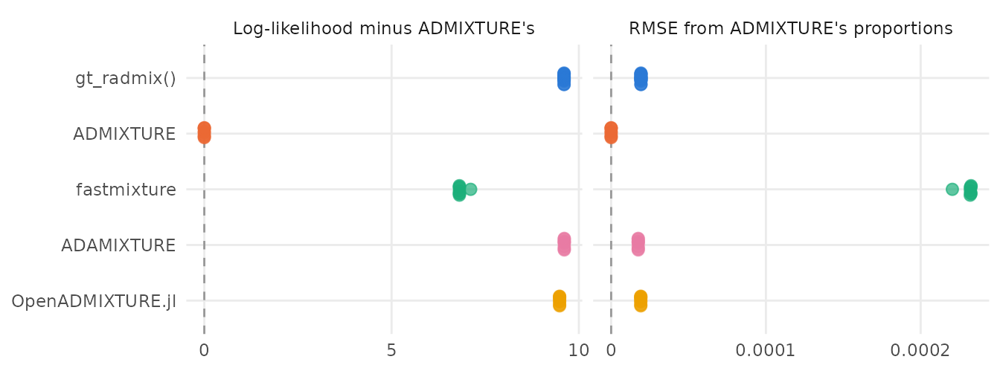
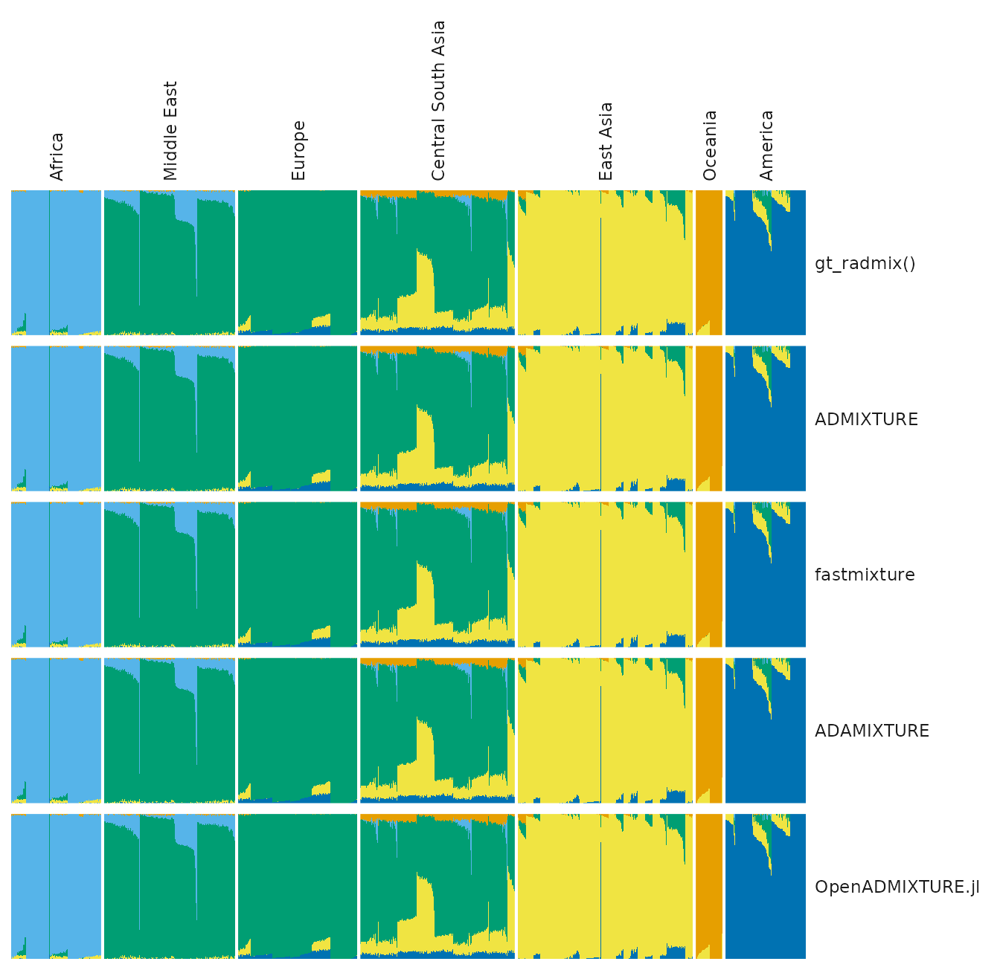
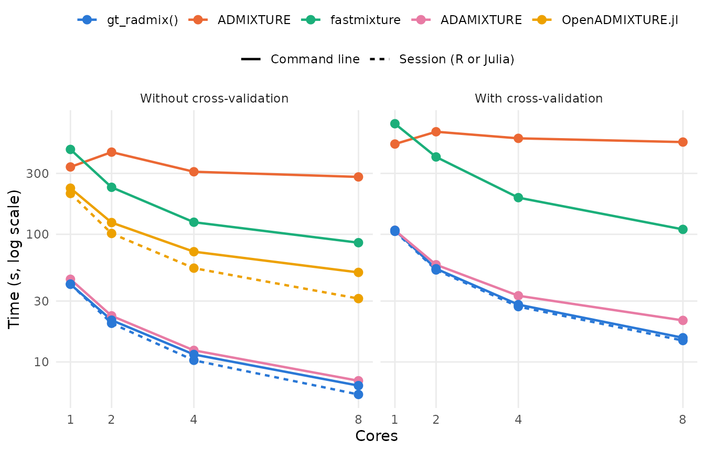
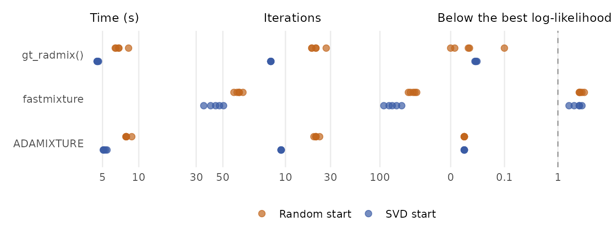

# Benchmarking gt_radmix()

[`gt_radmix()`](https://evolecolgroup.github.io/tidygenclust/dev/reference/gt_radmix.md)
estimates ancestry proportions with the method of ADMIXTURE (Alexander
et al. 2009), directly from the backing file of a `gen_tibble`. It uses
the algorithm of ADMIXTURE (block-wise Newton updates with quasi-Newton
acceleration), in multithreaded C++, and the cross-validation of
ADMIXTURE (Alexander and Lange 2011).

This article compares
[`gt_radmix()`](https://evolecolgroup.github.io/tidygenclust/dev/reference/gt_radmix.md)
with four programs that fit the same model: ADMIXTURE itself;
OpenADMIXTURE.jl (Ko et al. 2023), a Julia implementation of the
algorithm of ADMIXTURE (run without its selection of ancestry
informative markers); fastmixture (Santander et al. 2024), and
ADAMIXTURE (Saurina-i-Ricos et al. 2026). Note that OpenADMIXTURE.jl and
ADAMIXTURE can also run on GPUs; this comparison is limited to the CPU
implementations of the programs, which are all multithreaded. The actual
speeds will depend on the exact set up and operating system, so these
values should be interpreted with caution and only provide a general
idea of the relative performance of the programs.

The comparison uses the Human Genome Diversity Project (HGDP), and has
two parts:

- [Random starts](#random-starts): all the programs start from random
  values (ADMIXTURE and OpenADMIXTURE.jl have no other start, and
  fastmixture and ADAMIXTURE are run with their option to do so). This
  part checks that the programs find the same ancestry proportions, and
  measures how long each takes on different numbers of cores, with and
  without cross-validation (which OpenADMIXTURE.jl does not have).
- [SVD and random starts](#svd-and-random-starts):
  [`gt_radmix()`](https://evolecolgroup.github.io/tidygenclust/dev/reference/gt_radmix.md),
  fastmixture and ADAMIXTURE can also start from a truncated singular
  value decomposition (SVD) of the genotypes, which is the default for
  fastmixture and ADAMIXTURE
  ([`gt_radmix()`](https://evolecolgroup.github.io/tidygenclust/dev/reference/gt_radmix.md)
  does so with `init = "svd"`). Each of them is run from both starts,
  with several seeds, to compare their times and the log-likelihoods
  they reach.

We also compare the memory used by the programs, which is important for
large dataset. The other packages store the genotypes in a 2-bit packed
encoding, whilst gt_radmix() use a byte per genotype with memory
mapping, meaning that, whilst it uses more memory, it can also
effectively stream data when it runs out of memory. The section [Data
larger than the memory](#data-larger-than-the-memory), runs
[`gt_radmix()`](https://evolecolgroup.github.io/tidygenclust/dev/reference/gt_radmix.md)
alone on simulated data, with its memory capped below their size, to
show what working out of memory costs.

All the programs are timed from the command line, each run being a new
process that starts the program, reads the data and saves the results.
[`gt_radmix()`](https://evolecolgroup.github.io/tidygenclust/dev/reference/gt_radmix.md)
is also timed in an R session, and OpenADMIXTURE.jl in a Julia session,
in which the package is already loaded (see [How long do they
take?](#how-long-do-they-take)).

The [results](#results) come first. A final section, [How the benchmark
was run](#how-the-benchmark-was-run), describes the data and the runs,
with their code, and how to run the benchmark again.

## Results

### Summary

The five programs estimated the ancestry proportions of 1,043
individuals of the HGDP, typed at 130,943 loci, for K = 5 ancestral
populations (see [The data](#the-data)). On this dataset:

- **The same answer.** All the programs reached very similar
  log-likelihoods and almost identical ancestry proportions (see [Do the
  programs find the same ancestry
  proportions?](#do-the-programs-find-the-same-ancestry-proportions)).
- **[`gt_radmix()`](https://evolecolgroup.github.io/tidygenclust/dev/reference/gt_radmix.md)
  and ADAMIXTURE run at similar speeds**, about 8 times faster than
  ADMIXTURE on 1 core and 40 times faster on 8 cores (see [How long do
  they take?](#how-long-do-they-take)). fastmixture and OpenADMIXTURE.jl
  had intermediate speeds.
- **SVD starts save time.** Starting from an SVD of the genotypes made
  [`gt_radmix()`](https://evolecolgroup.github.io/tidygenclust/dev/reference/gt_radmix.md)
  and ADAMIXTURE about 1.5 times faster than starting from random values
  (about 5 s rather than 7-8 s on 8 cores), with the same results (see
  [SVD and random starts](#svd-and-random-starts)).
- **Memory.** ADAMIXTURE and fastmixture used the least memory, and
  OpenADMIXTURE.jl the most.
  [`gt_radmix()`](https://evolecolgroup.github.io/tidygenclust/dev/reference/gt_radmix.md)
  used more than ADMIXTURE, because it keeps a byte per genotype, but it
  can fit data larger than the memory (see [How much memory do they
  use?](#how-much-memory-do-they-use)).
- **Data larger than the memory.**
  [`gt_radmix()`](https://evolecolgroup.github.io/tidygenclust/dev/reference/gt_radmix.md)
  fitted 50 GB of simulated genotypes with its memory capped at 8 GiB, a
  sixth of the data, in about a third more time than in memory, with the
  same results (see [Data larger than the
  memory](#data-larger-than-the-memory)).

### Random starts

#### Do the programs find the same ancestry proportions?

All the programs maximise the same likelihood, but each starts from its
own random values and stops by its own convergence criterion. Each run
is compared with ADMIXTURE on 1 core without cross-validation, after
matching its clusters to those of ADMIXTURE:



Each point is a run (on each number of cores, with and without
cross-validation, and, for
[`gt_radmix()`](https://evolecolgroup.github.io/tidygenclust/dev/reference/gt_radmix.md)
and OpenADMIXTURE.jl, from the command line and in a session). All the
runs reached very similar log-likelihoods, with almost identical
ancestry proportions. ADMIXTURE stops a little earlier than the other
programs, so its log-likelihood is slightly lower (the [detailed
results](#detailed-results) give the numbers of each run).

The ancestry proportions from each program (on 1 core, without
cross-validation, and in a session for
[`gt_radmix()`](https://evolecolgroup.github.io/tidygenclust/dev/reference/gt_radmix.md)
and OpenADMIXTURE.jl), with the individuals grouped by region and
population:



#### How long do they take?

Each program is timed from the command line, as a new process that
starts the program, reads the bed file and writes Q and P (ADAMIXTURE
also always draws a plot, which is included in its time).
[`gt_radmix()`](https://evolecolgroup.github.io/tidygenclust/dev/reference/gt_radmix.md)
and OpenADMIXTURE.jl are also timed in a session, where R or Julia is
already running with the package loaded (and, for Julia, its code
compiled); the time of
[`gt_radmix()`](https://evolecolgroup.github.io/tidygenclust/dev/reference/gt_radmix.md)
includes reading the bed file into a `gen_tibble`, which an analysis of
several values of K would only do once.



[`gt_radmix()`](https://evolecolgroup.github.io/tidygenclust/dev/reference/gt_radmix.md)
and ADAMIXTURE were the fastest, with similar times on every number of
cores, with and without cross-validation. fastmixture made good use of
more cores, whereas ADMIXTURE gained little from them. Starting R adds
about a second to each run of
[`gt_radmix()`](https://evolecolgroup.github.io/tidygenclust/dev/reference/gt_radmix.md)
from the command line, and starting Julia and compiling OpenADMIXTURE.jl
about 20 s to each of its runs (the [detailed
results](#detailed-results) give the time of each run).

Differences of a few percent between programs are not meaningful: each
run was done once, and the relative speeds depend on the machine, the
compiler and the libraries. For example, ADAMIXTURE computes its main
sums with an optimised BLAS library, which can use the wider vector
instructions of some servers (AVX-512) and the matrix units of Apple
processors, whereas
[`gt_radmix()`](https://evolecolgroup.github.io/tidygenclust/dev/reference/gt_radmix.md)
uses its own loops, compiled for AVX2, and is multithreaded only where R
supports OpenMP (which the CRAN builds of R for macOS do not, without
extra set-up).

#### How much memory do they use?

The peak resident memory of each run from the command line was recorded
with `/usr/bin/time` (see the [detailed results](#detailed-results)).
ADAMIXTURE, which keeps the genotypes in a 2-bit packed encoding, used
the least memory without cross-validation, and fastmixture, whose memory
does not grow with cross-validation, the least with it.
OpenADMIXTURE.jl, including Julia, used the most.
[`gt_radmix()`](https://evolecolgroup.github.io/tidygenclust/dev/reference/gt_radmix.md)
used more than ADMIXTURE: it reads the genotypes from the backing file
of the `gen_tibble`, a byte per genotype, which the system keeps in
memory when it fits, and streams it when it does not (see [Data larger
than the memory](#data-larger-than-the-memory)).

#### Cross-validation errors

The cross-validation errors did not depend on the number of cores, and
those of
[`gt_radmix()`](https://evolecolgroup.github.io/tidygenclust/dev/reference/gt_radmix.md),
ADMIXTURE and ADAMIXTURE were almost the same (see the [detailed
results](#detailed-results)). OpenADMIXTURE.jl has no cross-validation.

[`gt_radmix()`](https://evolecolgroup.github.io/tidygenclust/dev/reference/gt_radmix.md)
and ADMIXTURE hold out a fold of the genotypes, refit the model on the
others, and average the deviance of the held-out genotypes (Alexander
and Lange 2011). They draw the folds differently, so their errors are
close but not identical. ADAMIXTURE does the same, but refits each fold
with only 5 iterations, starting from the estimates on all the
genotypes. fastmixture holds out individuals rather than genotypes, and
estimates their ancestry from the same genotypes on which it then
computes the error, so its errors can be compared between values of K,
but not with those of the other programs.

### SVD and random starts

[`gt_radmix()`](https://evolecolgroup.github.io/tidygenclust/dev/reference/gt_radmix.md),
fastmixture and ADAMIXTURE can start from a truncated SVD of the
genotypes, followed by alternating least squares (ALS) on its factors,
as well as from random values. fastmixture and ADAMIXTURE start from the
SVD by default,
[`gt_radmix()`](https://evolecolgroup.github.io/tidygenclust/dev/reference/gt_radmix.md)
from random values (the SVD is an option, `init = "svd"`). Each of the
three programs was run from both starts with seeds 1 to 5, on 8 cores,
without cross-validation, from the command line:



Each point is a run. The iterations count each program’s own steps, so
they can only be compared between the two starts of a program. The right
panel shows how far each run ended below the highest log-likelihood of
the benchmark (the dashed line marks 1).

From an SVD, all three programs needed fewer iterations, and were about
1.5 times faster than from random values. All the runs reached the same
optimum from both starts; fastmixture stops a little short of it, by its
own convergence criterion. The SVD of
[`gt_radmix()`](https://evolecolgroup.github.io/tidygenclust/dev/reference/gt_radmix.md)
is computed by
[`tidypopgen::gt_pca()`](https://evolecolgroup.github.io/tidypopgen/reference/gt_pca.html),
without imputing the missing genotypes.

### Data larger than the memory

[`gt_radmix()`](https://evolecolgroup.github.io/tidygenclust/dev/reference/gt_radmix.md)
maps the backing file of the `gen_tibble` into memory, so the system
keeps as much of the file in memory as it can and reads the rest from
the disk. When the file is larger than the memory available to R,
[`gt_radmix()`](https://evolecolgroup.github.io/tidygenclust/dev/reference/gt_radmix.md)
streams it: each pass over the genotypes reads the file in chunks,
alternating its direction from one pass to the next, and asks the system
to read the next chunk while the current one is processed. The results
are identical to those of the same fit in memory.

To measure what this costs,
[`gt_radmix()`](https://evolecolgroup.github.io/tidygenclust/dev/reference/gt_radmix.md)
was run on simulated genotypes of 50,000 individuals at 100,000 loci (5
GB in the backing file), for K = 5 on 8 cores: in memory, and with its
memory, page cache included, capped at 4 GiB and 1 GiB, reading from the
SSD of the machine and from the same disk throttled to 500 and 150 MB/s,
the speeds of a slower SSD and of a hard disk (see [How the benchmark
was run](#data-larger-than-the-memory-1)):

| Memory | Disk | Time (s) | Relative to in memory | Read (GB) | Peak memory (GB) | Of which R (GB) |
|:---|:---|---:|---:|---:|---:|---:|
| no cap | (in memory) | 214 | 1.0 | 0 | 5.23 | 0.21 |
| 4 GiB | SSD | 277 | 1.3 | 238 | 4.29 | 0.21 |
| 1 GiB | SSD | 332 | 1.5 | 476 | 1.07 | 0.21 |
| 4 GiB | 500 MB/s | 547 | 2.6 | 225 | 4.29 | 0.21 |
| 1 GiB | 500 MB/s | 917 | 4.3 | 444 | 1.07 | 0.21 |
| 4 GiB | 150 MB/s | 1,648 | 7.7 | 237 | 4.29 | 0.21 |
| 1 GiB | 150 MB/s | 2,972 | 13.9 | 441 | 1.07 | 0.21 |

All the fits reached the same log-likelihood. On the SSD, the capped
fits took only 1.3 to 1.5 times as long as the fit in memory. On slower
disks, the time is set by how fast the data can be read: the fits took
2.5 to 4 times as long at 500 MB/s, and 8 to 14 times at 150 MB/s. R
itself used only about 0.2 GB, leaving the rest of the cap to the page
cache. The throttle limits the throughput of the disk, not its latency,
so it mimics a slower disk only in part.

On a larger simulation, of 250,000 individuals at 200,000 loci (50 GB in
the backing file, and 12.5 GB even as a bed file),
[`gt_radmix()`](https://evolecolgroup.github.io/tidygenclust/dev/reference/gt_radmix.md)
was run in memory and with its memory capped at 8 GiB, a sixth of the
data:

| Memory | Disk | Time (s) | Relative to in memory | Read (GB) | Peak memory (GB) | Of which R (GB) |
|:---|:---|---:|---:|---:|---:|---:|
| no cap | (in memory) | 1,711 | 1.0 | 0 | 50.42 | 0.4 |
| 8 GiB | SSD | 2,290 | 1.3 | 3,579 | 8.59 | 0.4 |
| 8 GiB | 500 MB/s | 7,330 | 4.3 | 3,532 | 8.59 | 0.4 |

The three fits reached the same log-likelihood. On the SSD, the capped
fit took about a third longer than in memory (38 rather than 29
minutes); at 500 MB/s it took about 4 times as long, the time needed to
read the data from the disk over and over.

### Detailed results

#### Agreement between the programs (random starts)

| Program | Cores | CV | Log-likelihood | Difference | Largest difference (same program) | RMSE (ADMIXTURE) | Largest difference (ADMIXTURE) |
|:---|:---|:---|---:|---:|---:|---:|---:|
| gt_radmix() (command line) | 1 | no | -101,809,867.11 | 9.6 | 0 | 0.000019 | 0.00016 |
| gt_radmix() (command line) | 1 | yes | -101,809,867.11 | 9.6 | 0 | 0.000019 | 0.00016 |
| gt_radmix() (command line) | 2 | no | -101,809,867.11 | 9.6 | 0 | 0.000019 | 0.00016 |
| gt_radmix() (command line) | 2 | yes | -101,809,867.11 | 9.6 | 0 | 0.000019 | 0.00016 |
| gt_radmix() (command line) | 4 | no | -101,809,867.11 | 9.6 | 0 | 0.000019 | 0.00016 |
| gt_radmix() (command line) | 4 | yes | -101,809,867.11 | 9.6 | 0 | 0.000019 | 0.00016 |
| gt_radmix() (command line) | 8 | no | -101,809,867.11 | 9.6 | 0 | 0.000019 | 0.00016 |
| gt_radmix() (command line) | 8 | yes | -101,809,867.11 | 9.6 | 0 | 0.000019 | 0.00016 |
| gt_radmix() (R session) | 1 | no | -101,809,867.11 | 9.6 | 0 | 0.000019 | 0.00016 |
| gt_radmix() (R session) | 1 | yes | -101,809,867.11 | 9.6 | 0 | 0.000019 | 0.00016 |
| gt_radmix() (R session) | 2 | no | -101,809,867.11 | 9.6 | 0 | 0.000019 | 0.00016 |
| gt_radmix() (R session) | 2 | yes | -101,809,867.11 | 9.6 | 0 | 0.000019 | 0.00016 |
| gt_radmix() (R session) | 4 | no | -101,809,867.11 | 9.6 | 0 | 0.000019 | 0.00016 |
| gt_radmix() (R session) | 4 | yes | -101,809,867.11 | 9.6 | 0 | 0.000019 | 0.00016 |
| gt_radmix() (R session) | 8 | no | -101,809,867.11 | 9.6 | 0 | 0.000019 | 0.00016 |
| gt_radmix() (R session) | 8 | yes | -101,809,867.11 | 9.6 | 0 | 0.000019 | 0.00016 |
| ADMIXTURE | 1 | no | -101,809,876.71 | 0 | 0 | 0 | 0 |
| ADMIXTURE | 1 | yes | -101,809,876.71 | 0 | 0 | 0 | 0 |
| ADMIXTURE | 2 | no | -101,809,876.71 | 0.000001 | 0 | 0 | 0 |
| ADMIXTURE | 2 | yes | -101,809,876.71 | 0.000077 | 0.000001 | 0.000000014 | 0.000001 |
| ADMIXTURE | 4 | no | -101,809,876.71 | 0.000004 | 0 | 0 | 0 |
| ADMIXTURE | 4 | yes | -101,809,876.71 | 0.000004 | 0 | 0 | 0 |
| ADMIXTURE | 8 | no | -101,809,876.71 | 0.000004 | 0 | 0 | 0 |
| ADMIXTURE | 8 | yes | -101,809,876.71 | 0.000002 | 0 | 0 | 0 |
| fastmixture | 1 | no | -101,809,869.90 | 6.8 | 0 | 0.00023 | 0.0023 |
| fastmixture | 1 | yes | -101,809,869.90 | 6.8 | 0 | 0.00023 | 0.0023 |
| fastmixture | 2 | no | -101,809,869.90 | 6.8 | 0.000005 | 0.00023 | 0.0023 |
| fastmixture | 2 | yes | -101,809,869.90 | 6.8 | 0.000008 | 0.00023 | 0.0023 |
| fastmixture | 4 | no | -101,809,869.90 | 6.8 | 0.00001 | 0.00023 | 0.0023 |
| fastmixture | 4 | yes | -101,809,869.90 | 6.8 | 0.000002 | 0.00023 | 0.0023 |
| fastmixture | 8 | no | -101,809,869.90 | 6.8 | 0.000009 | 0.00023 | 0.0023 |
| fastmixture | 8 | yes | -101,809,869.60 | 7.1 | 0.0002 | 0.00022 | 0.0023 |
| ADAMIXTURE | 1 | no | -101,809,867.10 | 9.6 | 0 | 0.000017 | 0.00021 |
| ADAMIXTURE | 1 | yes | -101,809,867.10 | 9.6 | 0 | 0.000017 | 0.00021 |
| ADAMIXTURE | 2 | no | -101,809,867.10 | 9.6 | 0 | 0.000017 | 0.00021 |
| ADAMIXTURE | 2 | yes | -101,809,867.10 | 9.6 | 0 | 0.000017 | 0.00021 |
| ADAMIXTURE | 4 | no | -101,809,867.10 | 9.6 | 0 | 0.000017 | 0.00021 |
| ADAMIXTURE | 4 | yes | -101,809,867.10 | 9.6 | 0 | 0.000017 | 0.00021 |
| ADAMIXTURE | 8 | no | -101,809,867.10 | 9.6 | 0 | 0.000017 | 0.00021 |
| ADAMIXTURE | 8 | yes | -101,809,867.10 | 9.6 | 0 | 0.000017 | 0.00021 |
| OpenADMIXTURE.jl (command line) | 1 | no | -101,809,867.22 | 9.5 | 0 | 0.000019 | 0.00013 |
| OpenADMIXTURE.jl (command line) | 2 | no | -101,809,867.22 | 9.5 | 0 | 0.000019 | 0.00013 |
| OpenADMIXTURE.jl (command line) | 4 | no | -101,809,867.22 | 9.5 | 0 | 0.000019 | 0.00013 |
| OpenADMIXTURE.jl (command line) | 8 | no | -101,809,867.22 | 9.5 | 0 | 0.000019 | 0.00013 |
| OpenADMIXTURE.jl (Julia session) | 1 | no | -101,809,867.22 | 9.5 | 0 | 0.000019 | 0.00013 |
| OpenADMIXTURE.jl (Julia session) | 2 | no | -101,809,867.22 | 9.5 | 0 | 0.000019 | 0.00013 |
| OpenADMIXTURE.jl (Julia session) | 4 | no | -101,809,867.22 | 9.5 | 0 | 0.000019 | 0.00013 |
| OpenADMIXTURE.jl (Julia session) | 8 | no | -101,809,867.22 | 9.5 | 0 | 0.000019 | 0.00013 |

Log-likelihood of each run (fastmixture and ADAMIXTURE report it with
one decimal), and its difference from that of ADMIXTURE on 1 core
without cross-validation (CV; positive when higher). Largest absolute
difference between the ancestry proportions of each run and those of the
same program on 1 core without CV, and root mean square error (RMSE) and
largest absolute difference from those of ADMIXTURE on 1 core without
CV. The Q matrices are stored with 6 decimals, so differences smaller
than 1e-6 do not show. {.table}

#### Times (random starts)

| Program | Cores | Time (s) | Speed-up | Memory (MB) | Time with CV (s) | Speed-up with CV | Memory with CV (MB) |
|:---|---:|---:|---:|---:|---:|---:|---:|
| gt_radmix() (command line) | 1 | 40.6 | 1.0 | 560 | 108 | 1.0 | 620 |
| gt_radmix() (command line) | 2 | 21.3 | 1.9 | 560 | 53.8 | 2.0 | 620 |
| gt_radmix() (command line) | 4 | 11.4 | 3.5 | 560 | 28.1 | 3.8 | 620 |
| gt_radmix() (command line) | 8 | 6.53 | 6.2 | 560 | 15.5 | 6.9 | 620 |
| gt_radmix() (R session) | 1 | 40.7 | 1.0 | \- | 105 | 1.0 | \- |
| gt_radmix() (R session) | 2 | 20.1 | 2.0 | \- | 52.6 | 2.0 | \- |
| gt_radmix() (R session) | 4 | 10.3 | 4.0 | \- | 27.1 | 3.9 | \- |
| gt_radmix() (R session) | 8 | 5.56 | 7.3 | \- | 14.7 | 7.2 | \- |
| ADMIXTURE | 1 | 337 | 1.0 | 280 | 510 | 1.0 | 420 |
| ADMIXTURE | 2 | 440 | 0.8 | 280 | 636 | 0.8 | 420 |
| ADMIXTURE | 4 | 309 | 1.1 | 280 | 565 | 0.9 | 420 |
| ADMIXTURE | 8 | 282 | 1.2 | 280 | 528 | 1.0 | 420 |
| fastmixture | 1 | 462 | 1.0 | 200 | 735 | 1.0 | 200 |
| fastmixture | 2 | 234 | 2.0 | 200 | 404 | 1.8 | 200 |
| fastmixture | 4 | 124 | 3.7 | 200 | 194 | 3.8 | 200 |
| fastmixture | 8 | 86 | 5.4 | 200 | 109 | 6.7 | 200 |
| ADAMIXTURE | 1 | 44.5 | 1.0 | 150 | 108 | 1.0 | 910 |
| ADAMIXTURE | 2 | 23 | 1.9 | 160 | 57.8 | 1.9 | 920 |
| ADAMIXTURE | 4 | 12.3 | 3.6 | 170 | 33 | 3.3 | 930 |
| ADAMIXTURE | 8 | 7.13 | 6.2 | 180 | 21.2 | 5.1 | 930 |
| OpenADMIXTURE.jl (command line) | 1 | 230 | 1.0 | 1,600 | \- | \- | \- |
| OpenADMIXTURE.jl (command line) | 2 | 124 | 1.9 | 1,160 | \- | \- | \- |
| OpenADMIXTURE.jl (command line) | 4 | 73.1 | 3.1 | 1,160 | \- | \- | \- |
| OpenADMIXTURE.jl (command line) | 8 | 50.3 | 4.6 | 1,270 | \- | \- | \- |
| OpenADMIXTURE.jl (Julia session) | 1 | 209 | 1.0 | 1,600 | \- | \- | \- |
| OpenADMIXTURE.jl (Julia session) | 2 | 102 | 2.1 | 1,170 | \- | \- | \- |
| OpenADMIXTURE.jl (Julia session) | 4 | 54.3 | 3.8 | 1,150 | \- | \- | \- |
| OpenADMIXTURE.jl (Julia session) | 8 | 31.4 | 6.7 | 1,160 | \- | \- | \- |

Time (s) taken by each run, without and with cross-validation (CV),
speed-up relative to the run of the same program on 1 core, and peak
resident memory (MB; recorded for the runs from the command line).
OpenADMIXTURE.jl has no cross-validation. {.table}

#### Cross-validation errors (random starts)

| Program                    |  1 core | 2 cores | 4 cores | 8 cores |
|:---------------------------|--------:|--------:|--------:|--------:|
| gt_radmix() (command line) | 0.42239 | 0.42239 | 0.42239 | 0.42239 |
| gt_radmix() (R session)    | 0.42239 | 0.42239 | 0.42239 | 0.42239 |
| ADMIXTURE                  | 0.42242 | 0.42242 | 0.42242 | 0.42242 |
| fastmixture                | 0.42191 | 0.42191 | 0.42191 | 0.42191 |
| ADAMIXTURE                 | 0.42240 | 0.42240 | 0.42240 | 0.42240 |

Cross-validation error of each program, on each number of cores.
{.table}

#### Random and SVD starts

| Program | Start | Time (s) | Iterations | Memory (MB) | At the best | Largest shortfall | Largest difference between runs | RMSE (ADMIXTURE) |
|:---|:---|---:|---:|---:|---:|---:|---:|---:|
| gt_radmix() | Random | 6.8 (6.38-8.23) | 21 | 560 | 5 of 5 | 0.1 | 0.00044 | 0.000019 |
| gt_radmix() | SVD | 4.52 (4.5-4.63) | 7 | 690 | 5 of 5 | 0.028 | 0.000035 | 0.000023 |
| fastmixture | Random | 68.2 (61.8-73.4) | 225 | 200 | 0 of 5 | 3.1 | 0.0017 | 0.00023 |
| fastmixture | SVD | 43.5 (34.7-50.7) | 135 | 220 | 0 of 5 | 2.8 | 0.0014 | 0.00021 |
| ADAMIXTURE | Random | 7.89 (7.82-8.75) | 21 | 180 | 5 of 5 | 0.012 | 0.00032 | 0.000011 |
| ADAMIXTURE | SVD | 5.16 (5.07-5.45) | 9 | 200 | 5 of 5 | 0.012 | 0.00025 | 0.0000091 |

Median time (s; range in brackets) and number of iterations of the 5
runs of each program from each start, and their median peak resident
memory (MB); number of runs that reached the highest log-likelihood of
all the runs of the benchmark (to within 1), and the largest shortfall
from it; largest absolute difference between the ancestry proportions of
two runs of the same program from the same start; and median root mean
square error (RMSE) of the ancestry proportions from those of ADMIXTURE
on 1 core without cross-validation. The numbers of iterations are not
comparable between programs (see [Running the programs from the command
line](#running-the-programs-from-the-command-line)). {.table}

## How the benchmark was run

The benchmark is run with scripts in `vignettes/articles/code` (in the
source code of the package). The first prepares the data. The second
runs the programs from the command line: ADMIXTURE, fastmixture,
ADAMIXTURE, and
[`gt_radmix()`](https://evolecolgroup.github.io/tidygenclust/dev/reference/gt_radmix.md)
and OpenADMIXTURE.jl with two more scripts, which `Rscript` and `julia`
run. The last runs
[`gt_radmix()`](https://evolecolgroup.github.io/tidygenclust/dev/reference/gt_radmix.md)
in an R session. The results are read here from
`vignettes/articles/data/admixture_benchmark`. Each run is done once, as
the full runs take long enough for the variation between repeated runs
to be small. The code shown below is taken from these scripts. Timings
depend on the machine (see [Machine and
software](#machine-and-software)), the compiler and the libraries: large
differences between the programs should hold on other machines, but
small ones need not (see [How long do they
take?](#how-long-do-they-take)).

### The data

The data are those of the HGDP used in the benchmark of `tidypopgen`
(1043 individuals typed at about 650,000 loci), downloaded from Zenodo:

``` r

# the HGDP data (1043 individuals typed at about 650k loci) and the
# population of each individual, as used in the benchmark of tidypopgen.
# Each file is downloaded under a temporary name, so that an interrupted
# download is not mistaken for a complete file when the script is run again
zenodo_url <- "https://zenodo.org/records/15582364/files/"
hgdp_files <- c(
  "hgdp650.qc.hg19.bed", "hgdp650.qc.hg19.bim", "hgdp650.qc.hg19.fam",
  "hgdp650_id_pop.txt"
)
options(timeout = max(3600, getOption("timeout")))
for (file in hgdp_files) {
  path <- file.path(hgdp_dir, file)
  if (!file.exists(path)) {
    download.file(paste0(zenodo_url, file), paste0(path, ".part"), mode = "wb")
    file.rename(paste0(path, ".part"), path)
  }
}
```

and prepared as recommended in the manual of ADMIXTURE. The steps are
the same as in the analyses of the HGDP with `tidygenclust`:

``` r

library(tidypopgen)
hgdp <- gen_tibble(
  file.path(hgdp_dir, "hgdp650.qc.hg19.bed"),
  backingfile = file.path(gt_dir, "hgdp_raw"),
  quiet = TRUE
)
# loci with less than 5% of missing genotypes, as recommended in the manual
# of ADMIXTURE, and polymorphic (fastmixture stops on monomorphic loci)
hgdp <- hgdp |>
  select_loci_if(loci_missingness(genotypes) < 0.05) |>
  select_loci_if(loci_maf(genotypes) > 0)
```

``` r

# LD clumping with the thresholds of the manual of ADMIXTURE (plink
# --indep-pairwise 50 10 0.1). Clumping needs complete genotypes, so the
# missing ones are imputed first (on a backing file with only the loci kept
# above). loci_ld_clump() uses the imputed genotypes, but the gen_tibble
# keeps using the raw ones, which are those written to the bed file below:
# missing genotypes remain missing for all the tools
hgdp <- gt_update_backingfile(
  hgdp,
  backingfile = file.path(gt_dir, "hgdp_filtered"),
  quiet = TRUE
)
set.seed(1)
hgdp <- gt_impute_simple(hgdp, method = "random")
hgdp <- hgdp |>
  select_loci_if(
    loci_ld_clump(genotypes, thr_r2 = 0.1, size = 50, use_positions = FALSE)
  )
gt_as_plink(hgdp, file = file.path(hgdp_dir, "hgdp_bench.bed"))
```

All the programs are run on this bed file. A small subset of it is also
saved, to check the scripts quickly (see [Running the benchmark
again](#running-the-benchmark-again)):

``` r

# a small subset to check the benchmark scripts (on which ADMIXTURE takes
# about 30 s on one core): every 5th individual, and 25,000 of the loci that
# are still polymorphic among them
hgdp_quick <- hgdp[seq(1, nrow(hgdp), by = 5), ] |>
  select_loci_if(loci_maf(genotypes) > 0)
n_loci <- count_loci(hgdp_quick)
set.seed(2)
quick_loci <- seq_len(n_loci) %in% sample(n_loci, min(25000, n_loci))
hgdp_quick <- select_loci_if(hgdp_quick, quick_loci)
gt_as_plink(hgdp_quick, file = file.path(hgdp_dir, "hgdp_bench_quick.bed"))
```

### Running the programs from the command line

All the programs are run from the command line with the same settings:

``` bash
# the same settings as in admixture_benchmark_radmix.R
k=5
seed=1
n_folds=5
cores=(1 2 4 8)
# the comparison of the starts: these seeds, on the largest number of cores,
# without cross-validation
start_seeds=(1 2 3 4 5)
```

Each program is run on 1, 2, 4 and 8 cores (with `-j` in ADMIXTURE,
`--threads` in fastmixture, `-t` and `OMP_NUM_THREADS` in ADAMIXTURE,
`n_cores` in
[`gt_radmix()`](https://evolecolgroup.github.io/tidygenclust/dev/reference/gt_radmix.md)
and the number of threads of Julia for OpenADMIXTURE.jl), with and
without cross-validation (with `--cv` in ADMIXTURE, fastmixture and
ADAMIXTURE, and `crossval` in
[`gt_radmix()`](https://evolecolgroup.github.io/tidygenclust/dev/reference/gt_radmix.md);
OpenADMIXTURE.jl has none), from random values or from an SVD of the
genotypes (with `--random-init` in fastmixture, `--init random` or
`--init svd` in ADAMIXTURE, and `init` in
[`gt_radmix()`](https://evolecolgroup.github.io/tidygenclust/dev/reference/gt_radmix.md)),
with these functions:

``` bash
# the wall-clock time, in seconds (GNU date on Linux, python fallback on macOS)
now() {
  local t
  t=$(date +%s.%N 2>/dev/null || true)
  if [[ "$t" == *.* && "$t" != *N* ]]; then
    echo "$t"
  else
    python3 -c 'import time; print(f"{time.time():.6f}")'
  fi
}

# run a command redirecting its stdout+stderr to $2, and record peak RSS in $1
# using GNU /usr/bin/time -v (Linux) or BSD /usr/bin/time -l (macOS)
timed_exec() {
  local time_log=$1 out_log=$2
  shift 2
  if /usr/bin/time -v true >/dev/null 2>&1; then
    /usr/bin/time -v -o "$time_log" -- "$@" > "$out_log" 2>&1
  elif /usr/bin/time -l true >/dev/null 2>&1; then
    /usr/bin/time -l sh -c 'exec "$@" > "$0" 2>&1' "$out_log" "$@" 2> "$time_log"
  else
    : > "$time_log"
    "$@" > "$out_log" 2>&1
  fi
}

# peak resident set size in MiB from the log written by timed_exec(), or NA
extract_peak_rss_mb() {
  local time_log=$1 rss
  if [[ ! -s "$time_log" ]]; then
    echo "NA"
    return
  fi
  rss=$(awk '/Maximum resident set size \(kbytes\)/ { printf "%.1f", $NF / 1024; exit }' "$time_log")
  if [[ -z "$rss" ]]; then
    rss=$(awk '/maximum resident set size/ { printf "%.1f", $1 / 1048576; exit }' "$time_log")
  fi
  echo "${rss:-NA}"
}

# the first match of a regular expression (with one group, which is
# returned) at the start of a line of a log, or NA if there is none
extract() {
  local value
  value=$(sed -n -E "s/$1/\1/p" "$2" | head -n 1)
  echo "${value:-NA}"
}

# Each program is run by a function run_<program> <cores> <cross-validation
# (TRUE or FALSE)> <run directory> <seed> <start (random or svd)>.

# ADMIXTURE writes its output in the current directory, named after the bed
# file (e.g. hgdp_bench.5.Q), so it is run from the directory of the run;
# its log is what it prints. It starts from random values
run_admixture() {
  local n_cores=$1 crossval=$2 run_dir=$3 seed=$4
  local bed_path=$PWD/$bed
  local time_log=$PWD/$run_dir/time.log
  local args=(-s "$seed" -j"$n_cores")
  if [[ $crossval == TRUE ]]; then
    args+=(--cv="$n_folds")
  fi
  (cd "$run_dir" && timed_exec "$time_log" admixture.log "$admixture" "${args[@]}" "$bed_path" "$k")
}

# fastmixture writes its output (Q, P and a log with its settings and
# results) with the prefix given by --out, and prints its progress. It
# starts from an SVD of the genotypes, or from random values with
# --random-init
run_fastmixture() {
  local n_cores=$1 crossval=$2 run_dir=$3 seed=$4 init=$5
  local args=(
    --bfile "${bed%.bed}" --K "$k" --threads "$n_cores" --seed "$seed"
    --out "$run_dir/fastmixture"
  )
  if [[ $crossval == TRUE ]]; then
    args+=(--cv "$n_folds")
  fi
  if [[ $init == random ]]; then
    args+=(--random-init)
  fi
  timed_exec "$run_dir/time.log" "$run_dir/console.log" "$fastmixture" "${args[@]}"
}

# ADAMIXTURE writes its output (Q, P and a plot) in --save_dir, named after
# --name and K (e.g. adamixture.5.Q), and prints its progress. We pass
# --chrom_mode all explicitly and set OMP_NUM_THREADS before starting it so
# its OpenMP thread pool matches n_cores. In ADAMIXTURE >= 1.9, it starts
# from an SVD of the genotypes followed by alternating least squares
# (--init svd, its default), or from random values primed with EM steps
# (--init random)
run_adamixture() {
  local n_cores=$1 crossval=$2 run_dir=$3 seed=$4 init=$5
  local args=(
    --data_path "$bed" --save_dir "$run_dir" --name adamixture -k "$k"
    -t "$n_cores" -s "$seed" --chrom_mode all --device cpu --init "$init"
  )
  if [[ $crossval == TRUE ]]; then
    args+=(--cv "$n_folds")
  fi
  timed_exec "$run_dir/time.log" "$run_dir/console.log" \
    env OMP_NUM_THREADS="$n_cores" "$adamixture" "${args[@]}"
}

# gt_radmix() is run by a new R process, which loads tidygenclust, reads the
# bed file into a gen_tibble, runs gt_radmix() (from random values, its
# default, or with init = "svd"), saves the results, and prints the
# log-likelihood and cross-validation error
run_radmix_cli() {
  local n_cores=$1 crossval=$2 run_dir=$3 seed=$4 init=$5
  timed_exec "$run_dir/time.log" "$run_dir/console.log" \
    "$rscript" code/admixture_benchmark_radmix_cli.R "$bed" "$k" "$seed" \
    "$n_cores" "$crossval" "$n_folds" "$run_dir" "$init"
}

# julia, with the variables that activating its conda environment would
# set, so that it finds the packages installed in it (without the time
# taken by conda run)
julia_run() {
  env JULIA_DEPOT_PATH="$julia_prefix/share/julia:" \
    JULIA_PROJECT="@$julia_env" JULIA_LOAD_PATH="@:@$julia_env:@stdlib" \
    "$julia_prefix/bin/julia" "$@"
}

# OpenADMIXTURE.jl is run by a new Julia process, which writes Q and P with
# the prefix openadmixture, and prints its progress, the log-likelihood and
# the time of the fit (Julia is started without an interactive thread, see
# admixture_benchmark_openadmixture.jl); it starts from random values, and
# has no cross-validation
run_openadmixture_cli() {
  local n_cores=$1 run_dir=$3 seed=$4
  timed_exec "$run_dir/time.log" "$run_dir/console.log" \
    env JULIA_DEPOT_PATH="$julia_prefix/share/julia:" \
    JULIA_PROJECT="@$julia_env" JULIA_LOAD_PATH="@:@$julia_env:@stdlib" \
    "$julia_prefix/bin/julia" --threads="$n_cores,0" \
    code/admixture_benchmark_openadmixture.jl \
    "$bed" "$k" "$seed" "$run_dir/openadmixture"
}

# the same, after a warm-up on the small subset of the data, so that the
# fit, timed in Julia, does not include compiling the code
run_openadmixture() {
  local n_cores=$1 run_dir=$3 seed=$4
  timed_exec "$run_dir/time.log" "$run_dir/console.log" \
    env JULIA_DEPOT_PATH="$julia_prefix/share/julia:" \
    JULIA_PROJECT="@$julia_env" JULIA_LOAD_PATH="@:@$julia_env:@stdlib" \
    "$julia_prefix/bin/julia" --threads="$n_cores,0" \
    code/admixture_benchmark_openadmixture.jl \
    "$bed" "$k" "$seed" "$run_dir/openadmixture" "$warmup_bed"
}
```

and the time, Q matrix, log-likelihood, cross-validation error and
number of iterations of each run are saved:

``` bash
# each run is done in its own directory, and its time includes starting the
# program, reading the data and saving the results. Its Q matrix and log are
# then copied to the results, and its time, log-likelihood, cross-validation
# error and number of iterations (extracted from its log) are added to a
# table (csv file)
run_and_record() {
  local tool=$1 n_cores=$2 crossval=$3 seed=$4 init=$5 run=$6 table=$7
  local run_dir=$runs_dir/$run start seconds q_file log_file loglik cv_error
  local iterations iterations_pattern='^Converged in ([0-9]+) iterations.*'
  rm -rf "$run_dir"
  mkdir -p "$run_dir"
  echo "Running $run"
  start=$(now)
  "run_$tool" "$n_cores" "$crossval" "$run_dir" "$seed" "$init"
  seconds=$(awk -v start="$start" -v end="$(now)" \
    'BEGIN { printf "%.3f", end - start }')
  case $tool in
    admixture)
      q_file=$run_dir/$(basename "$bed" .bed).$k.Q
      log_file=$run_dir/admixture.log
      loglik=$(extract '^Loglikelihood: ([^[:space:]]+).*' "$log_file")
      cv_error=$(extract \
        '^CV error \(K=[0-9]+\): ([^[:space:]]+).*' "$log_file")
      ;;
    fastmixture)
      q_file=$run_dir/fastmixture.K$k.s$seed.Q
      log_file=$run_dir/fastmixture.K$k.s$seed.log
      loglik=$(extract \
        '^Final log-likelihood: ([^[:space:]]+).*' "$log_file")
      cv_error=$(extract \
        '^Cross-validation error \(SD\): ([^[:space:]]+).*' "$log_file")
      ;;
    adamixture)
      q_file=$run_dir/adamixture.$k.Q
      log_file=$run_dir/console.log
      loglik=$(extract \
        '^ *Final log-likelihood: ([^[:space:]]+).*' "$log_file")
      cv_error=$(extract \
        '^ *K=[0-9]+: CV index = ([^[:space:]]+).*' "$log_file")
      # (the lines indented further are those of the initialisation)
      iterations_pattern='^ {4}Converged at iteration ([0-9]+).*'
      ;;
    radmix_cli)
      q_file=$run_dir/radmix.Q
      log_file=$run_dir/radmix.log
      loglik=$(extract '^Loglikelihood: ([^[:space:]]+).*' \
        "$run_dir/console.log")
      cv_error=$(extract '^CV error \(K=[0-9]+\): ([^[:space:]]+).*' \
        "$run_dir/console.log")
      ;;
    openadmixture*)
      q_file=$run_dir/openadmixture.Q
      log_file=$run_dir/console.log
      loglik=$(extract '^Loglikelihood: ([^[:space:]]+).*' "$log_file")
      cv_error=NA
      iterations_pattern='^Main algorithm converged in ([0-9]+) iterations.*'
      if [[ $tool == openadmixture ]]; then
        # after the warm-up, the time of the fit alone
        seconds=$(extract '^Fit time \(s\): ([^[:space:]]+).*' "$log_file")
      fi
      ;;
  esac
  iterations=$(extract "$iterations_pattern" "$log_file")
  local peak_rss_mb
  peak_rss_mb=$(extract_peak_rss_mb "$run_dir/time.log")
  cp "$q_file" "$out_dir/Q/$run.Q"
  cp "$log_file" "$out_dir/logs/$run.log"
  echo "$tool,$init,$seed,$n_cores,$crossval,$seconds,$loglik,$cv_error,$iterations,$peak_rss_mb" \
    >> "$table"
}
mkdir -p "$out_dir/Q" "$out_dir/logs"
header=tool,init,seed,n_cores,crossval,seconds,loglik,cv_error,iterations,peak_rss_mb
```

The programs are first run from random values, on each number of cores,
with and without cross-validation:

``` bash
# all the programs from random starting values: each combination of
# program, number of cores and cross-validation (or not) is run once (e.g.
# admixture_t4_cv for ADMIXTURE on 4 cores with cross-validation).
# OpenADMIXTURE.jl, which has no cross-validation, is run without it, both
# from the command line (openadmixture_cli) and after a warm-up
# (openadmixture, timed in Julia)
timings=$out_dir/timings_cli.csv
echo "$header" > "$timings"
for tool in admixture fastmixture adamixture radmix_cli openadmixture_cli \
  openadmixture; do
  for n_cores in "${cores[@]}"; do
    for crossval in FALSE TRUE; do
      if [[ $crossval == TRUE && $tool == openadmixture* ]]; then
        continue
      fi
      if [[ $crossval == TRUE ]]; then
        run=${tool}_t${n_cores}_cv
      else
        run=${tool}_t${n_cores}_nocv
      fi
      run_and_record "$tool" "$n_cores" "$crossval" "$seed" random "$run" \
        "$timings"
    done
  done
done
```

and then
[`gt_radmix()`](https://evolecolgroup.github.io/tidygenclust/dev/reference/gt_radmix.md),
fastmixture and ADAMIXTURE from both starts, with several seeds:

``` bash
# the programs that can start from an SVD of the genotypes as well as from
# random values, from each start with each seed, on the largest number of
# cores, without cross-validation (e.g. fastmixture_svd_s2 for fastmixture
# from an SVD with seed 2)
starts=$out_dir/starts_cli.csv
echo "$header" > "$starts"
for tool in fastmixture adamixture radmix_cli; do
  for init in random svd; do
    for start_seed in "${start_seeds[@]}"; do
      run_and_record "$tool" "${cores[-1]}" FALSE "$start_seed" "$init" \
        "${tool}_${init}_s$start_seed" "$starts"
    done
  done
done
```

From the command line,
[`gt_radmix()`](https://evolecolgroup.github.io/tidygenclust/dev/reference/gt_radmix.md)
is run by this R script (with `Rscript`), which reads the same bed file
into a `gen_tibble`, runs
[`gt_radmix()`](https://evolecolgroup.github.io/tidygenclust/dev/reference/gt_radmix.md),
and saves the result to an RDS file:

``` r

args <- commandArgs(trailingOnly = TRUE)
bed_file <- args[1]
k <- as.integer(args[2])
seed <- as.integer(args[3])
n_cores <- as.integer(args[4])
crossval <- as.logical(args[5])
n_folds <- as.integer(args[6])
run_dir <- args[7]
init <- args[8]
library(tidygenclust)
# BLAS is limited to the cores of the run: gt_radmix() can use it for the
# PCA of init = "svd" (tidypopgen's gt_pca(), which handles missing
# genotypes without imputation), and otherwise only for small k x k systems
bigparallelr::set_blas_ncores(n_cores)
hgdp <- tidypopgen::gen_tibble(
  bed_file,
  backingfile = file.path(run_dir, "hgdp_bench"),
  quiet = TRUE
)
fit <- gt_radmix(
  hgdp,
  k = k,
  seed = seed,
  init = init,
  crossval = crossval,
  n_folds = n_folds,
  n_cores = n_cores
)
saveRDS(fit, file.path(run_dir, "radmix.rds"))
# the Q matrix (one row per individual, with 6 decimals, as ADMIXTURE writes
# it) and the log
q <- fit$Q[[1]]
write.table(
  matrix(sprintf("%.6f", q), nrow = nrow(q)),
  file.path(run_dir, "radmix.Q"),
  quote = FALSE,
  row.names = FALSE,
  col.names = FALSE
)
writeLines(fit$log[[1]], file.path(run_dir, "radmix.log"))
cat(sprintf("Loglikelihood: %.6f\n", fit$loglik))
if (crossval) {
  cat(sprintf("CV error (K=%d): %.6f\n", k, fit$cv))
}
```

and OpenADMIXTURE.jl by this Julia script (with `julia`), which runs it
on all the loci, without its selection of ancestry informative markers,
with its default settings (which
[`gt_radmix()`](https://evolecolgroup.github.io/tidygenclust/dev/reference/gt_radmix.md)
follows, except for its convergence threshold, see below):

``` julia
using OpenADMIXTURE, Printf, Random

bed, k, seed, prefix = ARGS[1], parse(Int, ARGS[2]), parse(Int, ARGS[3]), ARGS[4]
warmup = length(ARGS) >= 5 ? ARGS[5] : nothing

# a matrix written with one row per line, as ADMIXTURE writes its Q and P
# matrices (6 decimals)
function write_matrix(file, m)
    open(file, "w") do io
        for i in axes(m, 1)
            println(io, join([@sprintf("%.6f", x) for x in m[i, :]], " "))
        end
    end
end

if warmup !== nothing
    OpenADMIXTURE.run_admixture(warmup, k; rng=Xoshiro(seed), admix_n_iter=1,
        progress_bar=false)
end

seconds = @elapsed begin
    # sparsity = nothing (the default): all the loci are used
    d, _, _ = OpenADMIXTURE.run_admixture(bed, k; rng=Xoshiro(seed), progress_bar=false)
    # d.q and d.p have one column per individual and per locus
    write_matrix(prefix * ".Q", permutedims(d.q))
    write_matrix(prefix * ".P", permutedims(d.p))
end
println("Loglikelihood: ", @sprintf("%.6f", d.ll_new))
println("Fit time (s): ", @sprintf("%.3f", seconds))
```

### Running gt_radmix() in an R session

[`gt_radmix()`](https://evolecolgroup.github.io/tidygenclust/dev/reference/gt_radmix.md)
runs on a `gen_tibble`. Its parallel loops use OpenMP, with `n_cores`
threads. From random values, it only calls BLAS for small systems of K
equations; BLAS is limited to the cores of each run:

``` r

library(tidygenclust)
# gt_radmix() runs in parallel with OpenMP (with n_cores threads); from a
# random start it only uses BLAS for small (k x k) systems. BLAS is limited
# to the cores of each run (below), so that a multithreaded BLAS does not
# use more cores than requested
```

It is run from random values, with the same settings as the other
programs:

``` r

# the same settings as in admixture_benchmark_cli.sh
k <- 5
seed <- 1
n_folds <- 5
cores <- c(1, 2, 4, 8)
```

Each run reads the same bed file into a `gen_tibble`, runs
[`gt_radmix()`](https://evolecolgroup.github.io/tidygenclust/dev/reference/gt_radmix.md),
and saves the result to an RDS file:

``` r

# the Q matrices are written as ADMIXTURE and fastmixture write theirs (one
# row per individual, with 6 decimals)
write_q <- function(q, file) {
  q_text <- matrix(sprintf("%.6f", q), nrow = nrow(q))
  write.table(q_text, file, quote = FALSE, row.names = FALSE, col.names = FALSE)
}
# each combination of number of cores and cross-validation (or not) is run
# once, in its own directory. As ADMIXTURE and fastmixture read the bed file
# and write their estimates, the time of each run includes reading the bed
# file into a gen_tibble (with its backing file in the directory of the
# run), and saving the gt_admix object (with Q and P) to an RDS file. Its Q
# matrix and log are then saved with the results, and its log-likelihood,
# cross-validation error and number of iterations are recorded
timings <- list()
for (n_cores in cores) {
  for (crossval in c(FALSE, TRUE)) {
    run <- paste0("radmix_t", n_cores, if (crossval) "_cv" else "_nocv")
    run_dir <- file.path(runs_dir, run)
    unlink(run_dir, recursive = TRUE)
    dir.create(run_dir, recursive = TRUE)
    message("Running ", run)
    bigparallelr::set_blas_ncores(n_cores)
    start <- proc.time()[["elapsed"]]
    hgdp <- tidypopgen::gen_tibble(
      bed_file,
      backingfile = file.path(run_dir, "hgdp_bench"),
      quiet = TRUE
    )
    fit <- gt_radmix(
      hgdp,
      k = k,
      seed = seed,
      crossval = crossval,
      n_folds = n_folds,
      n_cores = n_cores
    )
    saveRDS(fit, file.path(run_dir, "radmix.rds"))
    seconds <- proc.time()[["elapsed"]] - start
    write_q(fit$Q[[1]], file.path(out_dir, "Q", paste0(run, ".Q")))
    writeLines(fit$log[[1]], file.path(out_dir, "logs", paste0(run, ".log")))
    converged_line <- grep("^Converged in", fit$log[[1]], value = TRUE)[1]
    timings[[run]] <- data.frame(
      tool = "radmix",
      init = "random",
      seed = seed,
      n_cores = n_cores,
      crossval = crossval,
      seconds = seconds,
      loglik = fit$loglik,
      cv_error = if (crossval) fit$cv else NA,
      iterations = as.integer(
        sub("^Converged in ([0-9]+) iterations.*", "\\1", converged_line)
      )
    )
  }
}
timings <- do.call(rbind, timings)
```

Each program stops when its own default convergence criterion is met.
ADMIXTURE stops when the log-likelihood increases by less than 1e-4
between iterations. fastmixture checks every 5 iterations, and stops
when the log-likelihood, divided by the number of observed genotypes,
has increased by less than 1e-9. ADAMIXTURE, with its default solver
(BR-QN; it also offers the Adam-EM algorithm of its paper), stops when
the log-likelihood changes by less than 0.1 between iterations.
[`gt_radmix()`](https://evolecolgroup.github.io/tidygenclust/dev/reference/gt_radmix.md)
stops when the relative change in the log-likelihood is less than 1e-8,
and OpenADMIXTURE.jl when it is less than 1e-7. The numbers of
iterations are not comparable either. An iteration of fastmixture is a
pass of accelerated EM updates, first over mini-batches of the loci. An
iteration of ADMIXTURE, ADAMIXTURE,
[`gt_radmix()`](https://evolecolgroup.github.io/tidygenclust/dev/reference/gt_radmix.md)
and OpenADMIXTURE.jl updates all the parameters with block-wise Newton
steps. From random values, ADMIXTURE, ADAMIXTURE,
[`gt_radmix()`](https://evolecolgroup.github.io/tidygenclust/dev/reference/gt_radmix.md)
and OpenADMIXTURE.jl first refine them with a few EM steps. From an SVD
(computed by
[`tidypopgen::gt_pca()`](https://evolecolgroup.github.io/tidypopgen/reference/gt_pca.html)
for
[`gt_radmix()`](https://evolecolgroup.github.io/tidygenclust/dev/reference/gt_radmix.md)),
fastmixture, ADAMIXTURE and
[`gt_radmix()`](https://evolecolgroup.github.io/tidygenclust/dev/reference/gt_radmix.md)
start from the solution of alternating least squares on its factors; the
ALS step of
[`gt_radmix()`](https://evolecolgroup.github.io/tidygenclust/dev/reference/gt_radmix.md)
is adapted from ADAMIXTURE (`src/radmix_als.cpp`, see
`inst/COPYRIGHTS`), and both ADAMIXTURE and
[`gt_radmix()`](https://evolecolgroup.github.io/tidygenclust/dev/reference/gt_radmix.md)
keep the best of three such solutions by log-likelihood.

### Data larger than the memory

The genotypes of [Data larger than the
memory](#data-larger-than-the-memory) are simulated, in blocks of loci
on several cores, straight into the backing file of a file-backed matrix
(from `bigstatsr`), written as a bed file and read into a `gen_tibble`,
by `code/admixture_benchmark_large_data.R`. Its sizes and paths can be
set with environment variables (the data are not part of the
repository):

``` r

large_dir <- Sys.getenv("LARGE_DIR", "data/large")
dir.create(large_dir, recursive = TRUE, showWarnings = FALSE)
n_cores <- as.integer(Sys.getenv("LARGE_CORES", "8"))
n_indiv <- as.integer(Sys.getenv("LARGE_N_INDIV", "250000"))
n_loci <- as.integer(Sys.getenv("LARGE_N_LOCI", "200000"))
k <- 5
```

Five ancestral populations, and five sampled ones, each mostly of one
ancestry:

``` r

# Five ancestral populations, with allele frequencies drawn under the
# Balding-Nichols model (Fst = 0.1 from frequencies uniform between 0.05 and
# 0.95 in their common ancestor), and five sampled populations of the same
# size, whose ancestry proportions are drawn from a Dirichlet
# distribution centred on one ancestral population (80% on average, the
# rest shared among the other four). The genotypes are binomial draws from
# the individual allele frequencies, with 1% of them missing.
set.seed(1)
pop <- rep(seq_len(k), each = n_indiv / k)
alpha <- matrix(0.25, n_indiv, k)
alpha[cbind(seq_len(n_indiv), pop)] <- 4
q_true <- matrix(stats::rgamma(n_indiv * k, alpha), n_indiv, k)
q_true <- q_true / rowSums(q_true)
saveRDS(q_true, file.path(large_dir, "q_true.rds"))
# the genotypes, written straight into the backing file of an FBM in blocks
# of loci (one byte per genotype, 3 for a missing genotype), on several
# cores; each block of loci has its own seed, so the data do not depend on
# the number of cores. Each core runs BLAS (for its matrix products) on a
# single thread, set in a.FUN, so bigstatsr's check against two levels of
# parallelism is not needed
options(bigstatsr.check.parallel.blas = FALSE)
genotypes <- bigstatsr::FBM.code256(
  n_indiv, n_loci,
  code = bigsnpr::CODE_012,
  backingfile = file.path(large_dir, "sim_fbm"),
  init = NULL
)
block_size <- 250
invisible(bigstatsr::big_apply(
  genotypes,
  a.FUN = function(x, ind, q_true, k, block_size) {
    bigparallelr::set_blas_ncores(1)
    for (j0 in seq(1, length(ind), by = block_size)) {
      cols <- ind[j0:min(length(ind), j0 + block_size - 1)]
      set.seed(1e6 + cols[1])
      f <- 0.1
      p_anc <- stats::runif(length(cols), 0.05, 0.95)
      p <- matrix(
        stats::rbeta(
          k * length(cols),
          rep(p_anc * (1 - f) / f, each = k),
          rep((1 - p_anc) * (1 - f) / f, each = k)
        ),
        k, length(cols)
      )
      g <- stats::rbinom(nrow(x) * length(cols), 2, q_true %*% p)
      g[stats::runif(length(g)) < 0.01] <- 3L
      x[, cols] <- matrix(g, nrow(x))
    }
    NULL
  },
  a.combine = "c",
  block.size = block_size * 8,
  ncores = n_cores,
  q_true = q_true,
  k = k,
  block_size = block_size
))
invisible(genotypes$save())
```

``` r

# a PLINK bed file of the genotypes, with the sampled population of each
# individual as its family ID, and the loci on 20 chromosomes
sim <- structure(
  list(
    genotypes = genotypes,
    fam = data.frame(
      family.ID = paste0("pop", pop),
      sample.ID = sprintf("ind%06d", seq_len(n_indiv)),
      paternal.ID = 0L,
      maternal.ID = 0L,
      sex = 0L,
      affection = -9L
    ),
    map = data.frame(
      chromosome = rep(1:20, each = n_loci / 20),
      marker.ID = sprintf("snp%06d", seq_len(n_loci)),
      genetic.dist = 0,
      physical.pos = rep(seq_len(n_loci / 20) * 1000L, 20),
      allele1 = "A",
      allele2 = "G"
    )
  ),
  class = "bigSNP"
)
bed_file <- bigsnpr::snp_writeBed(sim, file.path(large_dir, "sim_large.bed"))
# the FBM is no longer needed: the gen_tibble gets its own backing file
rm(sim, genotypes)
invisible(gc())
unlink(file.path(large_dir, c("sim_fbm.bk", "sim_fbm.rds")))
```

``` r

# the gen_tibble that gt_radmix() reads, saved so that each run can load it
# without reading the bed file again
sim_gt <- tidypopgen::gen_tibble(
  bed_file,
  backingfile = file.path(large_dir, "sim_large"),
  quiet = TRUE
)
invisible(tidypopgen::gt_save(sim_gt, quiet = TRUE))
```

Each fit is run by `code/admixture_benchmark_large_fit.R`, which records
its time, the bytes it read from the disk, its memory, whether
[`gt_radmix()`](https://evolecolgroup.github.io/tidygenclust/dev/reference/gt_radmix.md)
streamed the data, and how close its ancestry proportions are to the
simulated ones:

``` r

args <- commandArgs(trailingOnly = TRUE)
run <- args[1]
k <- as.integer(args[2])
seed <- as.integer(args[3])
n_cores <- as.integer(args[4])
results_file <- args[5]
memory_cap <- args[6]
read_mbps <- as.numeric(args[7])
large_dir <- Sys.getenv("LARGE_DIR", "data/large")
library(tidygenclust)
sim_gt <- tidypopgen::gt_load(file.path(large_dir, "sim_large.gt"))
# the bytes read from disk by this process so far (Linux)
read_bytes <- function() {
  io <- readLines("/proc/self/io")
  as.numeric(sub(".*: ", "", grep("^read_bytes", io, value = TRUE)))
}
# whether gt_radmix() will stream the data: it does when the backing file is
# larger than 0.8 times the memory available to it (the smaller of the free
# memory and the room under its memory cap), and then reads it in chunks
stream <- tidygenclust:::radmix_stream_mode(gt_radmix_data(sim_gt))
mem_available <- tidygenclust:::radmix_mem_available()
# the peak of the resident memory of this process (Linux): its own memory
# plus the pages of the backing file mapped in it
peak_rss <- function() {
  x <- grep("^VmHWM:", readLines("/proc/self/status"), value = TRUE)
  as.numeric(gsub("[^0-9]", "", x)) * 1024
}
# a memory file of the cgroup of this process (cgroups v2): memory.max is
# its cap, and memory.peak the peak of its memory, page cache included
# (NA without a cap: the cgroup is then the user's session)
cgroup_bytes <- function(name) {
  cg <- sub("^0::", "", grep("^0::", readLines("/proc/self/cgroup"),
    value = TRUE
  ))
  f <- file.path("/sys/fs/cgroup", cg, name)
  cap <- file.path("/sys/fs/cgroup", cg, "memory.max")
  if (!file.exists(f) || readLines(cap) == "max") {
    return(NA_real_)
  }
  as.numeric(readLines(f))
}
read_before <- read_bytes()
start <- proc.time()[["elapsed"]]
fit <- gt_radmix(sim_gt, k = k, seed = seed, n_cores = n_cores)
seconds <- proc.time()[["elapsed"]] - start
read_after <- read_bytes()
```

``` r

# the ancestry proportions estimated against those simulated: the clusters
# are numbered arbitrarily, so the columns are matched (by the permutation
# with the smallest sum of squared differences), then the root mean square
# difference is computed
q_true <- readRDS(file.path(large_dir, "q_true.rds"))
q <- fit$Q[[1]]
perms <- as.matrix(expand.grid(rep(list(seq_len(k)), k)))
perms <- perms[apply(perms, 1, function(x) length(unique(x)) == k), ]
sse <- apply(perms, 1, function(x) sum((q[, x] - q_true)^2))
rmse <- sqrt(min(sse) / length(q))
converged_line <- grep("^Converged in", fit$log[[1]], value = TRUE)[1]
result <- data.frame(
  run = run,
  memory_cap = memory_cap,
  read_mbps = read_mbps,
  n_indiv = nrow(sim_gt),
  n_loci = tidypopgen::count_loci(sim_gt),
  k = k,
  n_cores = n_cores,
  seconds = seconds,
  iterations = as.integer(
    sub("^Converged in ([0-9]+) iterations.*", "\\1", converged_line)
  ),
  loglik = fit$loglik,
  read_gb = (read_after - read_before) / 1e9,
  peak_rss_gb = peak_rss() / 1e9,
  cgroup_max_gb = cgroup_bytes("memory.max") / 1e9,
  cgroup_peak_gb = cgroup_bytes("memory.peak") / 1e9,
  data_gb = stream$data_bytes / 1e9,
  mem_available_gb = mem_available / 1e9,
  streamed = stream$stream,
  chunk_mb = stream$chunk_bytes / 2^20,
  rmse_q = rmse
)
write.table(
  result, results_file,
  sep = ",", row.names = FALSE,
  col.names = !file.exists(results_file),
  append = file.exists(results_file)
)
print(result)
```

The fits are run by `code/admixture_benchmark_large.sh`: the first in
memory, the others under a memory cap (a transient scope of systemd, on
Linux with cgroups v2, which also counts the page cache), from a cold
page cache, on the disk as it is or with its reads throttled (which
needs root):

``` bash
set -euo pipefail
large_dir=${LARGE_DIR:-data/large}
name=${LARGE_NAME:-large}
memory_caps=${LARGE_MEMORY_CAPS:-8G}
read_mbps=${LARGE_READ_MBPS:-0 500}
out_dir=data/admixture_benchmark
mkdir -p "$out_dir"
k=5
seed=1
cores=8
bk=$(readlink -f "$large_dir/sim_large.bk")
fit=(Rscript code/admixture_benchmark_large_fit.R)
runs=$out_dir/${name}_runs.csv
peaks=$out_dir/${name}_memory.csv
rm -f "$runs"
echo "run,peak_anon_gb" > "$peaks"

# the processes started by a process, those they started, and so on
descendants() {
  local c
  for c in $(pgrep -P "$1"); do
    echo "$c"
    descendants "$c"
  done
}
# run a command, and record the peak of the memory of its processes that is
# not the page cache (RssAnon, sampled every 0.2 s), in GB
with_peak() {
  local run=$1
  shift
  "$@" &
  local pid=$! peak=0 kb p
  while kill -0 "$pid" 2> /dev/null; do
    for p in $pid $(descendants "$pid"); do
      kb=$(awk '/^RssAnon:/ {print $2}' "/proc/$p/status" 2> /dev/null || true)
      if [ -n "$kb" ] && [ "$kb" -gt "$peak" ]; then peak=$kb; fi
    done
    sleep 0.2
  done
  wait "$pid"
  echo "$run,$(awk -v kb="$peak" 'BEGIN { printf "%.2f", kb * 1024 / 1e9 }')" \
    >> "$peaks"
}
# drop the pages of the backing file from the page cache (no root needed)
drop_cache() {
  sync "$bk"
  dd if="$bk" iflag=nocache count=0 status=none
}

# in memory: the backing file is first read into the page cache
cat "$bk" > /dev/null
with_peak memory "${fit[@]}" memory $k $seed $cores "$runs" none 0

# with the memory capped, for R and the page cache together, from a cold
# page cache: on the disk as it is, in a scope of the user's systemd; with
# the reads throttled, in a scope of the system's systemd (as root), in
# which R runs as the user, with the environment it needs
for mbps in $read_mbps; do
  for cap in $memory_caps; do
    run=capped_${cap}_$([ "$mbps" = 0 ] && echo ssd || echo "${mbps}mbps")
    drop_cache
    if [ "$mbps" = 0 ]; then
      with_peak "$run" \
        systemd-run --user --scope --quiet \
        -p MemoryMax="$cap" -p MemorySwapMax=0 \
        "${fit[@]}" "$run" $k $seed $cores "$runs" "$cap" 0
    else
      with_peak "$run" \
        sudo systemd-run --scope --quiet \
        -p MemoryMax="$cap" -p MemorySwapMax=0 \
        -p "IOReadBandwidthMax=$bk ${mbps}M" \
        sudo -u "$USER" env "PATH=$PATH" "R_LIBS=${R_LIBS:-}" \
        "TMPDIR=${TMPDIR:-/tmp}" "LARGE_DIR=$large_dir" \
        "OMP_PROC_BIND=${OMP_PROC_BIND:-false}" \
        "OMP_PLACES=${OMP_PLACES:-threads}" \
        "${fit[@]}" "$run" $k $seed $cores "$runs" "$cap" "$mbps"
    fi
  done
done
```

For the data of this article (5 GB), from `vignettes/articles`:

``` sh
cd vignettes/articles
LARGE_DIR=data/mid LARGE_N_INDIV=50000 LARGE_N_LOCI=100000 \
  Rscript code/admixture_benchmark_large_data.R
sudo -v
LARGE_DIR=data/mid LARGE_NAME=mid LARGE_MEMORY_CAPS="4G 1G" \
  LARGE_READ_MBPS="0 500 150" taskset -c 0-7 \
  bash code/admixture_benchmark_large.sh
```

and for the larger data (50 GB; the defaults of the scripts), which take
about 120 GB of disk while they are simulated:

``` sh
cd vignettes/articles
Rscript code/admixture_benchmark_large_data.R
sudo -v
taskset -c 0-7 bash code/admixture_benchmark_large.sh
```

### From the results to the tables and plots

The results are read, and the Q matrices aligned and compared, with this
code:

``` r

# to summarise and plot the results
library(dplyr)
library(tidyr)
library(ggplot2)
# each program, and how it is run (from the command line, or in an R or
# Julia session), in the order of the tables and plots
tool_labels <- c(
  radmix_cli = "gt_radmix() (command line)",
  radmix = "gt_radmix() (R session)",
  admixture = "ADMIXTURE",
  fastmixture = "fastmixture",
  adamixture = "ADAMIXTURE",
  openadmixture_cli = "OpenADMIXTURE.jl (command line)",
  openadmixture = "OpenADMIXTURE.jl (Julia session)"
)
# the program of each of them
tool_program <- c(
  radmix_cli = "radmix", radmix = "radmix", admixture = "admixture",
  fastmixture = "fastmixture", adamixture = "adamixture",
  openadmixture_cli = "openadmixture", openadmixture = "openadmixture"
)
program_labels <- c(
  radmix = "gt_radmix()",
  admixture = "ADMIXTURE",
  fastmixture = "fastmixture",
  adamixture = "ADAMIXTURE",
  openadmixture = "OpenADMIXTURE.jl"
)
# one colour per program, in all the plots
program_colours <- c(
  radmix = "#2a78d6",
  admixture = "#eb6834",
  fastmixture = "#1baf7a",
  adamixture = "#e87ba4",
  openadmixture = "#eda100"
)
# one row per run, with its time, log-likelihood, cross-validation error
# and number of iterations, and the name of the files of its Q matrix and
# log (e.g. admixture_t4_cv for ADMIXTURE on 4 cores with cross-validation)
timings <- bind_rows(
  read.csv(file.path(results_dir, "timings_cli.csv")),
  read.csv(file.path(results_dir, "timings_radmix.csv"))
) %>%
  mutate(
    run = paste0(tool, "_t", n_cores, if_else(crossval, "_cv", "_nocv")),
    tool = factor(tool, names(tool_labels))
  )
# the peak resident memory of the runs from the command line, in MB (not
# recorded in the R session, nor by older versions of the scripts)
if (!"peak_rss_mb" %in% names(timings)) timings$peak_rss_mb <- NA_real_
# the machine and software
session_cli <- read.csv(file.path(results_dir, "session_cli.csv"))
session_r <- read.csv(file.path(results_dir, "session_r.csv"))
# the population and region of the individual of each row of the Q matrices
individuals <- read.csv(file.path(results_dir, "individuals.csv"))
# the Q matrix of a run, with 6 decimals (as written by ADMIXTURE and most
# of the other programs; ADAMIXTURE writes 18 significant digits)
read_q <- function(run) {
  round(
    as.matrix(read.table(file.path(results_dir, "Q", paste0(run, ".Q")))),
    6
  )
}
# all the permutations of 1:n, one per row
permutations <- function(n) {
  if (n == 1) {
    return(matrix(1L))
  }
  smaller <- permutations(n - 1)
  do.call(rbind, lapply(seq_len(n), function(first) {
    others <- setdiff(seq_len(n), first)
    cbind(first, matrix(others[smaller], ncol = n - 1))
  }))
}
# the clusters of different runs are numbered arbitrarily, so the columns of
# a Q matrix are reordered to best match those of a reference (with the
# smallest sum of squared differences, trying all the permutations)
align_q <- function(q, reference) {
  perms <- permutations(ncol(q))
  ssd <- apply(perms, 1, function(perm) sum((q[, perm] - reference)^2))
  unname(q[, perms[which.min(ssd), ]])
}
# the reference: ADMIXTURE on the fewest cores, without cross-validation
min_cores <- min(timings$n_cores)
reference_run <- paste0("admixture_t", min_cores, "_nocv")
q_ref <- read_q(reference_run)
k <- ncol(q_ref)
# the Q matrix of each run, with its clusters in the order of the reference
q_aligned <- lapply(
  setNames(timings$run, timings$run),
  function(run) align_q(read_q(run), q_ref)
)
max_diff <- function(a, b) max(abs(a - b))
rmse <- function(a, b) sqrt(mean((a - b)^2))
# for each run, the difference in log-likelihood from the reference, the
# largest difference in the ancestry proportions from the run of the same
# program on the fewest cores without cross-validation, and the RMSE and
# largest difference from the reference
agreement <- timings %>%
  mutate(
    own_run = paste0(tool, "_t", min_cores, "_nocv"),
    loglik_diff = loglik - loglik[run == reference_run],
    diff_own = mapply(
      function(run, own_run) max_diff(q_aligned[[run]], q_aligned[[own_run]]),
      run, own_run
    ),
    rmse_ref = vapply(run, function(r) rmse(q_aligned[[r]], q_ref), 0),
    diff_ref = vapply(run, function(r) max_diff(q_aligned[[r]], q_ref), 0)
  )
```

### Running the benchmark again

To run the benchmark again (e.g. after changing `tidygenclust`, or on
another machine), install `tidygenclust` with `R CMD INSTALL`, rather
than loading it with
[`devtools::load_all()`](https://devtools.r-lib.org/reference/load_all.html),
which compiles its C++ code without optimisation. Also install
ADMIXTURE, fastmixture and ADAMIXTURE, e.g. in the conda environment
created by
[`tgc_tools_install()`](https://evolecolgroup.github.io/tidygenclust/dev/reference/tgc_tools_install.md),
and OpenADMIXTURE.jl, in the conda environment created (from the root of
the package) by:

``` sh
bash data-raw/radmix/setup_julia_env.sh
```

Then run, from `vignettes/articles`, on an otherwise idle machine with
at least 8 cores (the largest number of cores tested, set by `cores` in
the scripts). On a processor with performance and efficiency cores,
confine the runs to the performance cores (e.g. with `taskset -c 0-7`
before `bash` and `Rscript` on Linux):

``` sh
cd vignettes/articles
Rscript code/admixture_benchmark_data.R
conda activate ctidygenclust
bash code/admixture_benchmark_cli.sh
Rscript code/admixture_benchmark_radmix.R
```

The first script downloads and prepares the data in `data/hgdp`, which
is not part of the repository, and only needs to be run once. The other
two overwrite the results in `data/admixture_benchmark`; then render
this article again. With the argument `quick`, the last two scripts run
everything on the small subset of the data, to check them in less time.
They then save their results in `data/admixture_benchmark_quick`, which
this article can be rendered on (its plots and tables then show them,
but its text still describes the full benchmark) with:

``` r

rmarkdown::render(
  "admixture_benchmark.Rmd",
  params = list(results_dir = "data/admixture_benchmark_quick")
)
```

### Machine and software

|                  |                                                         |
|:-----------------|:--------------------------------------------------------|
| date             | 2026-11-24                                              |
| CPU              | 13th Gen Intel(R) Core(TM) i9-13900                     |
| cores            | 24                                                      |
| cores used       | 8                                                       |
| RAM              | 126 GB                                                  |
| ADMIXTURE        | 1.3.0                                                   |
| fastmixture      | 1.3.0                                                   |
| ADAMIXTURE       | 1.9.6                                                   |
| Julia            | 1.12.7                                                  |
| OpenADMIXTURE.jl | 0.1.0 (401ac5c4056f0f6f2a7ea6ffc3af69c2b1e56fdc)        |
| R                | R version 4.5.2 (2025-10-31)                            |
| BLAS             | /usr/lib/x86_64-linux-gnu/openblas-pthread/libblas.so.3 |
| tidygenclust     | 0.1.5.9006                                              |
| tidypopgen       | 1.0.0.9015                                              |

The runs on data larger than the memory (25 and 26 November 2026; the
fits in memory again on 27 November, after the passes over the
individuals in memory were changed to take the loci in chunks) used the
same machine, with `tidygenclust` 0.1.5.9007 and the data on a Samsung
SSD 970 EVO Plus.

## References

Alexander, D. H., Novembre, J. & Lange, K. (2009). Fast model-based
estimation of ancestry in unrelated individuals. *Genome Research*, 19,
1655-1664.

Alexander, D. H. & Lange, K. (2011). Enhancements to the ADMIXTURE
algorithm for individual ancestry estimation. *BMC Bioinformatics*, 12,
246.

Ko, S., Chu, B. B., Peterson, D., Okenwa, C., Papp, J. C., Alexander, D.
H., Sobel, E. M., Zhou, H. & Lange, K. L. (2023). Unsupervised discovery
of ancestry-informative markers and genetic admixture proportions in
biobank-scale datasets. *The American Journal of Human Genetics*, 110,
314-325.

Saurina-i-Ricos, J., Mas Montserrat, D. & Ioannidis, A. G. (2026).
ADAMIXTURE: adaptive first-order optimization for biobank-scale genetic
clustering. *Bioinformatics*, 42(Supplement_1), btag236.

Santander, C. G., Refoyo Martinez, A. & Meisner, J. (2024). Faster
model-based estimation of ancestry proportions. *Peer Community
Journal*, 4, e115.
