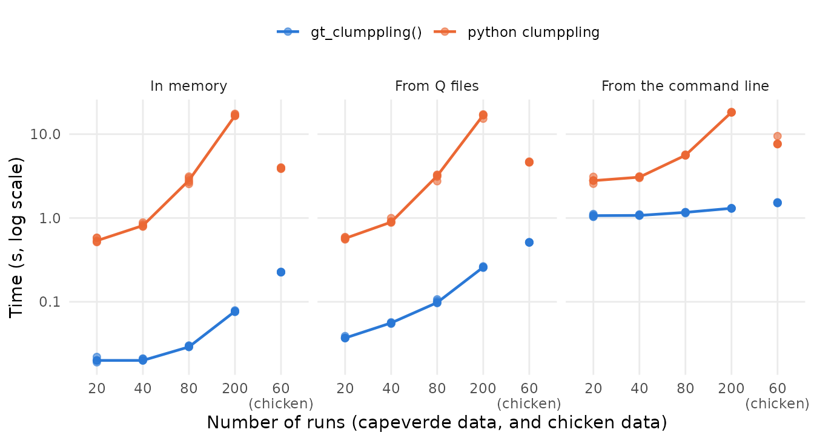

# Benchmarking gt_clumppling() against the python clumppling

[`gt_clumppling()`](https://evolecolgroup.github.io/tidygenclust/dev/reference/gt_clumppling.md)
aligns the clusters of replicate runs of ADMIXTURE-like analyses, and
groups the runs into modes, with the method of clumppling (Liu, Kopelman
& Rosenberg 2024). Its R and C++ code is ported, with modifications,
from the python package clumppling (version 2.0.10, by Xiran Liu), which
previous versions of `tidygenclust` ran through `reticulate`. This
article compares the two implementations: do they give the same results,
and how long do they take?

The comparison uses the two example datasets of the python clumppling,
which are also analysed in the paper that describes it (Liu, Kopelman &
Rosenberg 2024), and which `tidygenclust` includes as `gt_admix` objects
(in `inst/extdata`):

- capeverde: 200 runs of ADMIXTURE (50 for each K from 2 to 5) on the
  Cape Verde data of Verdu et al. (2017), with 399 individuals (44 Cape
  Verdeans, and 355 individuals from British, French, Iberian, Gambian
  and Mandenka populations);
- chicken: 60 runs of STRUCTURE (20 for each of K = 17, 19 and 21) on
  the chicken data of Rosenberg et al. (2001), with 600 chickens from 20
  breeds.

## Results

### Summary

- With the Q matrices already in memory, on the 200 runs of the
  capeverde data (399 individuals, K = 2 to 5),
  [`gt_clumppling()`](https://evolecolgroup.github.io/tidygenclust/dev/reference/gt_clumppling.md)
  took 0.077 s and the python implementation 17 s, about 215 times
  longer. On the 60 runs of the chicken data (600 individuals, K = 17,
  19 and 21), they took 0.23 s and 3.9 s.
- Starting from Q files adds the time taken to read them: on the 200
  capeverde runs, 0.26 s and 17 s. In R, reading the files takes longer
  than
  [`gt_clumppling()`](https://evolecolgroup.github.io/tidygenclust/dev/reference/gt_clumppling.md)
  itself.
- From the command line, each implementation also has to start, and load
  its packages: about 0.99 s for R and 2.1 s for python. With few runs,
  this is most of the time, and the difference shrinks: with 5 runs for
  each K, 1.1 s and 2.8 s. With 200 runs, it is still 1.3 s against 18
  s.
- The two implementations found the same modes in 4 of the 5 datasets.
  Where the modes were the same, their aligned ancestry proportions
  differed by at most 2.2e-16. On the chicken data, the modes were the
  same for K = 21 only, as expected (see below).

### Do they give the same results?

Both implementations were run with the default options
(`use_rep = TRUE`, `merge = TRUE`, `cd_method = "louvain"`,
`use_best_pair = TRUE`) and the same seed. Each implementation runs the
same code whether the Q matrices are in memory, read from Q files or the
analysis is run from the command line (see below), so the results were
compared once, with the Q matrices in memory:

| Dataset | Runs | Individuals | K | Modes (R) | Modes (python) | K with the same modes | Same representatives | Largest difference (modes) | Largest difference (costs) |
|:---|---:|---:|:---|---:|---:|:---|:---|---:|---:|
| capeverde_5 | 20 | 399 | 2, 3, 4, 5 | 9 | 9 | 2, 3, 4, 5 | yes | 2.2e-16 | 4.2e-17 |
| capeverde_10 | 40 | 399 | 2, 3, 4, 5 | 6 | 6 | 2, 3, 4, 5 | yes | 2.2e-16 | 2.8e-17 |
| capeverde_20 | 80 | 399 | 2, 3, 4, 5 | 6 | 6 | 2, 3, 4, 5 | yes | 2.2e-16 | 3.5e-18 |
| capeverde_50 | 200 | 399 | 2, 3, 4, 5 | 7 | 7 | 2, 3, 4, 5 | yes | 2.2e-16 | 4.2e-17 |
| chicken_20 | 60 | 600 | 17, 19, 21 | 8 | 7 | 21 | no | \- | \- |

Number of modes found by each implementation, the values of K for which
the modes (the runs in each mode) are the same, whether the
representative runs of the modes are the same, and, where all the modes
are the same, the largest absolute differences between the aligned
ancestry proportions of the modes, and between the costs of the
alignments across K. {.table}

Where the modes are the same, the remaining differences are rounding
errors. Grouping runs into modes uses community detection (the Louvain
method, by default), which draws random numbers.
[`gt_clumppling()`](https://evolecolgroup.github.io/tidygenclust/dev/reference/gt_clumppling.md)
draws them from R’s generator, so the same seed does not give the same
random choices as in python. This does not change the modes when the
community structure of the runs is clear, as in the capeverde data. It
can when the structure is ambiguous, as for K = 17 and 19 in the chicken
data, where the modes found by python itself change with the seed. The
test suite of `tidygenclust` checks that, given the same modes, the two
implementations give the same results on these data.

### How long do they take?

The two implementations are typically used in different ways. In R, the
Q matrices are usually already in memory, in a `gt_admix` object
returned by
[`gt_admixture()`](https://evolecolgroup.github.io/tidypopgen/reference/gt_admixture.html)
or by
[`tidypopgen::read_q_files()`](https://evolecolgroup.github.io/tidypopgen/reference/read_q_files.html),
and
[`gt_clumppling()`](https://evolecolgroup.github.io/tidygenclust/dev/reference/gt_clumppling.md)
returns its results as an R object. The python clumppling is usually run
as a command-line tool, which starts python, loads its packages, reads
the Q files, and writes its results to files. Timing
[`gt_clumppling()`](https://evolecolgroup.github.io/tidygenclust/dev/reference/gt_clumppling.md)
on a `gt_admix` object against the command-line tool would flatter
[`gt_clumppling()`](https://evolecolgroup.github.io/tidygenclust/dev/reference/gt_clumppling.md).
So we timed each implementation in three settings:

- **In memory**: the Q matrices are already in memory, and R or python
  is already running, with the packages loaded. This times the method
  alone. In python, the Q matrices are converted to numpy arrays before
  the timing starts, and the results are left as python objects, so the
  time taken to pass data between R and python (with `reticulate`) is
  not included.
- **From Q files**: as above, but starting from a directory of Q files,
  one for each run. In R, they are read with
  [`tidypopgen::read_q_files()`](https://evolecolgroup.github.io/tidypopgen/reference/read_q_files.html).
  In python, they are read by clumppling’s own parser, which writes the
  processed matrices to a directory and reads them back, as the
  command-line tool does.
- **From the command line**: each run is a new process, which starts R
  or python, loads the packages, reads the Q files, and saves the
  results. In R, this is a script run with `Rscript`, which loads
  `tidygenclust` and saves the results with
  [`saveRDS()`](https://rdrr.io/r/base/readRDS.html). In python, it is
  the command-line tool of clumppling, without figures (`-v False`).

The last setting is the closest to the time a user waits, but the two
implementations still do slightly different things: the command-line
tool of clumppling writes more output than
[`saveRDS()`](https://rdrr.io/r/base/readRDS.html) (the processed Q
files, the alignment of every pair of runs, the modes and their
statistics, and a log).



| Setting | Dataset | Runs | K | gt_clumppling() (s) | python (s) | Speed-up |
|:---|:---|---:|:---|---:|---:|---:|
| In memory | capeverde_5 | 20 | 2, 3, 4, 5 | 0.02 | 0.54 | 27 |
|  | capeverde_10 | 40 | 2, 3, 4, 5 | 0.02 | 0.81 | 41 |
|  | capeverde_20 | 80 | 2, 3, 4, 5 | 0.029 | 2.8 | 97 |
|  | capeverde_50 | 200 | 2, 3, 4, 5 | 0.077 | 17 | 215 |
|  | chicken_20 | 60 | 17, 19, 21 | 0.23 | 3.9 | 17 |
| From Q files | capeverde_5 | 20 | 2, 3, 4, 5 | 0.037 | 0.57 | 15 |
|  | capeverde_10 | 40 | 2, 3, 4, 5 | 0.056 | 0.89 | 16 |
|  | capeverde_20 | 80 | 2, 3, 4, 5 | 0.098 | 3.2 | 32 |
|  | capeverde_50 | 200 | 2, 3, 4, 5 | 0.26 | 17 | 65 |
|  | chicken_20 | 60 | 17, 19, 21 | 0.51 | 4.6 | 9 |
| From the command line | capeverde_5 | 20 | 2, 3, 4, 5 | 1.1 | 2.8 | 3 |
|  | capeverde_10 | 40 | 2, 3, 4, 5 | 1.1 | 3.1 | 3 |
|  | capeverde_20 | 80 | 2, 3, 4, 5 | 1.2 | 5.6 | 5 |
|  | capeverde_50 | 200 | 2, 3, 4, 5 | 1.3 | 18 | 14 |
|  | chicken_20 | 60 | 17, 19, 21 | 1.5 | 7.7 | 5 |

Median time (s) of 5 runs of each implementation, in each setting, and
ratio of the times of python and gt_clumppling(). {.table}

With many runs, most of the time goes into aligning every pair of runs
with the same K, so the time grows roughly with the square of the number
of runs for each K. For each pair, clumppling solves an integer linear
program with GLPK (through cvxpy), whereas
[`gt_clumppling()`](https://evolecolgroup.github.io/tidygenclust/dev/reference/gt_clumppling.md)
solves the same problem exactly as a linear assignment problem, with the
Hungarian algorithm in C++.

Reading the 200 capeverde Q files took about 0.18 s in R
([`tidypopgen::read_q_files()`](https://evolecolgroup.github.io/tidypopgen/reference/read_q_files.html)
reads each file with
[`read.table()`](https://rdrr.io/r/utils/read.table.html)), more than
[`gt_clumppling()`](https://evolecolgroup.github.io/tidygenclust/dev/reference/gt_clumppling.md)
itself, but little compared with the time of the python implementation,
whose own parser took about 0.29 s.

From the command line, starting R and loading `tidygenclust` took about
0.99 s, and starting python and loading clumppling (with numpy, cvxpy,
cdlib and matplotlib) about 2.1 s (medians of 5 runs, without doing
anything else). This sets a floor to the times of both implementations,
which dominates with few runs. The rest of the time from the command
line is within about a second of the time from Q files, so writing the
results takes little time, although clumppling writes more of them.

## How the benchmark was run

The benchmark is run with the script
`vignettes/articles/code/clumppling_benchmark.R` (in the source code of
the package), which saves its results in
`vignettes/articles/data/clumppling_benchmark`; this article reads them
from there. The code below is taken from that script.

The python implementation is run with the wrapper that previous versions
of `tidygenclust` used, which is now used to create the reference
results of the tests (`data-raw/clumppling/py_clumppling.R`). It runs in
the conda environment created by
`data-raw/clumppling/setup_clumppling_env.sh`, with clumppling 2.0.10
and pinned versions of its dependencies:

``` r

library(tidygenclust)
start_time <- Sys.time()
out_dir <- "data/clumppling_benchmark"
dir.create(out_dir, recursive = TRUE, showWarnings = FALSE)
# each implementation is timed n_repeats times on each dataset and in each
# setting, after a first run (not timed) that loads its code and gives the
# results compared
n_repeats <- 5
seed <- 1L
```

``` r

# py_clumppling() runs the python implementation on a gt_admix object, with
# the same arguments as gt_clumppling(); the wrapper is sourced from the
# root of the package, where it finds its python module
withr::with_dir(
  "../..",
  source("data-raw/clumppling/py_clumppling.R")
)
# the same python module, returning python objects instead of converting
# them to R objects, to time the python code alone
py_module <- reticulate::import_from_path(
  "py_rclumppling",
  path = "../../data-raw/clumppling",
  convert = FALSE
)
# the executables of python (in the conda environment) and R, for the runs
# from the command line
python <- reticulate::py_exe()
rscript <- file.path(R.home("bin"), "Rscript")
```

The datasets are the example datasets of clumppling (see the
introduction), and subsets of the capeverde data with fewer runs for
each K. Each is also written as a directory of Q files, and converted to
numpy arrays:

``` r

# the example datasets of clumppling, included in tidygenclust: 200 runs of
# ADMIXTURE (50 for each K from 2 to 5) on the Cape Verde data of Verdu et
# al. (2017), with 399 individuals (capeverde), and 60 runs of STRUCTURE (20
# for each of K = 17, 19 and 21) on the chicken data of Rosenberg et al.
# (2001), with 600 chickens
capeverde <- readRDS(
  system.file("extdata", "capeverde_admix.rds", package = "tidygenclust")
)
chicken <- readRDS(
  system.file("extdata", "chicken_admix.rds", package = "tidygenclust")
)
# the first n runs of each K of a gt_admix object
first_runs <- function(x, n) {
  keep <- sort(unlist(lapply(split(seq_along(x$k), x$k), utils::head, n)))
  x$k <- x$k[keep]
  x$Q <- x$Q[keep]
  x
}
# capeverde with 5, 10, 20 and 50 runs for each K, and chicken
datasets <- list(
  capeverde_5 = first_runs(capeverde, 5),
  capeverde_10 = first_runs(capeverde, 10),
  capeverde_20 = first_runs(capeverde, 20),
  capeverde_50 = capeverde,
  chicken_20 = chicken
)
# each dataset as a directory of Q files (one for each run, with one row for
# each individual and one column for each cluster, as written by ADMIXTURE),
# and as a python list of numpy arrays
write_q_files <- function(x, q_dir) {
  dir.create(q_dir)
  for (i in seq_along(x$Q)) {
    utils::write.table(
      as.matrix(x$Q[[i]]),
      file.path(q_dir, sprintf("run%03d.Q", i)),
      row.names = FALSE,
      col.names = FALSE
    )
  }
  q_dir
}
to_numpy <- function(x) {
  reticulate::r_to_py(lapply(x$Q, function(q) {
    reticulate::np_array(
      matrix(as.numeric(q), nrow = nrow(q)),
      dtype = "float64",
      order = "C"
    )
  }))
}
inputs <- lapply(names(datasets), function(name) {
  list(
    admix = datasets[[name]],
    q_dir = write_q_files(datasets[[name]], file.path(tempdir(), name)),
    q_py = to_numpy(datasets[[name]])
  )
})
names(inputs) <- names(datasets)
```

The results of the two implementations are compared with:

``` r

# compare the results of the two implementations: their modes (the runs of
# each mode, overall and for each K), their representatives, and, if the
# modes are the same, the largest differences between their aligned modes
# and their costs across K
compare_results <- function(r, py) {
  # the modes (named e.g. K2M1) of the values of K that match the pattern
  modes_of <- function(res, pattern) {
    modes <- res$mode_replicates[grep(pattern, names(res$mode_replicates))]
    lapply(modes, as.integer)
  }
  same_modes <- identical(modes_of(r, ""), modes_of(py, ""))
  same_modes_k <- Filter(function(k) {
    pattern <- paste0("^K", k, "M")
    identical(modes_of(r, pattern), modes_of(py, pattern))
  }, r$K_range)
  # (the elements of both lists are matched by name)
  max_diff <- function(a, b) {
    b <- b[names(a)]
    max(abs(unlist(lapply(a, as.matrix)) - unlist(lapply(b, as.matrix))))
  }
  data.frame(
    n_modes_r = length(r$mode_replicates),
    n_modes_python = length(py$mode_replicates),
    same_modes = same_modes,
    same_modes_k = paste(same_modes_k, collapse = ", "),
    same_representatives = identical(
      r$mode_stats$Representative,
      py$mode_stats$Representative
    ),
    max_diff_aligned = if (same_modes) {
      max_diff(r$aligned_modes, py$aligned_modes)
    } else {
      NA
    },
    max_diff_cost = if (same_modes) {
      max_diff(r$cost_acrossK, py$cost_acrossK)
    } else {
      NA
    }
  )
}
```

The runs that are timed, in each setting, are:

``` r

# run a command, stopping if it fails
run_command <- function(command, args) {
  status <- system2(command, args, stdout = FALSE, stderr = FALSE)
  if (status != 0) {
    stop("Failed: ", command, " ", paste(args, collapse = " "))
  }
}
# the timed runs of each implementation, in each setting, on an input (a
# dataset as a gt_admix object, a directory of Q files and numpy arrays)
run_r <- list(
  # the Q matrices are in a gt_admix object
  memory = function(input) {
    gt_clumppling(input$admix, seed = seed)
  },
  # the Q files are read with tidypopgen::read_q_files()
  files = function(input) {
    gt_clumppling(tidypopgen::read_q_files(input$q_dir), seed = seed)
  },
  # a new R process loads tidygenclust, reads the Q files, and saves the
  # results in an rds file
  command_line = function(input) {
    out <- tempfile(fileext = ".rds")
    on.exit(unlink(out))
    run_command(rscript, c("-e", shQuote(sprintf(
      paste(
        "library(tidygenclust);",
        "res <- gt_clumppling(tidypopgen::read_q_files('%s'), seed = %d);",
        "saveRDS(res, '%s')"
      ),
      input$q_dir, seed, out
    ))))
  }
)
run_python <- list(
  # the Q matrices are numpy arrays (converted from R before the timing),
  # and the results are python objects (not converted to R)
  memory = function(input) {
    py_module$clumppling_run(Q_list = input$q_py, random_seed = seed)
  },
  # the Q files are read by clumppling's own parser, which writes the
  # processed matrices to a directory and reads them back
  files = function(input) {
    processed_dir <- tempfile()
    on.exit(unlink(processed_dir, recursive = TRUE))
    py_module$clumppling_run(
      input_dir = input$q_dir,
      processed_dir = processed_dir,
      random_seed = seed
    )
  },
  # the command-line tool of clumppling, without figures, which reads the Q
  # files and writes its results to a directory
  command_line = function(input) {
    out <- tempfile()
    on.exit(unlink(out, recursive = TRUE))
    run_command(python, c(
      "-m", "clumppling", "-i", shQuote(input$q_dir), "-o", shQuote(out),
      "-f", "admixture", "-v", "False", "--random_seed", seed
    ))
  }
)
```

Each implementation is run on each dataset once in memory, to compare
the results, and once from the Q files, and then timed 5 times in each
setting:

``` r

timings <- list()
agreement <- list()
for (name in names(inputs)) {
  input <- inputs[[name]]
  x <- input$admix
  message("Running ", name)
  # a first run of each implementation in memory, compared, and a first run
  # from the Q files, neither timed
  res_r <- suppressMessages(gt_clumppling(x, seed = seed))
  res_py <- py_clumppling(x, seed = seed)
  agreement[[name]] <- data.frame(
    dataset = name,
    n_runs = length(x$Q),
    n_individuals = nrow(x$Q[[1]]),
    k_values = paste(sort(unique(x$k)), collapse = ", "),
    compare_results(res_r, res_py)
  )
  invisible(suppressMessages(run_r$files(input)))
  invisible(run_python$files(input))
  # then n_repeats timed runs of each, in each setting
  for (setting in names(run_r)) {
    for (i in seq_len(n_repeats)) {
      seconds_r <- system.time(
        suppressMessages(run_r[[setting]](input))
      )[["elapsed"]]
      seconds_py <- system.time(run_python[[setting]](input))[["elapsed"]]
      timings[[paste(name, setting, i)]] <- data.frame(
        dataset = name,
        setting = setting,
        repeat_run = i,
        implementation = c("r", "python"),
        seconds = c(seconds_r, seconds_py)
      )
    }
  }
}
timings <- do.call(rbind, timings)
agreement <- do.call(rbind, agreement)
```

Finally, the time taken to start R or python and load the packages is
timed on its own:

``` r

# the time taken to start R and load tidygenclust, and to start python and
# load the code of the command-line tool of clumppling
startup <- do.call(rbind, lapply(seq_len(n_repeats), function(i) {
  data.frame(
    repeat_run = i,
    implementation = c("r", "python"),
    seconds = c(
      system.time(
        run_command(rscript, c("-e", shQuote("library(tidygenclust)")))
      )[["elapsed"]],
      system.time(
        run_command(python, c("-c", shQuote("import clumppling.__main__")))
      )[["elapsed"]]
    )
  )
}))
```

### Running the benchmark again

Install `tidygenclust` with `R CMD INSTALL`, rather than loading it with
[`devtools::load_all()`](https://devtools.r-lib.org/reference/load_all.html),
which compiles its C++ code without optimisation. Create the conda
environment with the python implementation (from the root of the
package):

``` sh
bash data-raw/clumppling/setup_clumppling_env.sh
```

or set `CLUMPPLING_REFERENCE_ENV` to the name of another conda
environment with the same versions of the python packages. Then run,
from `vignettes/articles`, on an otherwise idle machine:

``` sh
cd vignettes/articles
Rscript code/clumppling_benchmark.R
```

This takes a few minutes. Then render this article again.

### Machine and software

|                |                                           |
|:---------------|:------------------------------------------|
| date           | 2026-10-31                                |
| R              | R version 4.6.1 (2026-06-24)              |
| tidygenclust   | 0.1.5.9003                                |
| CPU            | Intel(R) Core(TM) i7-10510U CPU @ 1.80GHz |
| python         | 3.11                                      |
| clumppling     | 2.0.10                                    |
| cdlib          | 0.4.1                                     |
| networkx       | 3.6.1                                     |
| numpy          | 2.4.6                                     |
| python-louvain | 0.16                                      |
| python-igraph  | 1.0.0                                     |
| cvxpy          | 1.6.7                                     |
| scipy          | 1.17.1                                    |

## References

Liu, X., Kopelman, N. M. & Rosenberg, N. A. (2024). Clumppling: cluster
matching and permutation program with integer linear programming.
*Bioinformatics*, 40, btad751.

Rosenberg, N. A., Burke, T., Elo, K., Feldman, M. W., Freidlin, P. J.,
Groenen, M. A. M., Hillel, J., Mäki-Tanila, A., Tixier-Boichard, M.,
Vignal, A., Wimmers, K. & Weigend, S. (2001). Empirical evaluation of
genetic clustering methods using multilocus genotypes from 20 chicken
breeds. *Genetics*, 159, 699-713.

Verdu, P., Jewett, E. M., Pemberton, T. J., Rosenberg, N. A. & Baptista,
M. (2017). Parallel trajectories of genetic and linguistic admixture in
a genetically admixed creole population. *Current Biology*, 27,
2529-2535.
